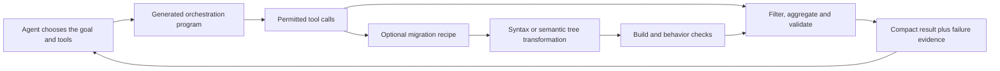

# Code Mode and algorithmic code migration

**Research snapshot:** 13 October 2026. **Scope:** agent tool orchestration, OpenCode v2, Codex, and large-scale code transformations. Product defaults and experimental runtime capabilities can change; the implementation evidence below is pinned to source revisions.

Code Mode moves a sequence of tool operations into a program written by the model. Algorithmic transformation moves repeatable source-code edits into a reusable transformation rule. They solve different problems and can be combined: an agent can orchestrate a migration pipeline whose actual edits are performed by a codemod, with an LLM handling ambiguous cases and validation failures.

## 1. The distinction

| Approach | What executes | What the model supplies | Example |
|---|---|---|---|
| Direct tool calling | A tool call, followed by another model decision | Individual arguments and interpretation of results | Read a file, inspect its contents, decide what to read next |
| Code Mode / programmatic tool calling | A program that composes permitted tools | Control flow, arguments and result selection | Fetch several results, join them by ID and return exceptions |
| Shell scripting | A program running through a shell/process tool | Commands or a script | Gather repository statistics with existing CLI tools |
| Algorithmic refactoring / codemod | A transformation over syntax, types or a code graph | A rule, recipe or choice of existing transformation | Rename references to one resolved Java method across a repository |
| Hybrid migration | A pipeline combining program analysis, transformations and model calls | Semantic choices, difficult translations and repairs | Discover affected code, apply a recipe, validate, ask an LLM about failures |

This classification is a teaching synthesis. Shell scripts can implement the same orchestration pattern without a dedicated Code Mode tool. A script containing repeated model calls still uses an LLM for those edits. A codemod can run entirely without an LLM. Generating a script anew for every run also differs from reusing a tested, versioned automation.

## 2. Why Code Mode can help

A conventional agent loop often carries each intermediate response through another model inference. A program can pass a returned ID directly into the next tool, calculate totals, page through records and return only a small result. Loops express repetition once instead of generating a separate action for each item. Independent reads can run concurrently; dependent operations remain ordered. Cloudflare described this pattern publicly in September 2025 and now provides several integration surfaces. [Cloudflare's original explanation](https://blog.cloudflare.com/code-mode/), [current Code Mode documentation](https://developers.cloudflare.com/agents/tools/codemode/).

The expected savings come from **fewer inference round trips and less intermediate context**, not from eliminating the underlying tool calls. Ten remote requests still involve ten requests, their latency and any service charges. Code generation, interpreter startup, discovery and retries add overhead. A one-call lookup can be cheaper through a direct tool.



The lower branch changes application code. The upper loop can also serve research, browser operations or data processing without changing application code.

## 3. OpenCode v2: defaults, execution and release evidence

### What is confirmed

The v2 MCP documentation says **Code Mode is the default for MCP servers**. `codemode: false` exposes a server's tools directly instead. Tools are grouped by normalized server names. This establishes the MCP default; it does not establish that every agent operation must pass through Code Mode. [MCP configuration](https://dev.opencode.ai/v2/docs/mcp-servers/).

The `execute` tool accepts JavaScript and composes tools from its catalog. It is subject to the `execute` permission, and nested tools retain their individual permission checks. The source requires exact catalog paths and signatures, supports returning a compact result, and recommends `Promise.allSettled` for independent operations. Await calls whose completion matters: unfinished work is interrupted when execution ends. [Tool documentation](https://dev.opencode.ai/v2/docs/tools/), [execute contract at revision 293a5bab](https://github.com/anomalyco/opencode/blob/293a5bab9a53bc1567607b6a90e5dd5bd8c03b8c/packages/core/src/codemode/tool.ts).

OpenCode uses a **restricted JavaScript-like interpreter**, not unrestricted Node.js. The interpreter implements selected language features; host-provided tools and extensions supply external capabilities. Imports, direct filesystem access, processes and timers are unavailable as ordinary globals. Syntax support and limits belong to this interpreter, so arbitrary Node packages cannot simply be imported into an `execute` program. [Interpreter README at the same revision](https://github.com/anomalyco/opencode/blob/293a5bab9a53bc1567607b6a90e5dd5bd8c03b8c/packages/codemode/README.md).

### A documentation discrepancy worth knowing

On 13 October, the Tools page says `fetch` is unavailable, but the pinned current `execute` source explicitly advertises it. The interpreter README explains that hosts can inject globals such as `fetch` through extensions. Therefore network access depends on the host implementation and configuration; a generic interpreter restriction is not a guarantee about every host. Inspect the actual tool contract and authorization path in the installed version. The two linked sources above preserve the discrepancy instead of assuming one universal runtime.

### What the changelog adds

The official changelog lists **v2.0.28 on 13 October 2026**. Relevant changes show ongoing work on execution boundaries and failure handling rather than a benchmark proving universal speed or correctness gains:

| Change | Why it matters |
|---|---|
| Merged PR #52798, 2 October | Code Mode guidance recommends `Promise.allSettled` for independent calls |
| Merged PR #52812, 2 October | Updates a test expectation to that guidance; this is test maintenance, not a new runtime capability |
| v2.0.27, 12 October | Adds worktree operations to the Code Mode tool surface; removal requires edit approval |
| v2.0.28, 13 October | Turns rejected Promise-based plugin tools into normal tool failures rather than crashing their execution path |

Sources: [official changelog](https://opencode.ai/changelog), [guidance PR](https://github.com/anomalyco/opencode/pull/52798), [test-only follow-up](https://github.com/anomalyco/opencode/pull/52812), [pinned changelog](https://github.com/anomalyco/opencode/blob/293a5bab9a53bc1567607b6a90e5dd5bd8c03b8c/CHANGELOG.md).

A built-in worktree operation being available does not mean an agent should create a worktree automatically; repository rules and the user's authorization still determine its use.

## 4. Codex and OpenAI: similar pattern, different surfaces

### Codex implementation

The inspected Codex source exposes `exec` for orchestration in a **fresh V8 isolate**. Nested tools are available through `tools`; `text()` and other helpers return selected results. This runtime has no ordinary Node.js, filesystem, network or subprocess access. A nested shell tool can execute commands in its own environment; that does not give the orchestration isolate a shell or Node runtime. Catalog discovery, output selection and awaiting pending calls are part of the execution contract. [Runtime contract at revision 2b2d7923](https://github.com/openai/codex/blob/2b2d7923055f3ad4827270edefe65e71293cf26c/codex-rs/code-mode-protocol/src/description.rs).

**Do not describe Code Mode as universally enabled in Codex CLI.** At that revision, the feature registry marks `code_mode` and `code_mode_only` under development and off by default, while the supporting `code_mode_host` flag is on. The routing logic gives model metadata's `tool_mode` precedence over the flag fallback. Availability and host behavior also affect the effective mode. These are implementation facts for the pinned revision, not a promise about every deployed client. [Feature registry](https://github.com/openai/codex/blob/2b2d7923055f3ad4827270edefe65e71293cf26c/codex-rs/features/src/lib.rs), [tool-mode routing](https://github.com/openai/codex/blob/2b2d7923055f3ad4827270edefe65e71293cf26c/codex-rs/core/src/tools/mod.rs).

### OpenAI API defaults are a separate question

OpenAI documents Programmatic Tool Calling for its APIs. The **Agents API enables it by default**; with the **Responses API**, the application enables the hosted tool and controls eligible callers. Its JavaScript runtime is isolated, and nested tools keep their existing execution location. The documented routing guidance favors predictable composition and compact results, while direct calls remain useful for adaptive judgment, approvals and final artifact/citation validation. An API default does not establish the default of a particular Codex CLI build. [Programmatic Tool Calling guide](https://developers.openai.com/api/docs/guides/tools-programmatic-tool-calling).

### A read-only Codex-style example

This is an original orchestration example for a host whose catalog exposes `tools.exec_command` and `text`. It is not a standalone Node script. Verify the actual catalog before using it.

```javascript
const jobs = [
  { label: "repository state", cmd: "git status --short" },
  { label: "material files", cmd: "rg --files course-materials" }
];
const results = await Promise.allSettled(
  jobs.map(job => tools.exec_command({
    cmd: job.cmd,
    max_output_tokens: 800
  }))
);
for (let i = 0; i < results.length; i++) {
  const result = results[i];
  if (result.status === "rejected") {
    text({ label: jobs[i].label, failed: true, error: String(result.reason) });
    continue;
  }
  text({
    label: jobs[i].label,
    exitCode: result.value.exit_code,
    output: result.value.output,
    runningSession: result.value.session_id
  });
}
```

The two reads are independent. `allSettled` preserves both outcomes, but a fulfilled tool promise can still report a failed command or an ongoing process. Inspect the exit code or session state. A read, mutation and verification sequence requires ordered execution and explicit failure handling; it should not be blindly parallelized.

## 5. What has actually been measured?

| Evidence | Reported result | What it establishes and what it does not |
|---|---|---|
| Anthropic, code execution with MCP, November 2025 | An illustrated tool-definition example drops from 150,000 to 2,000 tokens, 98.7% | Potential catalog/context savings; not an average agent cost reduction |
| Anthropic, advanced tool use, November 2025 | Complex research tasks average 43,588 versus 27,297 tokens, about 37% fewer; GIA accuracy 46.5% to 51.2% | Vendor-reported workload results; neither an independent replication nor a Codex/OpenCode benchmark |
| CodeAct, ICML 2024 | Across 17 LLMs, up to 20% higher success rate than evaluated alternatives | Earlier evidence for executable actions; its tasks, models and runtime differ from current products |
| CE-MCP study, February 2026 | Lower tokens, latency and turns across the evaluated configurations; broadly comparable quality, with some three-server failures | Supports efficiency benefits and exposes a trade-off in global orchestration decisions |

Sources: [Anthropic MCP article](https://www.anthropic.com/engineering/code-execution-with-mcp), [Anthropic advanced tool use](https://www.anthropic.com/engineering/advanced-tool-use), [CodeAct paper](https://arxiv.org/abs/2402.01030), [CE-MCP study](https://arxiv.org/html/2602.15945v1).

The CE-MCP evaluation used ten selected servers and GPT-based judging. Its difficult multi-server cases included missing conditional branches, where incremental tool-by-tool reasoning could recover better. It also examined security failures involving malicious metadata, exceptions and tool outputs. This supports bounded programs and checks around execution, not a claim that all Code Mode implementations have the same vulnerability profile. [Study methods and results](https://arxiv.org/html/2602.15945v1).

**There is no verified universal percentage saving for current OpenCode v2 or Codex in these sources.** Lower token usage can reduce metered API spend; on a subscription, it may preserve allowance or shorten work without changing the monthly invoice. Compare total cost, including tools, runtime, retries, human review and failure recovery. [Subscription versus API research](chatgpt-subscription-vs-enterprise-credits-2026-10-12.md).

## 6. Algorithmic programming: make the edit a rule

For repeated changes, the agent can select or author a transformation that matches the intended code structure. The transformation then applies that rule consistently to its supported cases. The LLM can help discover the change, explain types, create fixtures and handle exceptions; it need not regenerate every affected file.

A semantic transformation can distinguish two identically named methods using resolved types. A text replacement cannot generally make that distinction. OpenRewrite represents code using type-attributed, formatting-preserving Lossless Semantic Trees and applies recipes to them. This is particularly relevant to Java dependency/API migrations. Preservation of formatting or symbol targeting still does not prove behavior equivalence. [OpenRewrite LST documentation](https://docs.openrewrite.org/concepts-and-explanations/lossless-semantic-trees).

Airbnb's `ts-migrate` is another concrete tool: a plugin pipeline helps make JavaScript projects compile as TypeScript, with subsequent work needed to improve type quality. A compiling migration is a checkpoint, not proof that the final types or runtime behavior are correct. [ts-migrate repository](https://github.com/airbnb/ts-migrate).

For C, C2Rust can mechanically transpile into unsafe Rust and provides cross-checking support. Its scope is **C**, not a general C++ migration solution. Mechanical translation, idiomatic Rust and eliminating unsafe operations are separate objectives. [C2Rust repository](https://github.com/immunant/c2rust).

### A reusable transformation is more predictable than a regenerated plan

Reproducibility depends on fixing the input revision, transformation version, configuration and environment. Tests should cover matching cases, cases that must remain untouched, reruns and partial failures. Idempotence is a useful goal for a one-time migration: running it again should not repeatedly change already migrated code. It is a property to test, not a consequence of using an AST.

The useful division of work is: **LLM for interpretation and exceptions; code for repetition and explicit checks; compiler/tests for feedback; humans for acceptance and unresolved trade-offs.** This is a proposed engineering practice based on the mechanisms and cases here.

## 7. Migration cases: production evidence and research ambitions

### Airbnb: a validated LLM migration pipeline

Airbnb migrated roughly **3,500 React component test files** from Enzyme to React Testing Library. Per-file states, validation, bounded retries and context selection made the work schedulable and observable. The first bulk run completed **75% in four hours**; four days of refinement reached **97%**, and the remaining files needed manual work. The overall effort included **six weeks of engineering time**. Some difficult files consumed **50-100 retries**, demonstrating why costs and stopping rules matter.

This is a production hybrid-automation case. The state machine and validation were programmed; many edits still came from an LLM. It should not be presented as proof that a deterministic codemod performed all transformations, nor as proof of a dedicated Code Mode interface. [Airbnb engineering account](https://airbnb.tech/infrastructure/accelerating-large-scale-test-migration-with-llms/).

### Google: change discovery plus LLM edits

A Google study covers **39 migrations by three developers over twelve months**, with **595 submitted code changes and 93,574 edits**. It reports that **74.45% of changes and 69.46% of edits** were LLM-generated. Developers estimated **50% less migration time** compared with previous manual work. That last number is a developer estimate, not a randomized controlled speedup.

The mechanism combines algorithmic discovery of change locations with model-assisted editing. This is direct evidence for hybrid migration infrastructure, even though it does not establish that the tooling used a current product's Code Mode. [Google migration paper](https://arxiv.org/abs/2504.09691).

### Microsoft: research ambition

Galen Hunt described combining AI with algorithms, using a scalable source-code graph to guide modifications. His stated ambition includes C/C++-to-Rust migration and **one engineer, one month, one million lines**. His later clarification identifies the effort as research into language migration and rejects the interpretation that Windows is being rewritten in Rust with AI.

This is a useful architectural direction, **not a measured achieved throughput, completed Microsoft-wide migration or documented use of OpenCode/Codex Code Mode**. A source graph can guide what to modify while an agent orchestrates transformations and validation, but that combination is an interpretation of the architecture, not an implementation detail established by the post. [Hunt's original post and clarification](https://www.linkedin.com/posts/galenh_principal-software-engineer-coreai-microsoft-activity-7407863239289729024-WTzf).

### RustMap: program analysis plus bounded translation

RustMap decomposes C projects using dependencies, translates smaller units with an LLM and uses compilation and input/output tests to locate and refine faults. Its evaluation includes **126 programs**, of which **125 are Rosetta Code programs**, plus a **7,000-plus-line bzip2 implementation**, using GPT-4o. This demonstrates a research-scale hybrid method, not a million-line C++ production migration. Testing observed behavior does not establish equivalence for every input or system interaction. [RustMap paper](https://arxiv.org/abs/2503.17741).

## 8. How to combine the approaches in an existing repository

This is an illustrative workflow, not an additional mandatory course exercise.

1. **Establish behavior and scope.** Record the input revision, selected files, desired change and observable acceptance criteria. For legacy code, distinguish current behavior from the desired correction.
2. **Inspect structure.** Use a parser, language server, dependency graph or existing transformation tool to identify affected symbols. Ask the model about uncertain semantics.
3. **Choose the edit mechanism.** Use an existing recipe when it matches. Otherwise build a bounded transformation against representative fixtures, with explicit cases it refuses.
4. **Preview.** Produce a file/change manifest and diff before a wide run. Include non-matching and unsupported cases.
5. **Execute in checkpoints.** A Code Mode program or ordinary script can coordinate the recipe and checks. Independent inspections may run concurrently; edits to shared files must be serialized or isolated according to repository rules.
6. **Validate.** Compilation, focused tests and realistic behavior checks provide different evidence. Compare original and transformed behavior where possible. Never repair a migration by weakening assertions or silently dropping tests.
7. **Handle the remainder.** Give the model small, explained failures. Bound retries and escalate unsupported cases rather than repeatedly rewriting the whole repository.
8. **Make successful automation reusable.** Save the reviewed recipe, fixtures and configuration so the next run reuses a stable artifact instead of generating a new plan.

## 9. Failure modes to discuss in class

| Failure | Practical response |
|---|---|
| A shorter report hides an omitted file or failed request | Return requested/completed counts, failures and evidence references alongside aggregates |
| The program succeeds but computes the wrong condition | Check outputs against known fixtures and task acceptance criteria |
| One rejected call causes successful results to be lost | Inspect settled outcomes; distinguish runtime exceptions from tool-reported failures |
| Parallel calls race on files or shared state | Parallelize independent reads; order dependent work and mutations |
| A retry repeats an external mutation | Use operation IDs/idempotency where supported and confirm actual state before retrying |
| Generated shell text turns data into executable syntax | Keep data separate from commands and apply real argument escaping |
| A codemod matches by text rather than the intended symbol | Prefer syntax/type-aware matching and refusal for ambiguous cases |
| Translation compiles but changes semantics | Test behavior, resource handling, errors and representative runtime flows |

Code Mode makes control flow explicit; it does not automatically make that flow correct or deterministic. A reviewed transformation can improve repeatability, but its rule, inputs and validation still define the result.

## 10. What to measure before choosing a default

Compare direct calls, one-shot Code Mode and a saved workflow on the same tasks. Include simple lookups, large outputs, dependent calls, ambiguous branches, failures and migrations. Keep model, reasoning effort, tool implementations and input revisions comparable.

Record end-to-end latency, model turns, input/output tokens, tool calls, runtime charges, retries, validated completion, human correction time and unintended side effects. A result counts as an improvement only if it meets the same quality bar. Keep the complete tool traces outside the compact model-facing summary so failures remain diagnosable.

**Teaching takeaway:** Code Mode can make agent operations cheaper and faster by running predictable control flow as code. Algorithmic transformations can make repeated edits more consistent by applying explicit rules. Their combination is useful when interpretation remains with the model and execution and verification are handled by suitable programs. Neither label replaces behavioral evidence.

## Source and version record

All sources were accessed on **13 October 2026**. Official product docs and implementation files establish behavior; vendor reports and papers establish only the results they describe. This research does not claim an independent performance benchmark of the installed agents.

- **OpenCode latest changelog observed:** v2.0.28, 13 October 2026. Source snapshot: `293a5bab9a53bc1567607b6a90e5dd5bd8c03b8c` on `dev`.
- **Codex source snapshot:** `2b2d7923055f3ad4827270edefe65e71293cf26c` on `main`. Source defaults may differ from released builds and model-selected modes.
- **OpenCode runtime discrepancy:** current Tools docs disallow `fetch`; the pinned implementation advertises a host-provided `fetch` extension. Recheck installed contracts before teaching an execution example.
- **Evidence dates:** CodeAct 2024; migration and MCP articles/papers 2025; CE-MCP study February 2026; product behavior checked October 2026.
- **Related course research:** [subscription/API cost comparison](chatgpt-subscription-vs-enterprise-credits-2026-10-12.md), [legacy repository analysis](legacy-repository-analysis.md), [headless automation](Headless%20agents%20-%20CLI%20automation,%20JSON%20streaming,%20subscriptions%20and%20CI-CD.md).
