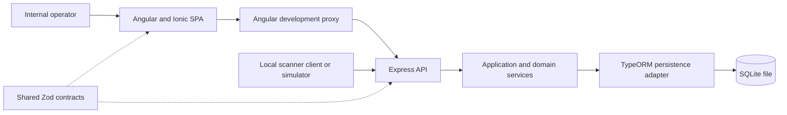
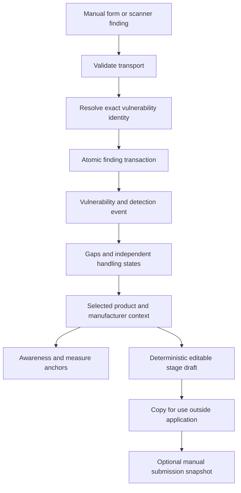
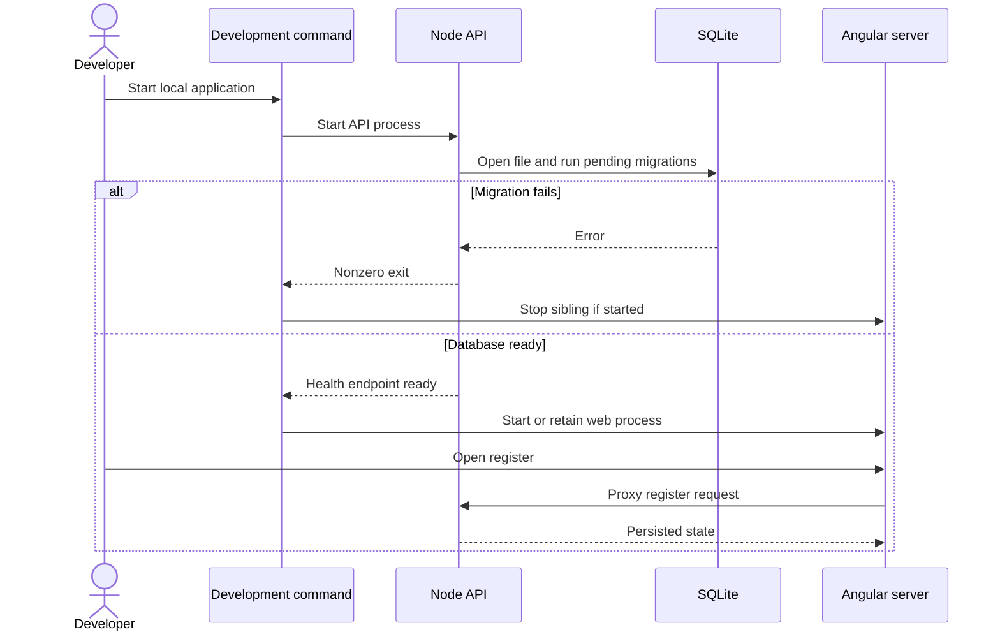

# ADR: CRA Vulnerability Register PoC — Main Architecture

**Date:** 22 October 2026

**Status:** Accepted within the authorised PoC scope; dependency installation and runtime verification are pending implementation.

**PRD:** [Product requirements](../PRD.md)

**Supporting research:** [Technology comparison](../TECHNOLOGY-RESEARCH.md), [CRA information catalogue](../CRA-RESEARCH.md)

## 1. Overview

Build a small local full-stack TypeScript application in `app/` in the existing repository. An Angular/Ionic browser application and an Express API share validation contracts; the API persists data in one SQLite file. Manual forms and scanner intake use the same application services.

The user answered seven architecture questions: Node.js/TypeScript is allowed; local development only; free commercially usable components; very low expected volume and a small internal team; no data migration now; favour speed with Ionic when comparable; keep the application in a dedicated directory here. A possible Java port is not a decided future feature and is not added to the roadmap.

This ADR fixes the component boundary, runtime and dependency baseline. [ADR-001](001-api-and-persistence.md) defines data, API contracts and transactions. [ADR-002](002-frontend-and-starter.md) defines the source donor and UI behaviour. No application code is implemented by these documents.

## 2. Technology Documentation References

| Technology | Verified Context7 ID / official reference | Purpose |
|---|---|---|
| Angular | `/websites/angular_dev`; [compatibility](https://angular.dev/reference/versions), [development proxy](https://angular.dev/tools/cli/serve), [unit testing](https://angular.dev/guide/testing) | SPA, proxy and CLI test integration. |
| Ionic | `/ionic-team/ionic-docs`; [official source donor](https://github.com/ionic-team/starters/tree/15aee8b93f46b48e4db7464bceb4b0560ea5dc35/angular-standalone) | Standalone starter and browser UI. |
| Angular CDK | `/angular/components` | Table and drag/drop foundations. |
| Express | `/expressjs/express` | Node HTTP API, JSON parsing and error handling. |
| Zod | `/colinhacks/zod` | Shared, runtime-checked transport contracts. |
| TypeORM | `/typeorm/typeorm` | Explicit persistence mapping, transactions and migrations. |
| ngx-quill | `/killercodemonkey/ngx-quill` | Restricted rich-text editor. |
| Vitest | `/vitest-dev/vitest` | Unit/integration tests and deterministic clocks. |
| Playwright | `/microsoft/playwright` | Real browser/API/SQLite E2E flows. |
| Analog.js, evaluated alternative | `/analogjs/analog` | Verified file-based API routes and Ionic integration; not selected. |
| Exact package metadata | [npm registry](https://registry.npmjs.org/) | Missing Context7 version, peer-dependency, engine and licence facts; read without installing packages. |

Context7 was consulted first. Official repository and registry reads filled gaps in template contents, source revisions and exact version compatibility. Documentation samples are not installation evidence.

## 3. System Architecture

### Architecture pattern

Use a local SPA plus one Node API, in one application directory and one dependency manifest. The development command starts two processes: Angular on `127.0.0.1:4200` and Express on `127.0.0.1:3001`. Angular proxies `/api/**` to Express. The browser uses relative API URLs; scanner clients can call the API port directly.

Angular's normal development server is not the domain backend. SSR and a meta-framework are unnecessary for this internal register. No Docker, cloud service, Redis, worker, message broker, event-sourcing framework or microservice is included.

### Repository structure

| Location to create during implementation | Responsibility |
|---|---|
| `app/package.json`, `app/pnpm-lock.yaml` | One application dependency set, pinned direct versions and verification scripts; do not change the course repository's other tooling. |
| `app/web/` | Angular workspace/configuration, Ionic shell, feature screens and UI tests. |
| `app/server/` | Express transport, application/domain services, TypeORM persistence, migrations and Node tests. |
| `app/shared/` | Browser-compatible request/response schemas, enums and pure value helpers; imported by web/server without a separately published package. |
| `app/e2e/` | Playwright flows and synthetic fixtures. |
| `app/.data/` | Local development SQLite file; ignored by Git. |
| `app/artifacts/` | Ignored test reports, screenshots and diagnostic evidence. |
| `app/dist/` | Ignored Angular build output; no production deployment package is required. |

Source imports from `shared/` must be included by both TypeScript configurations. There is no generated client, contract build daemon or monorepo orchestrator. `server/` is typechecked without requiring a deployable server bundle; local execution uses `tsx`.

### Technology stack and baseline

These versions were read from package metadata during this research. Use exact direct versions and commit the generated application lockfile during implementation. Additional type/build dependencies must match this baseline and have compatible commercial-use licences.

| Layer | Baseline | Reason |
|---|---|---|
| Runtime / package manager | Node.js 24.x, at least 24.15.0; pnpm 12.14.0 | Compatible with the checked Angular/editor engines; one package manager. |
| Angular packages and CLI/build | 22.2.3 | Align core, compiler, forms, router, browser platform, CLI and build tooling. |
| TypeScript | 6.0.3 | Angular build accepts `>=6.0 <6.1`; registry `latest` 7.0.2 is outside that range. |
| Ionic Angular | 9.0.9 | Uses the preferred UI framework; inspected starter declares Ionic 9. |
| Angular CDK | 22.2.3 | Matches the chosen Angular baseline without a second visual framework. |
| Editor | ngx-quill 31.0.1; Quill 2.0.3 | Checked Angular-22/Quill-2 peer compatibility and required formatting. |
| HTTP / validation | Express 5.3.0; Zod 4.6.7 | Small API with explicit typed contracts. |
| SQL persistence | TypeORM 1.1.2; better-sqlite3 12.11.1 | Driver peer range is 12.x; registry `latest` driver 13.0.3 is not selected. |
| Tests | Vitest 5.0.5; Playwright Test 1.64.1 | Angular build metadata accepts Vitest 5; real-browser flows use Playwright. |
| Development processes | tsx 4.23.15; concurrently 10.0.6 | Run the API and coordinate the two local servers. |
| AI/LLM | None | Outside the PoC. |

All selected runtime/frontend direct packages declare MIT except Quill, which declares BSD-3-Clause. TypeScript and Playwright declare Apache-2.0. Preserve applicable licence notices. Verify the actual installed dependency graph before adoption; do not import paid template modules or unrelated charting/demo dependencies.

The source donor declares Angular 22.1.7. Deliberately align it to 22.2.3 during scaffold work, rather than copying its manifest unchanged. This is a defined adaptation, not a claim that the resulting combination has already built. Installation/build failures require investigation; do not bypass peer checks with force flags.

## 4. Module Structure & Dependencies

| Module | Responsibility | Allowed dependencies |
|---|---|---|
| Web features | Forms, register, Kanban and reporting editor | Shared contracts, UI components and an HTTP client. |
| HTTP transport | Parse/validate requests, translate errors and responses | Shared contracts and application services. |
| Application/domain | Identity rules, gaps, statuses, context grouping, deadlines and drafts | Pure shared values, clock/reference generators and persistence interfaces. |
| Persistence adapter | TypeORM EntitySchemas, SQLite queries, transactions and migrations | Domain persistence interfaces and shared values; no UI imports. |
| Composition root | Construct the API, database and services | The server modules above. |

The browser never imports TypeORM, filesystem code or SQLite. Domain rules never import Express or UI components. TypeORM types stay within the adapter. Shared contracts contain neither Node-only dependencies nor persistence entities. No circular imports or business-rule duplication between manual/API paths is permitted.

## 5. Data Models

Persist a shared `Vulnerability`, its exact `VulnerabilityIdentity` records, distinct `DetectionEvent` observations, product/manufacturer `ReportingContext` records and their event memberships, current per-stage `ReportDraft` records, immutable `ExternalSubmissionRecord` snapshots and narrowly scoped `TimingCorrection` history. [ADR-001](001-api-and-persistence.md) specifies fields and uniqueness.

Use relational keys and transactions. Record identifiers are UUID text; controlled values are validated text; instants are canonical UTC text; structured arrays and rich-text Delta are validated JSON serialized into text where appropriate. No PostgreSQL-specific enum, JSONB, array or full-text feature is used.

Data is retained until an explicit later retention decision. This PoC has no delete, purge or bulk-reset endpoint. Tests use isolated disposable databases and never erase the normal development file.

## 6. API / Interface Contracts

All domain endpoints are under `/api/v1`; JSON is the transport. The scanner and manual form use `POST /findings`. Read/update endpoints cover vulnerabilities, events, contexts, stage drafts, external submission records and timing corrections. Responses include stable references, revisions, gaps and explicit outcomes. The full endpoint and error tables are in [ADR-001](001-api-and-persistence.md).

Browser traffic stays on the Angular development origin through its proxy. Do not enable wildcard CORS. No credentials or authentication middleware are added. Default binding is loopback; a remote scanner requires a later explicit decision on network exposure, or can be simulated by a local client now.

## 7. Environment Variables and Command Contract

| Variable | Purpose | Required / default | Example |
|---|---|---|---|
| `API_HOST` | API listener | Default `127.0.0.1`; loopback-only in this PoC | `127.0.0.1` |
| `API_PORT` | API listener port | Default `3001` | `3001` |
| `DATABASE_PATH` | SQLite file, resolved relative to `app/` | Default `.data/cra.sqlite` | `.data/cra.sqlite` |
| `NODE_ENV` | Development/test behaviour | Set by scripts | `development` |
| `CI` | Noninteractive test execution | Optional | `true` |

The web dev server uses port 4200 and an explicit proxy target on port 3001. Changing the API port requires changing that local proxy configuration; no configuration generator is introduced. No secret or AI variable is required. Browser-facing code must not receive the database path.

The implementation must supply the following commands from `app/`. They are future command contracts, not commands executed during this documentation task.

| Command | Defined result |
|---|---|
| `pnpm install --frozen-lockfile` | Reproduce the committed dependencies after the initial lockfile exists. |
| `pnpm dev` | Start both servers; stop the other process when either fails or the parent is interrupted. |
| `pnpm db:migrate` | Apply pending explicit SQLite migrations; no model synchronization. |
| `pnpm typecheck` | Check shared/server TypeScript and Angular templates. |
| `pnpm build` | Produce the Angular build and typecheck the server/shared code; no production deployment. |
| `pnpm test:unit` | Run discovered pure-domain and Angular component tests once. |
| `pnpm test:integration` | Run API/repository tests against isolated real SQLite files. |
| `pnpm test:e2e` | Start isolated real servers and exercise Chromium with Playwright. |

First startup creates only a missing database and applies migrations before listening. A migration failure stops startup. It never resets an existing database or seeds real records automatically.

## 8. Technical Decisions

### Standard Angular/Ionic SPA with a small Node API

**Status:** Accepted. **Date:** 22 October 2026.

**Context:** The user allows TypeScript/Node and wants a fast local PoC. Existing Ionic starters already define Angular routing.

**Decision:** Use Express alongside the SPA, with one start command and Angular's proxy.

**Rejected alternatives:** Angular SSR just to host API routes adds an unnecessary rendering concern; Analog.js provides genuine full-stack routes but introduces its own routing/server conventions into the selected donor.

**Consequences:** (+) Direct donor reuse and a clear scanner API. (-) Two development processes instead of one integrated server.

**Review trigger:** A requirement for a different production host or server rendering.

### SQLite adapter with an explicit portability boundary

**Status:** Accepted. **Date:** 22 October 2026.

**Context:** Very low volume makes a local SQL file sufficient; later PostgreSQL adoption should not require rewriting business rules.

**Decision:** Use TypeORM's explicit EntitySchema mapping and repositories, isolated behind domain interfaces. Keep SQLite migrations explicit.

**Rejected alternatives:** Browser-local persistence does not provide a shared scanner API; immediate PostgreSQL/Docker adds setup; database-specific domain queries undermine portability.

**Consequences:** (+) Real SQL from the beginning. (-) Future PostgreSQL schema/driver work and possible data transfer remain necessary.

**Review trigger:** PostgreSQL adoption, multiple API processes or observed write contention. No transfer tool is built now.

### One shared creation path

**Status:** Accepted. **Date:** 22 October 2026.

**Context:** The clarified scope includes manual entry and scanner findings.

**Decision:** Both use the same finding command and transactional rules; the form supplies manual source identities.

**Rejected alternatives:** Separate manual-save business logic risks different gap, duplicate and status outcomes.

**Consequences:** (+) Equivalent behaviour across paths. (-) The form must preserve a stable save reference for retries.

**Review trigger:** A future bulk import or materially different intake workflow.

### Keep future capabilities outside the runtime

**Status:** Accepted. **Date:** 22 October 2026.

**Context:** Auth, approval, sending, AI and controller access are deferred in the PRD.

**Decision:** Add none of their SDKs, demo routes or service placeholders. Use the existing retained records for the later inspection-report feature.

**Rejected alternatives:** Retaining template login screens falsely suggests access control and expands scope.

**Consequences:** (+) Small runnable surface. (-) Future capabilities require their own design work.

**Review trigger:** Human selection of a deferred feature.

## 9. Diagrams

### 9.1 Components

### 9.2 Data flow

### 9.3 Local start and readiness

Intake, retry, manual creation, status conflicts and reporting sequences are specified in the two focused ADRs.

## 10. Testing Strategy

TDD is mandatory for new behaviour and fixes: write a meaningful failing behaviour test, observe the expected failure, implement, then refactor while green. A compilation/fixture error is not the Red step. The source donor is not a tested application baseline.

| Layer | Type | Scope | Tools |
|---|---|---|---|
| Pure domain | Unit | Identity, gaps, transitions, deadlines, templates and draft staleness | Vitest with controlled clocks and repository doubles where appropriate. |
| UI | Unit/component | Form validation, retained edits and status/editor failures | Angular CLI Vitest integration and HTTP testing doubles. |
| API and SQL | Integration | Real migrations, constraints, rollback, revisions and restart persistence | Vitest, a real Express listener and an isolated SQLite file. |
| Entire flow | E2E | Real browser, proxy, API and SQL; no mocked network/storage in the exercised path | Playwright Chromium. |

Required scenarios include new/reused vulnerability, exact retry, conflicting retry, manual no-CVE creation, incomplete save, simultaneous duplicate delivery, invalid dates, stale edits, deadline correction, draft editing/regeneration, external snapshot preservation and restart persistence. Detailed cases appear in each focused ADR.

| PRD criteria | Primary verification responsibility |
|---|---|
| AC-01–AC-10 | ADR-001 intake unit/integration cases plus real API-to-register E2E. |
| AC-11–AC-19 | ADR-001 review/transition cases and ADR-002 save/error interactions. |
| AC-20–AC-31 | ADR-001 context, assessment, correction and deadline cases. |
| AC-32–AC-43 | ADR-001 draft/snapshot cases and ADR-002 editor/copy/recovery cases. |
| AC-44–AC-49 | ADR-001 same-event query cases and ADR-002 table/Kanban E2E. |
| AC-50–AC-54 | Polish UI/draft review, restart E2E, excluded-feature checks and deadline/manual-record displays. |
| AC-55–AC-60 | ADR-002 manual creation/cancel/retry E2E backed by ADR-001 intake integration. |

Build/typecheck, test discovery/results, startup and manual QA are separate evidence. After automated checks, start the actual application and manually exercise manual/API intake, table/Kanban, event review and editor/save/copy/error paths. Capture each changed screen/state, record API examples, and inspect browser/server logs. Only synthetic local data/services are used. Report unavailable prerequisites as unverified rather than treating tests as a substitute for runtime QA.

### Technical acceptance criteria

- **TAC-000-01:** One `pnpm dev` invocation starts the web and API processes and terminates both on interruption or sibling failure.
- **TAC-000-02:** A browser request to `/api/v1/health` through port 4200 reaches the same API as a local direct request to port 3001.
- **TAC-000-03:** Restarting the application preserves records in the configured SQLite file.
- **TAC-000-04:** Installation satisfies the selected peer ranges without force/legacy-peer overrides, and the lockfile pins the resulting graph.
- **TAC-000-05:** Domain/shared modules have no dependency on browser-only UI or database-driver modules in the prohibited direction.
- **TAC-000-06:** The required unit, integration and E2E suites each execute at least one discovered test and report counts/skips separately.
- **TAC-000-07:** Manual QA records the environment, real steps, screenshots/API evidence and logs before any runtime-change commit.

## Corrections log

- **2026-10-22 — ENV-01 (human-approved):** Change the local API default and matching Angular proxy/test baseline from port `3000` to `3001`; keep the web listener on `4200`. Actual runtime on the mirrored WSL host failed with `EADDRINUSE` because the shared Windows Tailscale listener reserves port 3000. A temporary owned bind on `127.0.0.1:3001` succeeded and was immediately closed. This corrects a verified local-environment conflict without stopping shared networking services, changing business behavior or adding configuration infrastructure. The developer must update the configuration test first, observe Red for the new default, then align API/proxy and all runtime QA/harness references and rerun verification.
