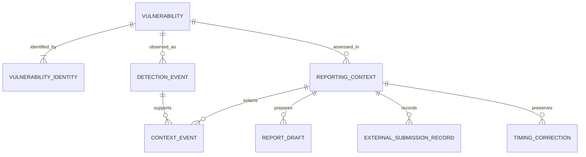
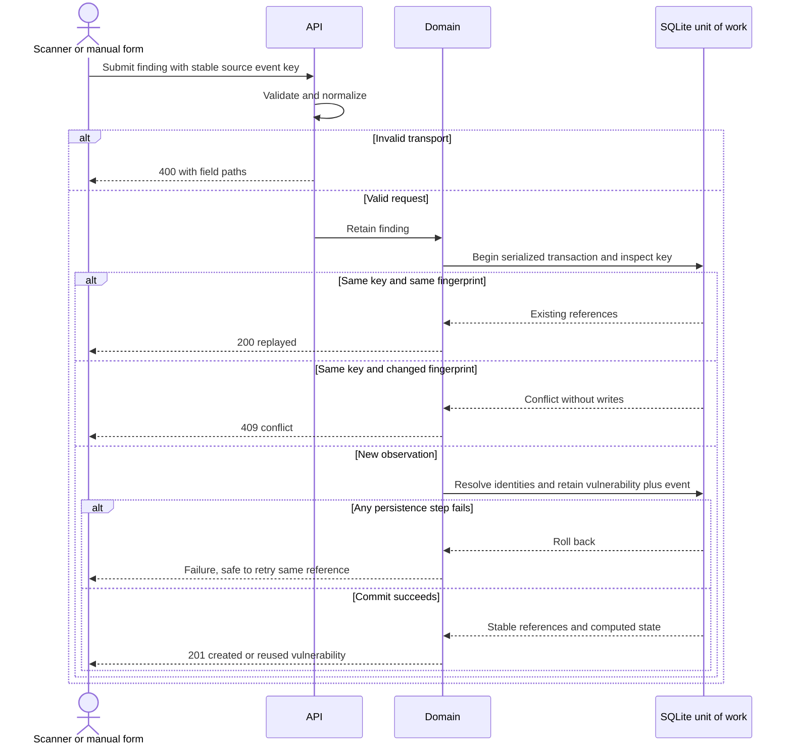

# ADR-001: API, Domain Rules and SQLite Persistence

**Date:** 22 October 2026

**Status:** Accepted

**Relates to:** [Main architecture](000-main-architecture.md), [PRD](../PRD.md), [business information catalogue](../CRA-RESEARCH.md)

## 1. Scope

Define one transactional server implementation for scanner/manual intake, review, reporting contexts, deadlines and saved drafts. Define enough contracts and stored information for implementation without selecting another backend framework. PostgreSQL implementation, data transfer, authentication, sending and severe incidents remain outside the PoC.

## 2. Technology Documentation References

| Library | Verified Context7 ID / official documentation | Use |
|---|---|---|
| Express | `/expressjs/express` | JSON transport and error middleware. |
| Zod | `/colinhacks/zod` | Strict request validation and field-path errors. |
| TypeORM | `/typeorm/typeorm` | EntitySchema, repository operations, transactions and explicit migrations. |
| better-sqlite3 | [Package metadata](https://registry.npmjs.org/better-sqlite3/12.11.1), TypeORM SQLite documentation above | Server-side SQLite driver compatible with TypeORM's checked 12.x peer range. |
| Vitest | `/vitest-dev/vitest` | Domain and real-SQL integration tests. |
| Playwright | `/microsoft/playwright` | API requests and real browser flows against the running server. |

## 3. Component Design

Transport validates a command and calls an application service. Domain functions compute identities, gaps, transitions, stage completeness, plain text and deadlines. A persistence unit of work performs the required reads/writes in one SQLite transaction. HTTP requests never manipulate entities directly.

Use explicit TypeORM EntitySchema definitions; do not require decorators or inferred reflection metadata in domain classes. Keep foreign keys, unique constraints and mappings in the adapter. Run migrations explicitly with model synchronization disabled.

One process owns one connection and one local database file. The adapter serializes complete units of work, including reads, so another request cannot observe a partially completed operation on that connection. Do not hold a transaction across external I/O. This is an in-process storage guard, not distributed locking or a background job system.

Enable foreign-key enforcement. Use a 5-second SQLite busy timeout and translate exhausted lock waits to a retryable error. Normal startup performs migrations before opening the listener. Use a temporary real file per integration test group; in-memory-only tests do not establish restart persistence.

## 4. Data Structures

### 4.1 Common representations

- IDs are UUID strings generated by the server, except stable manual request/identity tokens generated by the UI before its first submission.
- Revisions are positive integers starting at 1. Every mutable resource update requires its current revision.
- Instants arrive as ISO 8601 strings with an explicit offset and are stored as UTC ISO strings with millisecond precision. Missing values are null, not the receipt time.
- Each timing anchor is an object with `at` as a nullable instant, `accuracy` as `exact`, `estimated` or `unknown`, and `basis` as a nullable supporting explanation/reference. `unknown` requires a null instant; estimated values require an explanation. Persistence maps each anchor to separate instant/accuracy/basis columns.
- Enum values are language-neutral text in transport/storage; the UI maps them to Polish labels.
- Arrays of tags, countries, source references, gap resolutions and rich-text operations are schema-validated JSON stored as text. Core identities, references, statuses, context keys and timing anchors are separate relational/scalar columns.
- No user identity is implied by `manual` origin. It is source metadata in an unauthenticated application.

### 4.2 Shared information groups

The following groups define the public field vocabulary. Unless explicitly required below, fields can be omitted or null on creation and then assessed as gaps. Updates distinguish omitted fields, which remain unchanged, from explicit null values, which clear a value. Unknown object keys are rejected.

| Group | Fields and conceptual types |
|---|---|
| Identity | `scheme` and `value`: nonempty strings; schemes are `cve`, `euvd`, `source:<source-name>` or `manual`. CVE/EUVD values use their canonical uppercase form. Other values are trimmed and retain case. |
| Shared description | `title`, `description`, `componentName`, `ecosystem`, `vendor`, `affectedComponentVersions`, `generalExploit`, `exploitPrerequisites`, `remediationGuidance`, `fixedComponentVersions`: nullable strings. |
| Classification | `category`: `dependency`, `application`, `other`, `unknown`; `weaknessCode`: nullable string; `severity`: `critical`, `high`, `medium`, `low`, `unknown`; `severityRationale`: nullable string; `score`: nullable finite number; `scoreSystem`, `scoreVersion`, `scoreSource`: nullable strings. A valid numeric score without its method/version is retained with an information gap. |
| General exploitation | `exploitationSignal`: `confirmed`, `not_established`, `unknown`; `exploitationEvidence`: nullable string; `knowledgeAt`: nullable instant. A shared signal does not establish product-specific reportability. |
| References | Array of records with `label`, `reference`, optional `observedAt`; references are plain text or HTTP(S) URLs. No server-side fetching occurs. |
| Event observation | `detectedAt`, `product`, `productVersion`, `client`, `environment`, `installedComponentVersion`, `componentLocation`, `evidence`, `reviewNotes`: nullable values, with `detectedAt` an instant and the rest strings; `scannerAssessment`: nullable structured snapshot of supplied classification/exploit information. |
| Event impact | `productAffected`: `affected`, `not_affected`, `unknown`; `exploitabilityNotes`, `impactDescription`: nullable strings. |
| Event reporting evidence | `reportingEvidence`: nullable validated snapshot using the context scope/assessment/report/timing/follow-up vocabulary, without context IDs, membership or revisions. It lets a scanner or manual caller supply legal reporting facts, including awareness, measures and manufacturer information, without creating a reporting context automatically. |
| Review metadata | `tags`: unique trimmed strings; `status`: handling enum; `closureNote`: nullable string; `gapResolutions`: field/reason pairs that explicitly explain allowed unknown/not-applicable values. |
| Context scope | `manufacturer`, `reportingContact`, `establishmentCountry`, `coordinator`, `product`, `productVersions`: nullable strings; `eventIds`: array of event UUIDs; `memberStates`: unique EU country-code strings. Client values stay on events. |
| Context assessments | `applicability`: `in_scope`, `out_of_scope`, `not_assessed`; `applicabilityRationale`; `productAffected` and rationale; `exploitation`: `confirmed`, `not_established`, `unknown`; evidence; `notificationAssessment`: `required`, `not_required`, `undecided`; `notificationRationale`: nullable strings. |
| Context report information | `title`, `summary`, `vulnerabilityAccount`, `exploitAccount`, `severityDescription`, `impactDescription`, `maliciousActor`, `measuresTaken`, `userMeasures`, `updateDetails`, `sensitivityExplanation`, `attackVector`: nullable strings; `sensitivity`: `sensitive`, `not_sensitive`, `unknown`. |
| Optional product information | `regulatoryType`: `default`, `important`, `critical` or null; `productClass`, `productCategory`: nullable strings; `supportEnded`, `mitigationExpected`: nullable booleans. No automatic CRA product classification. |
| Timing anchors | `awareness` and `measureAvailable`: nullable instant plus accuracy and explanation/reference. |
| Intermediate request | `requestReference`, `requestDescription`: nullable strings; `requestedResponseAt`: nullable instant. |
| User follow-up | `userAudience`, `userInstructions`, `userCommunicationReference`: nullable strings; `userCommunicationState`: `not_recorded`, `pending`, `recorded`; `userCommunicatedAt`: nullable instant. |

`ContextAssessment` and `ContextReportInformation` are independent of the shared weakness description. Context descriptions can initially be copied from known facts, but later shared changes only mark relevant drafts for review; they do not overwrite curated context fields.

### 4.3 Persisted records

| Record | Key fields / relationships / invariants |
|---|---|
| Vulnerability | `id`, shared-description/classification/exploitation groups, references, tags, review metadata, `createdAt`, `updatedAt`, `revision`. One underlying identified weakness, without client/product-specific reporting clocks. |
| VulnerabilityIdentity | `id`, `vulnerabilityId`, `scheme`, `value`; globally unique `(scheme, value)`. Multiple supplied identities must resolve to the same vulnerability or return a conflict. No fuzzy matching or automatic merge of two existing vulnerabilities. |
| DetectionEvent | `id`, `vulnerabilityId`, `source`, `sourceEventId`, `receiptAt`, event observation/impact/review/reporting-evidence groups, `incomingSharedSnapshot`, normalized original intake snapshot and its SHA-256 fingerprint, `createdAt`, `updatedAt`, `revision`. Unique `(source, sourceEventId)`. Original intake snapshot/fingerprint remain unchanged when operator review fields change. |
| ReportingContext | `id`, `vulnerabilityId`, all context/scope/assessment/report/timing/follow-up groups, nullable `scopeKey`, `createdAt`, `updatedAt`, `revision`. Known scope key combines vulnerability and normalized manufacturer/product; unique when non-null. Provisional contexts with unknown scope have no key and cannot be ready. |
| ContextEvent | Composite `(contextId, eventId)`; both must concern the same vulnerability. Known event product must match the context product. One event can support a context without changing its original observation. |
| ReportDraft | `id`, `contextId`, `stage`, `subject`, restricted Delta content, derived plain text, preparation state, `edited` boolean, `sourceSignature`, `savedAt`, `revision`. Generation sets `edited` false; operator saves set it true. Unique `(contextId, stage)`. Only one current saved draft per stage is required. |
| ExternalSubmissionRecord | `id`, unique `recordingRequestId`, request fingerprint, `contextId`, `stage`, `submittedAt`, `externalReference`, subject/Delta/plain-text snapshot, `recordedAt`. Append-only; never verified by the application. |
| TimingCorrection | `id`, `contextId`, anchor name, old/new value and accuracy, correction reason, recorded time. Persist when an existing anchor is changed or cleared; not a general activity log. |

SQL mappings use text for identifiers, controlled values and UTC instants, integers for revisions and finite numeric columns for scores. Avoid driver-specific `datetime`/enum/array types. Keep validated serialized JSON out of database-specific query expressions. Logical search/filtering at this volume can run over the loaded record set in application code; do not add FTS or a search service.

The unique known scope keeps one reporting preparation context per vulnerability/manufacturer/product in the PoC. Repeated scans and new clients/versions are linked to it rather than generating fresh clocks. If a distinct later exploitation cycle requires separate formal notification under the same scope, revisit this restriction before implementing cycle management; do not reset the old context's anchors to simulate it.

## 5. Interface Contracts

### 5.1 Transport rules

Base path is `/api/v1`. Dates and IDs are strings; objects are strict; missing optional information is not an invalid transport message. Require JSON for body endpoints, with an explicit 1 MiB request limit. No attachments, batch intake, arbitrary HTML or external-resource fetching.

Success responses return an object containing resource data and relevant outcome/gap metadata. Mutation responses return the new resource revision. Error responses contain `code`, a Polish-safe `message`, `fieldErrors` as path/code/message items, and `retryable`; conflict responses may also identify the current revision or existing resource. Never return stack traces or raw database errors to the browser.

| Status | Meaning |
|---|---|
| 200 | Read, successful update or equivalent finding retry. |
| 201 | Newly retained finding, context, first draft or external record. |
| 400 | Invalid JSON/schema/date/enum, unknown fields or invalid request parameters. |
| 404 | Referenced resource does not exist. |
| 409 | Source event conflict, conflicting identities/scope, stale revision, disallowed transition or unconfirmed replacement. |
| 413 | JSON body exceeds 1 MiB. |
| 415 | Unsupported content type. |
| 503 | Database unavailable or lock wait exhausted; caller may retry with the same save reference. |
| 500 | Unexpected internal failure with a generic response and no partial commit. |

### 5.2 Intake

**POST `/findings`** accepts `source` and `sourceEventId` as nonempty strings, `vulnerability` with either an existing UUID or at least one stable identity, optional shared-information groups, and optional `observation` and `reportingEvidence` fields. Source names/identity values are limited to 255 characters; missing or invalid identifiers are transport errors. Missing descriptive fields or detection time are accepted as gaps. The API records receipt time.

For manual creation, the form uses source `manual`, a generated source-event UUID and, when needed, a generated `manual` vulnerability identity. Those values are held unchanged until the save succeeds or the operator abandons the form. A selected existing vulnerability uses its UUID; adding an event does not generate another weakness identity.

Return `vulnerabilityId`, `eventId`, `vulnerabilityOutcome` (`created`/`reused`), `eventOutcome` (`created`/`replayed`), each current handling status/revision and separate gap lists. Resolve exact identities and normalize valid instants before computing the request fingerprint. Canonicalize object keys and set-like identity/tag/country arrays; do not include server-generated receipt timestamps in the fingerprint.

An equivalent retry returns the original IDs without repeating side effects. Changed content under the same source-event key returns `SOURCE_EVENT_CONFLICT`. A source event cannot be moved to another vulnerability by reusing its key. An operator wishing to correct an observation uses the review update endpoint.

One transaction resolves/creates the vulnerability and identities, creates the event, fills previously unknown shared facts, determines gaps/statuses and reopens a closed shared vulnerability when appropriate. Incoming nonempty facts never silently replace a different nonempty curated value; preserve incoming candidates in the event snapshot for review. Failed operations roll back all writes. Unique constraints remain the final defence against duplicate concurrent intake.

### 5.3 Register and review

| Endpoint | Input | Output / constraints |
|---|---|---|
| GET `/health` | None | Readiness after database migration; 503 if storage is unavailable. No path/configuration disclosure. |
| GET `/vulnerabilities` | Optional `q`, `status`, `eventStatus`, `severity`, `category`, `tag`, `product`, `client`, `detectedFrom`, `detectedTo`, `notificationAssessment` | Rows, matching event IDs and dashboard summary; no pagination in this low-volume PoC. Invalid filters are 400. |
| GET `/vulnerabilities/:id` | UUID | Shared record, identities, all events with incoming candidates, and reporting-context summaries. |
| PATCH `/vulnerabilities/:id` | `expectedRevision`, allowed shared fields/tags/review changes and optional `addIdentities` | Updated shared record and gaps; 409 for stale revision, invalid handling transition or an identity already owned by another vulnerability. Adding a public identity to a manual record is allowed; removing/reassigning identities or merging existing records is not supported. |
| PATCH `/events/:id` | `expectedRevision`, observation/impact/review/reporting-evidence fields | Updated event and gaps, while preserving the original intake snapshot. Identity/source keys and receipt time are immutable. |

Text search is trimmed, Unicode-normalized and case-insensitive across identifier/title/component/tags and linked product/client values. `product` and `client` filters are case-insensitive text matches; controlled filters are exact. Date bounds are inclusive instants; the UI converts selected calendar dates using Europe/Warsaw before sending them. Missing detection times do not match a bounded detection-date filter.

Product/client/date/event-status predicates must all match the same event. A vulnerability is returned if its shared predicates and at least one event predicate match; if there are no event predicates, an event match is not required. Return deterministic ordering by latest receipt time descending, then vulnerability ID. Summary counts derive from this same matched set and distinguish shared records, matching events and related contexts.

Do not allow changing an event product to contradict an already linked known context product. Return `CONTEXT_SCOPE_CONFLICT`; the operator first adjusts the context membership. Editing facts that contribute to a context changes its source signature and makes its current drafts stale.

### 5.4 Reporting contexts and timing

| Endpoint | Input | Output / constraints |
|---|---|---|
| POST `/contexts` | `vulnerabilityId`, `eventIds`, context fields | New context; event IDs are distinct and belong to that vulnerability. A known existing scope returns 409 with `existingContextId` for reuse. Unknown scope can be retained provisionally. |
| GET `/contexts/:id` | UUID | Context, selected events, current drafts, external records, timing corrections, deadlines, stage checklists and the current source signature. |
| PATCH `/contexts/:id` | `expectedRevision`, editable scope/assessment/report/follow-up fields and optional replacement `eventIds` | Updated context. Existing non-null timing-anchor edits are not accepted here. Known-scope collisions and incompatible events are 409. |
| POST `/contexts/:id/timing-corrections` | `expectedRevision`, anchor name (`awareness`/`measureAvailable`), replacement anchor object and nonempty reason | Atomically append correction, update context anchor/revision and invalidate affected drafts. Clearing an anchor is also a correction. |

Initial anchor values may be supplied at context creation or filled while null; an explicitly selected event's supplied earlier awareness information must be presented and retained when creating that context, with its source. Do not copy detection/receipt time into awareness. If several selected events supply different awareness instants, use the earliest supplied instant for the same scope and expose that choice; changing it requires a correction reason. Event links or later review never silently move an established anchor forward.

Known awareness produces 24-hour and 72-hour planning limits from the same instant. Measure availability produces a planning limit fourteen 24-hour periods later in UTC. The display uses Europe/Warsaw, labels estimated anchors and applies no holiday/extension mechanism. These are operational planning limits, not a legal-calendar compliance certificate. Intermediate requests have only their separately entered requested response date.

For dashboard purposes, outstanding means a stage without a manual external submission record in a context whose notification assessment is required or undecided. It is overdue when its known deadline is earlier than server time. A known date remains visible when the context is incomplete or undecided. Unknown anchors contribute to an unresolved-context count. A justified `not_required` assessment excludes that context from outstanding-action counts without deleting dates/history.

### 5.5 Drafts and manual external records

Stage values are `early_warning`, `notification_72h`, `final`, `intermediate`.

| Endpoint | Input | Output / constraints |
|---|---|---|
| POST `/contexts/:id/drafts/:stage/generate` | Current context revision; existing draft revision and `replaceEdited` confirmation when replacing edited text | Persisted deterministic subject/Delta/plain-text draft, gaps, SRP length warnings and source signature; 409 when edited text would be replaced without confirmation. |
| PUT `/contexts/:id/drafts/:stage` | Expected draft revision, subject, restricted Delta, requested state `draft`/`ready` and optional `reviewedSourceSignature`; creation uses expected revision 0 | Persisted content/plain text; readiness requires an explicitly reviewed signature matching the current source and a complete stage checklist. Retain edited text even when incomplete as `draft`. |
| POST `/contexts/:id/external-submissions` | Unique `recordingRequestId`, stage, `submittedAt`, nonempty `externalReference` and current saved draft revision | Append-only snapshot of that draft and an explicitly manual/unverified record. Equivalent recording retry returns the existing record; conflicting reuse returns 409. |

The draft source signature covers relevant shared, selected event and context revisions, not merely generation time. Reads calculate whether it still matches and return `needsReview` plus an effective preparation state; a stale saved `ready` value is displayed as a draft requiring review. Saving a stale draft without a review acknowledgement retains its old signature. A matching `reviewedSourceSignature` explicitly acknowledges review; a mismatched signature returns `SOURCE_CHANGED` with 409. Stale drafts remain editable/copyable but cannot be ready until this acknowledgement and the stage checklist both pass. Existing external snapshots never change when a source or current draft changes.

Template content is Polish. It identifies the selected manufacturer/product/versions and stage, then includes stage-relevant facts, references and explicit unknown placeholders. An internal client name or private review note is not included in outward-facing text by default. Intermediate text requires its request context. No template fetches information from the internet.

Store rich text as Quill Delta operations with string inserts only. Allow paragraphs/newlines, bold, italic, ordered/bullet lists and HTTP(S)/mailto links. Reject embedded media, arbitrary objects, raw HTML, scripts and unsupported attributes. Derive plain text from the validated Delta while retaining list markers and readable links. No HTML rendering or sanitation library is required for this constrained representation; do not introduce an unsafe raw-HTML preview.

### 5.6 Gaps, statuses and readiness

Handling values are `review`, `missing_data`, `in_progress`, `closed`. New records without gaps start at `review`; detected gaps force `missing_data`. Clearing them returns a `missing_data` record to `review`. A closing operation requires a note and does not close related events or submit reports. A new distinct event reopens a closed shared record; an exact transport retry does not.

Compute gaps as field/code/Polish-message items; do not maintain independent stale gap copies. Required shared review information is title, description, applicable component identification, category and severity assessment/reference. Unknown severity can be explained for review but does not manufacture a known final-report severity assessment. Required event review information is detection time, product/version, client and installed component version when relevant. An explicit permitted unknown/not-applicable reason can resolve a review gap while remaining an unknown fact in report completeness.

Each stage checklist combines [the PRD](../PRD.md) and [the researched SRP mapping](../CRA-RESEARCH.md). Early readiness requires identified scope/title/summary/awareness and relevant Member States. The 72-hour stage carries identification forward and assesses the vulnerability/exploit account, measures, user actions and relevant sensitivity. Final readiness requires severity/impact, measure availability and update details, measures taken and user measures; actor information is required only when known. An explicit statement that no measure has yet been taken is distinct from leaving the field unexplained. Editing draft narrative does not silently populate structured fields; an operator resolves structured gaps separately before requesting readiness.

Mapped SRP warnings use the research limits: 255 characters for title/product/version/component/IDs/sensitivity; 4,000 for summary/accounts/severity/impact/user guidance; 2,000 for measures taken/update details; 100 for actor information. For the 72-hour general-information field, combine the vulnerability and exploit accounts into one mapped value and apply the 4,000-character limit to that combined value. Overlong internal values remain stored. A stage with unresolved required fields or mapped length errors cannot be `ready`, but generation/save/copy as a draft remains available.

## 6. Technical Decisions

### Atomic intake and stable retries

**Status:** Accepted. **Date:** 22 October 2026.

**Context:** Scanner retries and manual double clicks must not duplicate events.

**Decision:** Combine normalized request fingerprints, unique source-event keys and one transaction; use the same command for both entry paths.

**Rejected alternatives:** Deleting duplicate rows after intake loses evidence; matching titles conflates unrelated vulnerabilities.

**Consequences:** (+) Stable repeat outcomes. (-) Changed observations must use review updates or a new source event.

**Review trigger:** Bulk intake or cross-source identity reconciliation.

### Explicit revisions and immutable external snapshots

**Status:** Accepted. **Date:** 22 October 2026.

**Context:** Even a small internal team can overwrite an open draft or record accidentally.

**Decision:** Reject stale mutable updates and retain submitted-text snapshots separately from current drafts.

**Rejected alternatives:** Last write wins can erase edits; a mutable draft alone cannot preserve what was recorded as submitted.

**Consequences:** (+) Clear recovery and evidence boundaries. (-) UI must handle a 409 and reload/reapply changes.

**Review trigger:** Requirements for collaborative editing or authenticated audit attribution.

### Portable storage without implementing PostgreSQL now

**Status:** Accepted. **Date:** 22 October 2026.

**Context:** The user deferred data transfer while requiring code that can later target PostgreSQL.

**Decision:** Separate the adapter, use explicit scalar mappings/migrations and keep filtering/business semantics in application code at this volume.

**Rejected alternatives:** Driver switching alone does not move data or translate every SQL migration; JSONB/FTS/sqlite-specific domain queries create avoidable coupling.

**Consequences:** (+) Small current setup. (-) Future driver/schema work still requires real PostgreSQL integration tests.

**Review trigger:** Database replacement, larger data volume or search/write performance evidence.

## 7. Diagrams

### 7.1 Data relationships



### 7.2 Intake, retry and rejection



### 7.3 Reporting changes and preserved evidence

```mermaid
sequenceDiagram
    actor Operator
    participant API
    participant Domain
    participant DB
    Operator->>API: Save context with expected revision
    API->>Domain: Validate scope, assessment and supplied anchors
    Domain->>DB: Compare revision and commit changes
    alt Stale revision or incompatible scope
        DB-->>API: Conflict
        API-->>Operator: 409, preserve local edits
    else Saved
        API-->>Operator: New revision and stage checklist
        Operator->>API: Generate stage draft
        API->>DB: Save deterministic content and source signature
        Operator->>API: Edit and save Delta content
        API->>DB: Save validated current draft
        Operator->>API: Record external submission with request reference
        API->>DB: Append immutable snapshot
        Operator->>API: Correct an existing anchor with reason
        API->>DB: Append timing correction and update context atomically
        API-->>Operator: New planning limits; current draft needs review
        Note over API,DB: Earlier external snapshot remains unchanged
    end
```

## 8. Testing Strategy

Use the TDD and manual-QA requirements in [ADR-000](000-main-architecture.md). New business rules require observed meaningful Red before implementation. No test relies on real authorities, customers, mail services or scanner installations.

| Scenario | Type | Input | Expected output | Edge cases |
|---|---|---|---|---|
| Exact identity and event reuse | Unit + integration | New identity, same identity/new event, exact repeated event | One weakness, distinct observations, stable replay IDs | Two requests in flight; multiple aliases resolving to different weaknesses. |
| Manual/API equivalence | Integration | Same normalized facts using scanner and manual origins | Same validation/status/gap rules | No CVE, no detection time, new manual identity, double save. |
| Transaction rollback | Integration | A failure after one SQL write but before commit | No partial vulnerability/identity/event | Constraint violation and unavailable file. |
| Review rules | Unit + integration | Missing fields, explained unknowns, close/reopen | Independent status behaviour | Retry does not reopen; a new event does; closing one record does not close others. |
| Revisions | Integration | Two edits based on one revision | First accepted; second 409 | Context, event and draft updates. |
| Deadline semantics | Unit | Fixed awareness/measure instants | 24/72 hours share an anchor; UTC planning final limit | Unknown/estimated times, offset equivalents, DST display, correction history, overdue undecided contexts. |
| Filters | Integration | Products/clients/dates distributed across different events | Same-event matching and matching summary counts | Unknown dates, empty result, Unicode/case. |
| Rich text | Unit + integration | Allowed Delta and unsupported objects/links | Formatting survives; unsafe input rejected | Empty text, lists, link plain-text copy, request size limits. |
| Draft lifecycle | Integration | Source change after save; regeneration; manual external record | Stale flag, replacement confirmation, immutable snapshot | Equivalent submission-record retry and conflicting request reference. |
| Restart | Integration + E2E | Stop/reopen using the same temporary file | All saved state remains | Pending migration and failed migration startup. |

### Technical acceptance criteria

- **TAC-001-01:** Concurrent equivalent deliveries retain exactly one event and return its original references.
- **TAC-001-02:** An intake error after a partial SQL operation leaves no partial committed records.
- **TAC-001-03:** The TypeORM configuration disables automatic schema synchronization and applies migrations before readiness.
- **TAC-001-04:** Domain behaviour does not use database-specific date, enum, JSON or full-text expressions.
- **TAC-001-05:** Manual source references survive a failed save/retry without another event being retained.
- **TAC-001-06:** Every stale mutable update is rejected with 409 without replacing the current stored value.
- **TAC-001-07:** Source changes or timing corrections leave previous external-submission snapshots unchanged.
- **TAC-001-08:** Unknown timing anchors remain null and never default to receipt or current time.
- **TAC-001-09:** Invalid JSON, unsupported media type and over-limit requests produce the defined errors without persistence.
- **TAC-001-10:** The real local API can create a finding that is then visible after API restart and in the real browser register.
