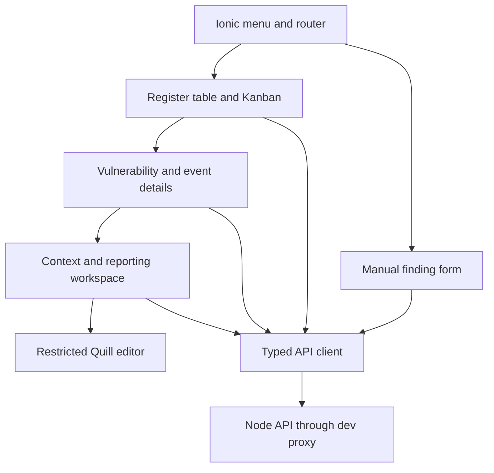
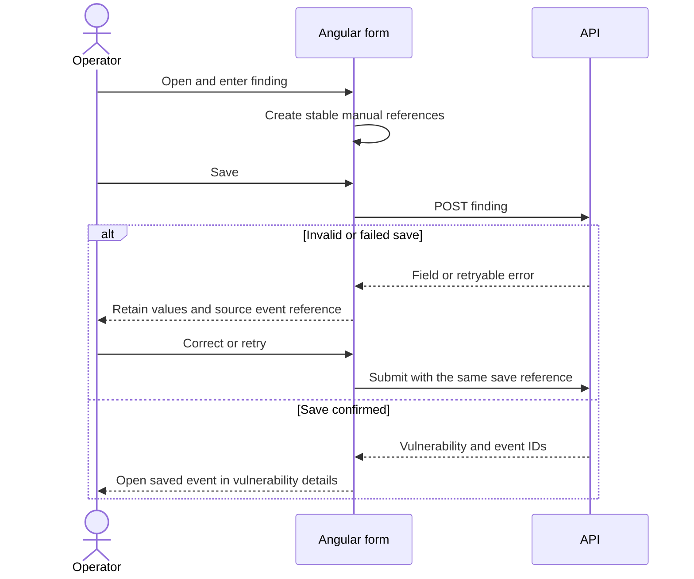
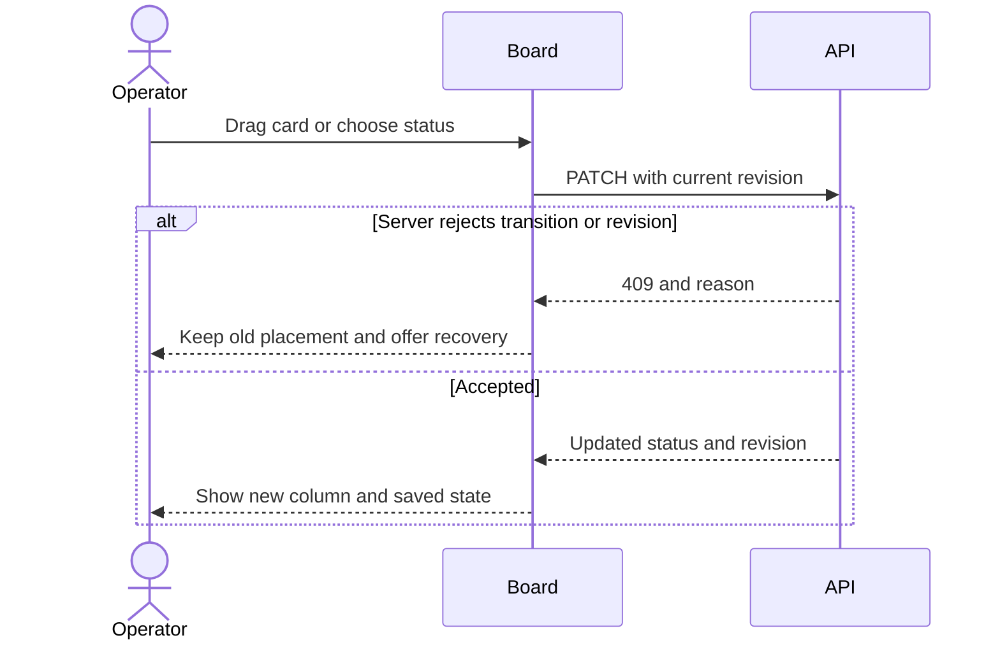
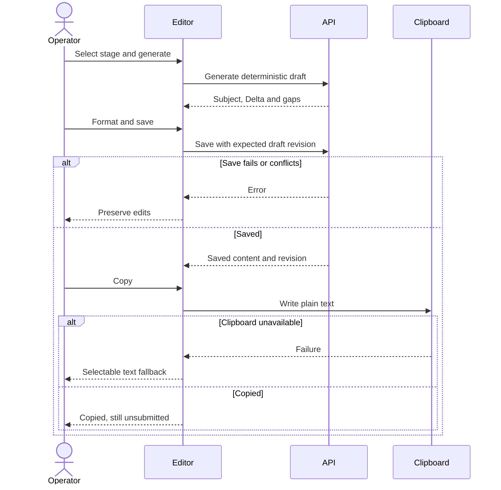

# ADR-002: Ionic Angular Starter and PoC Frontend

**Date:** 22 October 2026

**Status:** Accepted

**Relates to:** [Main architecture](000-main-architecture.md), [API and persistence](001-api-and-persistence.md), [PRD](../PRD.md)

## 1. Scope

Define the frontend donor, the small set of reusable components, screen routes and client behaviour for the local PoC. No alternative theme migration, native mobile build, authentication, controller portal or inspection-report screen is implemented now.

## 2. Technology Documentation References

| Library | Verified Context7 ID / official reference | Use |
|---|---|---|
| Ionic | `/ionic-team/ionic-docs`; [starting an app](https://ionicframework.com/docs/developing/starting), [split pane](https://ionicframework.com/docs/api/split-pane) | Official starter and application layout. |
| Angular | `/websites/angular_dev` | Standalone routing, reactive forms, HttpClient, proxy and CLI Vitest tests. |
| Angular CDK | `/angular/components`; [table source documentation](https://github.com/angular/components/blob/main/src/cdk/table/table.md), [drag/drop](https://angular.dev/guide/drag-drop) | Unstyled table and connected column behaviour. |
| ngx-quill | `/killercodemonkey/ngx-quill` | Angular-22 integration and configurable editing/model formats. |
| Quill | [Package metadata](https://registry.npmjs.org/quill/2.0.3), ngx-quill documentation above | Delta rich-text representation; BSD-3-Clause licence. |
| Zod | `/colinhacks/zod` | Shared input/output contracts; the server remains authoritative. |
| Vitest / Playwright | `/vitest-dev/vitest`, `/microsoft/playwright` | Component and browser verification. |

Exact dependency versions are fixed in [ADR-000](000-main-architecture.md). The source comparison and rejected candidates are recorded in [technology research](../TECHNOLOGY-RESEARCH.md).

## 3. Component Design

### 3.1 Source donor and adaptation boundary

Use `ionic-team/starters` at commit `15aee8b93f46b48e4db7464bceb4b0560ea5dc35`, combining its `angular-standalone/base` with `angular-standalone/official/sidemenu`. The overlay alone is not a complete application. Preserve the [MIT licence](https://github.com/ionic-team/starters/blob/15aee8b93f46b48e4db7464bceb4b0560ea5dc35/LICENSE) and attribution.

Reuse the standalone Angular/Ionic bootstrap, global Ionic styles, split-pane/menu/navigation structure and relevant Angular build/test configuration. Align the donor's Angular 22.1.7 declarations to the chosen 22.2.3 baseline. Preserve required bootstrap configuration while verifying it with the selected Ionic version; do not simultaneously introduce a custom rendering or change-detection architecture.

Replace sample Inbox/folder routes, sample labels, icons and demonstration content with the product screens. Do not copy historical `ionic-angular` directories, conference native projects, PWA/offline storage, login screens, maps or unrelated dependencies. No Capacitor/native platform setup is needed for the browser-only PoC.

Do not clone a full demo into the repository root or replace existing course files. Put the adapted app and its own manifest/lockfile under `app/`. Before treating the donor as a baseline, implementation must demonstrate dependency resolution, typecheck, build, real startup and an Ionic route rendered in the browser.

### 3.2 Feature boundaries and routes

| Route / feature | Responsibility |
|---|---|
| `/register` | Default table, Kanban switch, search/filters and dashboard summary. |
| `/findings/new` | Manual finding form, selecting an existing vulnerability or entering a new one. Optional selected-vulnerability input preselects a known record. |
| `/vulnerabilities/:id` | Shared information, identities, event list, event review and reporting-context list. Event details can be an inline section rather than another top-level route. |
| `/contexts/new` | Selected event scope and initial context fields; reuse suggestion for an existing known scope. |
| `/contexts/:id` | Assessments, anchors/history, stage preparation/editor and manual external records. |

The menu needs only the register and manual-entry actions. Detail/preparation routes are reached from records. `/` redirects to `/register`. Unsupported routes show a local not-found screen with return navigation.

Use standalone feature components, small HttpClient services and Angular reactive forms. Keep query/view state in the register URL. Use component-level signals/observable HTTP results; do not add NgRx or a global client database/cache. Persisted records always come from the API. Unsaved values stay in the current form with navigation protection.

### 3.3 Shared interaction rules

- Show explicit loading, empty, filtered-empty and failed-load states. Retry failed reads without discarding the selected query.
- Form saves retain input until confirmed successful. Display server field errors at the corresponding controls and a form-level message for service failure.
- A 409 preserves local values and offers reload of the current record. Reapplying an edit is an explicit operator action; do not silently resubmit against a new revision.
- Native semantic labels and a visible keyboard focus indicator accompany inputs/actions. Status changes have a select/button alternative to dragging.
- Use Polish labels from shared controlled-value mappings. Business statuses and report-preparation states are visually and textually distinct.
- Do not put secrets, API base URLs, business records or unsaved reports into persistent browser storage. Relative `/api/v1` URLs use the configured development proxy.

## 4. Data Structures and State

| Client state | Content / lifetime |
|---|---|
| Register query | View `table`/`kanban`, shared/event filters and detection-date bounds; kept in URL and restored on returning. |
| Loaded register result | Server rows, matching event IDs and summary from one query; replaced atomically after a successful fetch. |
| Manual form | New/existing selection, entered shared/event fields and stable manual source-event/identity UUIDs. Retained across a save retry, discarded only on successful save or confirmed abandonment. |
| Edit form | Last loaded resource revision, current values and dirty state. |
| Context workspace | Saved context plus stage checklists, source signatures, timing history and external records. |
| Draft editor | Selected stage, subject, restricted Delta, expected revision, source-review state and saved/dirty state. |

Do not share one mutable status object between a vulnerability and its events. Do not infer context reportability from a card's severity. Use API-provided gaps, checklists and deadline instants; the browser localizes their display but does not establish a separate business-rule engine.

Manual forms permit entry without CVE, detection time, product or client. Before submitting a new manual identity, generate its UUID once, not on every button click. The API supplies the actual persisted record UUIDs and receipt time. A selected existing vulnerability exposes its identity without replacing it with an invented public identifier.

## 5. Interface Contracts and UI Behaviour

### 5.1 Register and Kanban

Send all active filters through GET `/api/v1/vulnerabilities`. Maintain the selected view and query across navigation and view switching. Render the returned matching event markers and summary; do not locally combine independent event matches into a misleading product/client match.

Use a CDK table with Ionic controls, not a second full Material/CoreUI theme. Sorting/filtering are composed explicitly; no advanced grid, virtual scrolling or pagination is required at the stated volume. Default order is the server's deterministic order.

Kanban has four columns matching shared handling status. Cards show identifiers/title, severity, gaps and event/context summaries. Moving a card issues the same revision-checked PATCH as the detail status control. Retain the old placement while saving and move only on success; on failure show the reason and retain the old placement. A missing-data transition cannot bypass the server's rules.

### 5.2 Manual creation and review

`Dodaj wykrycie` opens the form. An existing-vulnerability lookup reuses the register search result; no new lookup service is required. New vulnerability inputs include optional public identifiers and the applicable shared description/classification fields. Event inputs include product/version/client, detection time and evidence, plus optional reporting evidence supplied by the operator.

Submit through the same POST `/api/v1/findings` as scanner intake. Disable save during the active request; retain the same source-event token after an error. On success navigate to `/vulnerabilities/:id` and identify/highlight the saved event. Cancel/discard does not call intake. Route-leave protection offers continue editing or abandon for dirty forms.

Shared/event edit actions use the contracts in ADR-001. Show incoming shared facts preserved from scanner findings next to curated values for review. An operator explicitly adopts a candidate through a revision-checked update; there is no background replacement or fuzzy merge.

### 5.3 Contexts and reporting editor

Context creation selects matching events and known manufacturer/product details. Present supplied reporting evidence and earlier awareness anchors for review. If the server returns an existing known-scope reference, offer opening it and adding the relevant events there; do not reset its dates.

Display the context's three vulnerability reporting limits, requested intermediate date where applicable, and exact/estimated/unknown labels. Entering a corrected anchor uses the dedicated correction action with a required explanation. There is no legal time-extension control.

Use ngx-quill with Delta as the canonical model. Expose only paragraphs, bold, italic, ordered/bullet lists, links and clear-formatting. Disable image/video/attachment/embed controls. Validate allowed operations and URLs on the server before persistence; display saved rich content through Quill's read-only/editor model, not arbitrary HTML.

Generation calls the deterministic backend template action. Save persists subject/Delta and restores it on reopening; clipboard actions use the saved or current editor-derived plain text, with a visible indication when copying unsaved content. If clipboard access fails, select/show the plain text for manual copying. Neither action sends anything. Marking a draft ready explicitly acknowledges the currently displayed source signature; an intervening source change is shown as a conflict instead of being silently accepted.

If generation would replace edited saved content, ask for replacement confirmation. If local unsaved edits exist, confirm discarding them before making the generation call; cancellation preserves the editor. A structured source change displays `Wymaga przeglądu` and keeps the saved content.

The manual external-submission form requires the stage, actual time and reference and uses a stable recording token. If the editor is dirty, require saving first so the snapshot refers to a known draft revision. Its label is `Przekazano poza aplikacją — wpis ręczny`; no delivery-success or approval badge is shown.

## 6. Technical Decisions

### Official Ionic starter plus narrowly selected reusable components

**Status:** Accepted. **Date:** 22 October 2026.

**Context:** Ionic is preferred and speed matters more than a large prebuilt demo. Every reviewed donor still needs the domain screens and API.

**Decision:** Use the sidemenu donor, CDK table/drag-drop and ngx-quill, avoiding another application meta-framework.

**Rejected alternatives:** Conference App carries conference/native features; Ng-Matero carries Material/auth/demo infrastructure; CoreUI carries another component/theme system. None demonstrated a ready CRA workflow.

**Consequences:** (+) Ionic from the beginning, with less unrelated code to remove. (-) Domain screen composition and Kanban persistence remain application work.

**Review trigger:** A measured integration blocker or a new requirement demonstrably served faster by another maintained component.

### Delta persistence and deterministic template generation

**Status:** Accepted. **Date:** 22 October 2026.

**Context:** The user needs formatted editable text that survives reopening; AI is deferred.

**Decision:** Persist restricted Delta, derive plain text and prepare templates on the backend.

**Rejected alternatives:** Plain text alone loses formatting; arbitrary HTML adds an unnecessary content surface; LLM generation is outside scope.

**Consequences:** (+) Small, explicit formatting vocabulary with reproducible storage. (-) A future different editor needs format conversion.

**Review trigger:** A requirement for richer document structure, imported HTML or a different canonical document format.

### Simple local screen state

**Status:** Accepted. **Date:** 22 October 2026.

**Context:** Few operators and findings do not justify a client data synchronization platform.

**Decision:** URL query state, reactive forms and API-loaded data; no global store or offline database.

**Rejected alternatives:** A generalized store/offline layer increases synchronization work without a current requirement.

**Consequences:** (+) Predictable save/reload behaviour. (-) Unsaved work is protected during navigation but not promised to survive a browser crash.

**Review trigger:** Offline use or sustained collaborative editing.

## 7. Diagrams

### 7.1 Frontend components

### 7.2 Manual entry and recovery

### 7.3 Kanban transition

### 7.4 Editor save and copy

## 8. Testing Strategy

Follow TDD and the layered verification in [ADR-000](000-main-architecture.md). Component tests may use HttpClient test doubles. Real E2E tests use actual API/SQLite and must not intercept the exercised business requests. Screenshots alone do not establish saving or persistence.

| Scenario | Type | Input | Expected output | Edge cases |
|---|---|---|---|---|
| Donor adaptation | Build + browser | Clean installation with chosen versions | Ionic shell and routes load | No demo/login routes, no missing assets, no console errors. |
| Manual form | Component + E2E | New no-CVE entry and event for existing vulnerability | Saved event and correct shared identity | Missing fields, invalid time, double click, retry and cancellation. |
| Query/view state | Component + E2E | Combined product/client/date filters | Same result set and summary across table/Kanban | Empty results, returning from details, different events carrying separate predicates. |
| Status update | Component + E2E | Drag and non-drag actions | Same server-validated transition | Missing-data rule, service failure and stale revision. |
| Shared/event independence | E2E | Different statuses and incoming candidate facts | Each level stays independent | Closing, new observation and explicit adoption of incoming facts. |
| Editor | Component + E2E | Every allowed format, save and reload | Same formatting and readable plain text | Clipboard rejection, dirty navigation, regeneration cancellation, stale source and 409. |
| External record | E2E | Save draft then record external action | Manual label and preserved snapshot | Dirty draft, retry and later source/text changes. |

After tests, manually operate the real register, manual form, details, Kanban and reporting editor using local synthetic records. Exercise successful saves and visible error recovery, keyboard navigation/focus, copy fallback and reload persistence. Capture the changed screens/states and inspect browser/server errors before committing runtime changes.

### Technical acceptance criteria

- **TAC-002-01:** The adapted frontend uses the pinned Ionic donor and no unrelated demo authentication or native platform setup.
- **TAC-002-02:** A new manual finding and an event added from existing details reach the same backend finding command as the scanner.
- **TAC-002-03:** A failed manual save preserves values and references; a successful retry does not duplicate the event.
- **TAC-002-04:** Table/Kanban switching preserves URL query state and the server-defined result set.
- **TAC-002-05:** Drag and non-drag transitions both honour backend gaps/revisions and preserve old state on rejection.
- **TAC-002-06:** Every required rich-text format survives save/reopen, and copy produces readable plain text without submitting a report.
- **TAC-002-07:** A stale or failed save does not erase unsaved editor content or earlier external-submission snapshots.
- **TAC-002-08:** Real browser flows use the real local API and SQLite file, with recorded manual QA evidence for each changed screen.
