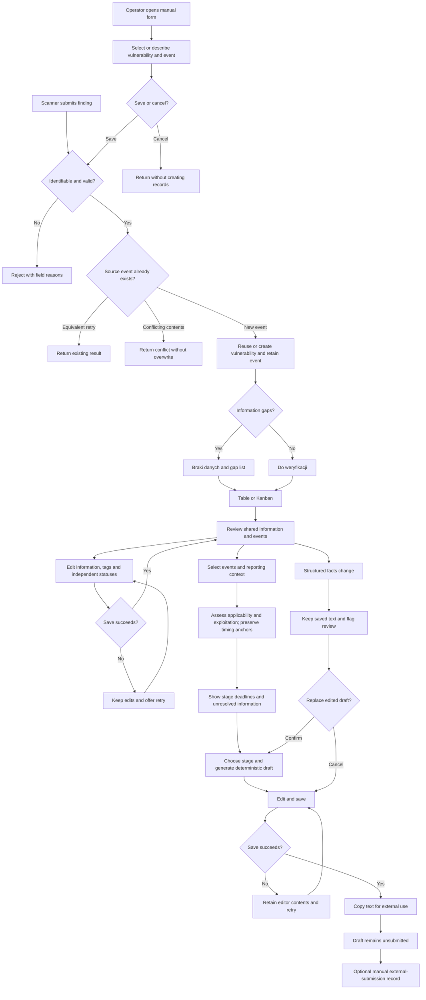

# PRD — CRA Vulnerability Register and Reporting Preparation PoC

Date: 22 October 2026. Scope: requirements only, before architecture and implementation.

This proposes a new application. The current repository contains course materials; this document does not change or extend the separate jFTP application.

## 1. Executive Summary

Build an internal web PoC that receives vulnerability findings from an existing daily scanner through an API or from an operator through a manual form, groups identical vulnerabilities and retains their individual detection events. Operators review the information in a table or Kanban, manage status and tags, and prepare editable, saved reporting text for copying into an external workflow. The PoC covers vulnerability reporting preparation under CRA Article 14; authentication, approval roles, message sending, formal submission and AI are future scope.

## 2. Problem Statement

The company needs to relate repeated vulnerability findings to affected products and clients while preserving when and where each finding occurred. Scanner output alone does not establish which findings require CRA notification, what information is missing or which reporting deadline applies. Manual consolidation and message preparation can duplicate weaknesses, lose occurrence context and confuse a prepared message with a completed external submission.

## 3. Users / Personas

| Persona | Goal | Expected outcome |
|---|---|---|
| Vulnerability analyst / developer | Review scanner observations, add evidence, classify issues and update handling status | One shared vulnerability with identifiable events and visible missing information. |
| Reporting coordinator / decision maker | Assess reportability, review deadlines and prepare the required reporting material | Saved, editable text with a defined reporting scope, stage and known gaps. |
| Internal observer | Search and inspect the current state across products and clients | The same information as other PoC users, without a separate permission model. |
| External controller / ministry inspector | Examine how the company handles vulnerabilities and fulfils applicable reporting duties during an inspection | A scoped report presenting available evidence, decisions, deadlines, reporting records and unresolved gaps; direct application access is future scope. |

These are usage perspectives, not enforced roles. All internal PoC users have the same capabilities. The external controller is a future report recipient, not an application user in the current PoC; an internal coordinator will prepare and provide inspection material. The existing scanner is an external source; building or operating it is not part of this product.

## 4. Main Flows

### 4.1 Receive a new finding

1. The scanner provides a stable vulnerability identity, its source and event reference, and whatever timing, descriptive and contextual information it knows.
2. The product validates whether it can identify the vulnerability and observation and interpret the supplied information.
3. For a new vulnerability, the product creates one shared record and attaches the event. For a known identity, it attaches the event to the existing vulnerability.
4. A new shared record and event enter `Do weryfikacji`; records with detected gaps enter `Braki danych` with a visible list of gaps.
5. The API response identifies the stored vulnerability and event, their creation/reuse outcome and detected gaps.
6. The finding becomes available in the web interface. No report is sent or automatically declared legally required.

### 4.2 Receive a retry, later observation or conflicting update

1. A repeated delivery with the same source event reference and equivalent contents returns the existing result without adding another event.
2. A different source event reference creates another event, including for the same product, version, client and date.
3. Reusing the same event reference for materially different contents returns a conflict without replacing the earlier observation.
4. Scanner data does not silently replace manually curated shared information or a saved reporting draft; differing shared facts are presented for review.
5. A new event for a closed vulnerability returns the shared record to review, or to `Braki danych` if shared gaps remain, without reopening historical events.

### 4.3 Review, search and manage

1. An operator opens the vulnerability table, searches and applies filters, or switches to Kanban.
2. The operator opens a vulnerability and reviews its shared information, detected gaps and event list.
3. The operator adds or corrects descriptive information, severity, category and tags, and independently updates shared or event handling status.
4. Adding missing information clears the corresponding gaps; resolving all detected gaps returns a `Braki danych` record to `Do weryfikacji`.
5. Saving confirms success. A save failure preserves entered values and offers a retry.

### 4.4 Establish a reporting context

1. From a vulnerability, an operator selects events concerning one manufacturer and affected product; events may span clients and versions.
2. The operator creates or reuses a reporting context and reviews the selected event scope.
3. The product collects the information defined in Section 8, including applicability, product impact, exploitation evidence, reporting assessment and timing anchors.
4. The initial notification assessment is undecided. The operator may record required or not required with a rationale; the application does not infer a legal duty from severity or a CVE alone.
5. A supplied awareness date is retained even before human review. The product shows the reporting limits for known anchors and flags unknown anchors.
6. Further observations may be linked to this context without restarting its deadlines. Unclear manufacturer or product grouping remains explicitly unresolved.

### 4.5 Generate, edit, save and copy text

1. The operator chooses the reporting context and stage: early warning, 72-hour notification, final report or requested intermediate report.
2. The product shows stage-specific missing or overlong information and generates a deterministic subject and body from available facts.
3. Unknowns appear as explicit placeholders; the operator can prepare an incomplete early warning without waiting for final-report information.
4. The operator edits the body using a simple formatting toolbar, saves it and copies the subject/body for use outside the application.
5. Reopening the context restores the saved text and formatting. Later source changes mark the draft as needing review without overwriting it.
6. Regenerating an edited draft requires confirmation before replacing its saved content.
7. Copying, editing and saving leave the report unsubmitted. Optionally, after external submission, the operator records the actual stage, time and reference as a manual record.

### 4.6 Handle unclear and invalid input

1. Identifiable findings missing product/client details, descriptive information or legal evidence are stored with gaps.
2. Findings without a usable vulnerability identity or source/event reference, or with a supplied but invalid timestamp, are rejected with field-level reasons and no partial write. An absent detection time is retained as unknown with a gap.
3. Unknown exploitation, severity or applicability remain unknown; an incomplete record is never converted into a negative finding.
4. If the service cannot confirm saving, it returns a failure without claiming success; the scanner can retry using the same event reference.

### 4.7 Add a finding manually

1. An operator selects `Dodaj wykrycie` from the register, or adds an event from an existing vulnerability's details.
2. The operator selects an existing vulnerability or enters information about a new one, together with the known product, version, client, detection time and supporting information. Client and product are text fields.
3. The product identifies the entry as manual and supplies internal references where no public vulnerability identifier or source event reference exists. An internal reference is never presented as a CVE or other assigned public identifier.
4. The form applies the same validation, identity reuse, gap detection and initial-status rules as API intake. Missing descriptive/contextual information is retained with gaps; missing detection time remains unknown.
5. Saving creates or reuses the shared vulnerability and records one event. Repeated clicks or a retry of the same save do not create duplicate events.
6. After success the product opens the saved finding. A validation or save error retains the form values, identifies the problem and supports retry; cancellation creates no finding.

## 5. User Stories

- As a vulnerability analyst, I want identical weaknesses grouped across clients and products so that I maintain their common description once.
- As a vulnerability analyst, I want every distinct observation retained so that I can see when and where the vulnerability was found.
- As a scanner operator, I want retries recognised so that a delivery failure does not create duplicate events.
- As an analyst, I want incomplete findings saved with explicit gaps so that missing information can be supplied manually.
- As a coordinator, I want product-specific reporting assessments and awareness dates so that a shared CVE does not incorrectly determine every reporting obligation.
- As a coordinator, I want editable stage-specific text so that I can complete and copy a report without retyping known information.
- As an operator, I want saved changes and drafts restored after reopening so that I can continue work later.
- As an operator, I want a failed save to preserve my edits so that a temporary error does not lose my work.
- As an observer, I want matching filters in table and Kanban views so that I can inspect the same scope in either view.
- As an analyst, I want to add a vulnerability finding or another event manually so that the register can be used without a connected scanner.

## 6. Acceptance Criteria

### Intake, identity and observations

- **AC-01:** A first valid finding creates one vulnerability and one linked detection event and returns both references.
- **AC-02:** A finding with an existing stable vulnerability identity and a new source event reference adds one event without creating another vulnerability.
- **AC-03:** Equivalent redelivery of an existing source/event reference returns the existing event without increasing the event count.
- **AC-04:** Materially different contents under an existing source/event reference return a conflict and leave the stored event unchanged.
- **AC-05:** A finding missing a stable vulnerability identity or source/event reference, or containing an invalid supplied timestamp, is rejected with the affected field names and creates no records.
- **AC-06:** An identifiable finding missing detection time, descriptive, product, client or legal information is retained with the corresponding gaps and its receipt time.
- **AC-07:** Different titles alone do not prevent reuse of the same stable identity, and similar titles alone do not merge different identities.
- **AC-08:** A vulnerability without a CVE can be retained and reused using a stable source-specific vulnerability reference.
- **AC-09:** A scanner update that conflicts with curated shared information leaves the curated value unchanged and exposes the incoming value for review.
- **AC-10:** An API failure never reports the finding as successfully saved.

### Review, status and persistence

- **AC-11:** A new vulnerability or event without detected gaps has the initial handling status `Do weryfikacji`.
- **AC-12:** A new vulnerability or event with detected gaps has handling status `Braki danych` and lists the gaps at that record's level.
- **AC-13:** Shared and event handling statuses are independent; changing one does not change the other.
- **AC-14:** When all detected gaps on a `Braki danych` record are resolved, its status becomes `Do weryfikacji` rather than automatically becoming handled or closed.
- **AC-15:** An operator cannot change a record with detected gaps out of `Braki danych` until those gaps are resolved or explicitly marked unknown/not applicable with an explanation where that is allowed.
- **AC-16:** Shared status changes do not bulk-close detection events or mark reporting stages as submitted.
- **AC-17:** A new distinct event for a closed vulnerability returns the shared record to `Do weryfikacji`, or `Braki danych` when shared gaps remain, and preserves historical event statuses.
- **AC-18:** Saved shared descriptions, event notes, categories, severity, tags and statuses are restored when the record is reopened.
- **AC-19:** A failed web save preserves the operator's entered values and shows a retry action.

### Reporting scope, assessments and timing

- **AC-20:** A reporting context identifies its manufacturer, affected product and included events without duplicating the shared vulnerability.
- **AC-21:** A context cannot be declared ready for external transfer while its manufacturer or affected product remains unresolved.
- **AC-22:** A new context has notification assessment `Nieustalone`; changing it to required or not required records a rationale.
- **AC-23:** Product affected assessment, active exploitation assessment and notification assessment are displayed separately from severity and handling status.
- **AC-24:** A high severity score or CVE identifier alone does not change the notification assessment to required.
- **AC-25:** When an awareness time is known, the context displays outer limits at 24 and 72 hours after that time.
- **AC-26:** When the relevant corrective or mitigating measure availability time is known, the context displays the final-report outer limit 14 days after that anchor.
- **AC-27:** An unknown timing anchor produces `Nieustalony termin` and an information gap instead of using detection, receipt or current time as a substitute.
- **AC-28:** Additional events, human review, stage preparation and status changes do not reset an existing awareness or measure-availability time.
- **AC-29:** An intentional timing-anchor correction preserves the previous value, the new value and a reason, and recalculates the displayed limits.
- **AC-30:** A known elapsed deadline is displayed as overdue even when the corresponding context remains incomplete or undecided.
- **AC-31:** An intermediate-report context accepts a CSIRT request and optional requested response date without inventing a statutory numerical deadline.

### Drafts and external records

- **AC-32:** The application offers separate deterministic templates for early warning, 72-hour notification, final report and requested intermediate report.
- **AC-33:** Each draft includes the selected scope, reporting stage, known stage-relevant information and explicit placeholders for unknown information.
- **AC-34:** Missing final-report information does not prevent generating, editing, saving or copying an early-warning draft.
- **AC-35:** A report marked ready for external transfer has no unresolved required information for that stage, including the mapped SRP fields listed in the research catalogue.
- **AC-36:** The editor supports paragraphs, bold, italic, bullet/numbered lists and links, and restores these after saving and reopening.
- **AC-37:** Copy actions provide the subject and a readable plain-text body; a copy failure leaves text selectable for manual copying.
- **AC-38:** Regenerating a modified draft requires explicit replacement confirmation and cancelling retains the saved text.
- **AC-39:** A structured source change marks an existing draft as needing review without changing its saved body.
- **AC-40:** Saving or copying a draft never marks it as submitted or sends it to an external recipient.
- **AC-41:** A manually recorded external submission stores its stage, actual time and reference and is labelled `Przekazano poza aplikacją — wpis ręczny`.
- **AC-42:** Recording a stage as externally submitted preserves a snapshot of its text and does not imply that later stages or user communications were completed.
- **AC-43:** An overlong mapped SRP value is flagged against the researched field limit without truncating the stored information or blocking an incomplete draft.

### Search, views and PoC boundary

- **AC-44:** Text search matches vulnerability identifiers, title, component, product, client and tags.
- **AC-45:** Filters support shared status, event status, severity, category, tag, product, client, detection date range and notification assessment.
- **AC-46:** Event-based filters return vulnerabilities with at least one matching event and identify the matching events; combined product/client/date conditions apply to the same event.
- **AC-47:** Switching between table and Kanban preserves the active query and filters and shows the same vulnerability set.
- **AC-48:** Kanban cards move through the same validated status-change action as the detail view, including a non-drag alternative.
- **AC-49:** Event lists and dashboard counts distinguish unique vulnerabilities, distinct events and reporting contexts.
- **AC-50:** The application provides Polish interface text and Polish generated drafts.
- **AC-51:** Reopening the application preserves saved records, linked events, contexts, drafts and external submission records.
- **AC-52:** The PoC presents no login, permission roles, approval action, message-sending control or automatic external research action.
- **AC-53:** The dashboard separately shows due/overdue unrecorded reporting stages and contexts with unknown deadline anchors.
- **AC-54:** The application displays preparation as preparation and manual external records as unverified user entries, rather than certifying legal compliance.

### Manual creation

- **AC-55:** The register provides a form for adding a manual finding, and vulnerability details provide an action to add another event for that vulnerability.
- **AC-56:** A manual finding can select an existing vulnerability or create one using an internal identity when no public identifier exists.
- **AC-57:** Manual and scanner intake apply the same identity, validation, missing-data and initial-status rules, with manual entries visibly identified as manual.
- **AC-58:** A repeated click or retry of the same manual save creates at most one event.
- **AC-59:** A successful manual save opens the stored finding, while a rejected or failed save retains all entered values and shows the error.
- **AC-60:** Cancelling an unsaved manual form creates no vulnerability or event.

## 7. Out of Scope

- **Severe incidents:** no incident intake, incident-specific information, templates or one-month deadline calculation in this PoC.
- **Authentication and permissions:** no accounts, Microsoft directory login, session-based identity, administrator view or read-only role.
- **External inspection support:** no inspection-report generation or controller access in the current PoC. A basic inspection report is the next candidate extension described in Section 12.3; controller accounts and scoped read-only access remain a later capability.
- **Approval workflow:** no designated approver, delegation, separation between approval and sending, or enforceable authority to submit.
- **Sending and submission:** no email delivery, email-file export, mailbox access, SRP integration, authority API integration or receipt verification.
- **AI:** no LLM enrichment, internet research, text generation by a model, Jev categorisation or model-based reportability decisions.
- **Scanner development:** no scanning, dependency installation, automatic advisory retrieval or modification of the existing daily schedule.
- **Remediation execution:** no patching, deployments, repository changes or external issue-tracker integration.
- **Master-data management:** no product/client administration, CRM connection or external directory synchronisation; names are text fields.
- **Full compliance platform:** no conformity assessment, SBOM generation, full CRA lifecycle management, KSC/NIS2/GDPR workflows or automatic legal determinations.
- **Advanced operations:** no notifications, reminder delivery, real-time feeds, general-purpose audit system, bulk imports, file attachments or raw log archive.
- **Additional channels and languages:** no mobile application, public customer portal, multilingual interface or alternative-language templates.

Future capabilities are described in Section 12 as requested product scope, not as implementation commitments for this PoC.

## 8. Constraints

### Business

- Use [CRA research and the information catalogue](CRA-RESEARCH.md) as the source-backed legal and field reference. Statutory duties, SRP platform requirements and internal management fields remain distinguishable.
- The company serves Polish public institutions, but applicability and manufacturer responsibility are assessed per product context, not inferred from the client name.
- The formal reporting channel is external ENISA SRP. No government email address or contract-specific duty has been verified for this brief.
- This is an internal unauthenticated evaluation PoC, not a production repository for sensitive government incident material. Course evaluation uses synthetic findings, products, clients and contact details.
- No required production identity/security programme is included in the PoC. Future production use is a separate decision.
- The daily scanner already exists. The PoC preserves supplied detection and awareness times independently; a daily scan is not a guarantee that external reporting duties have been met.
- All stages remain subject to action without undue delay. Displayed outer limits do not authorise waiting until the deadline.
- Historical dates may precede import. A report record cannot become compliant merely by being copied or saved.

### Functional information and minimum completeness

The catalogue defines information ownership. This section defines completeness rules so that the UI can identify gaps without discarding a finding.

| Level | Minimum to retain / identify | Information assessed for review |
|---|---|---|
| Shared vulnerability | Stable public identifier or source-specific vulnerability identity | Title, description, component identification, category, severity assessment and evidence/reference. Unknown severity is allowed but displayed. |
| Detection event | Source, stable event reference and linked vulnerability identity; the manual form supplies internal references for a manual entry | Detection time, product, product version, client and observed component version where a component is involved. Explicitly unavailable information has a reason; a missing applicable value is a gap. Receipt time is recorded independently. |
| Reporting context | Selected vulnerability and identifiable event scope; provisional contexts may be incomplete | Manufacturer, product/versions, applicability, affected-product assessment, exploitation evidence, notification assessment, awareness time, Member States and contact information. |
| Early-warning readiness | Context plus stage-specific researched requirements | Title, summary, manufacturer, product/versions, relevant Member States, awareness time and identification of the actively exploited vulnerability. |
| 72-hour readiness | Initial identification carried forward | Available product/exploit/vulnerability account, measures taken, user measures and sensitivity assessment where applicable; distinguish unknown from no measures yet. |
| Final-report readiness | Context and carried-forward identification | Severity and impact description; measures taken and user measures; relevant measure availability time; security update/corrective details; actor information if known. Unknown actor is not a blocker. |
| Intermediate report | Context and external request | Request-specific status update; optional requested response time. |

Completeness is not a legal decision. “Ready for external transfer” means prepared against the selected stage checklist. It does not mean approved, submitted, accepted or compliant. Explicit unknown values remain visible; they do not become known facts to satisfy a checklist.

Shared data covers the weakness. Event data covers the observation. Reporting context data covers product-specific assessments, legal anchors and prepared reports. One global vulnerability can have several contexts; a new scan does not itself create a new context or clock.

Identity uses exact supplied public/source identities and declared aliases, not inferred similarity. The PoC does not promise automatic merging across unrelated scanner identifiers. Alias reconciliation is a future extension.

### Status and categorisation

- Both vulnerabilities and events use `Do weryfikacji`, `Braki danych`, `W obsłudze`, `Zamknięte`.
- `Braki danych` is the visible handling status when detected gaps exist. Gap explanations and a return to review prevent automatic closure after data entry.
- Report preparation states are separate: no draft, draft, ready for external transfer, and manually recorded external submission. Readiness can be revoked by relevant source changes; a historical external submission snapshot is retained.
- Severity values are critical, high, medium, low and unknown. Optional numeric scores retain their method/version and source.
- Vulnerability origin categories are dependency/framework, application code, other and unknown. A category is not a reporting decision.
- Tags are free-form searchable labels. Product and client are text fields supporting multiple values across distinct events, without a predefined customer catalogue.
- Closed handling records remain searchable; closing does not certify correction or submission. A closure note explains the disposition.

### Dates, content and interaction

- Supplied timestamps identify an unambiguous instant, including an offset or time zone. The UI shows date/time with an explicit zone; the default operational display is Europe/Warsaw.
- Exact, estimated and unknown awareness/availability times are distinguishable. Estimated-anchor deadlines are labelled as based on an estimate.
- The 24-hour and 72-hour calculations use elapsed hours. The final-report planning date is 14 days after measure availability; the PoC applies no extensions or discretionary postponements.
- Time-anchor corrections require a reason and preserve prior values; this narrow history does not require a general-purpose audit subsystem or authenticated attribution.
- Descriptions can exceed external SRP field limits; mapped-content warnings support preparation without silent data loss. No other numerical capacity or file-size limit is asserted without a later decision.
- The PoC supports single-finding API submissions and manual creation through a form. Both paths use the same business validation and persistent register. Serialization, response codes and precise transport contracts belong in the ADR.
- No library or editor package is chosen here. The editor's required formatting behaviour is specified in AC-36.
- Operator-entered structured changes do not edit already recorded external-submission snapshots.

### External document / data references

| Document/data | Location | When used |
|---|---|---|
| CRA obligations, stage mapping and information catalogue | [CRA-RESEARCH.md](CRA-RESEARCH.md) | Requirements, missing-information checklists and template content. |
| Regulation (EU) 2024/2847 | [EUR-Lex](https://eur-lex.europa.eu/eli/reg/2024/2847/oj/eng) | Legal scope, definitions, duties and deadlines. |
| Official reporting overview | [European Commission](https://digital-strategy.ec.europa.eu/en/policies/cra-reporting) | Channel and reporting-stage interpretation. |
| Current SRP fields | [ENISA glossary, v1.6](https://www.enisa.europa.eu/topics/product-security/single-reporting-platform-srp/cra-srp-glossary2) | Report preparation and external field-limit warnings. |
| Scanner findings | Existing scanner; no sample supplied | Incoming observations; the scanner must adapt to the agreed intake requirements. |

## 9. UI Description (wireframe level)

### 9.1 Register and dashboard

- Navigation contains the register, its table/Kanban switch and the current filter controls.
- Summary counters show unique vulnerabilities, events, records with gaps, due/overdue reporting stages and contexts with unknown anchors. Counts state their unit and respect the current scope.
- The default table has one row per vulnerability: identifier/title, component, severity, handling status, event count, affected products/clients, tags and reporting summary.
- Filters cover AC-45. Clearing filters restores the full register; no results displays the active filter context and a clear action.
- The register provides `Dodaj wykrycie`. Its empty state offers manual creation and explains that observations may also arrive through the API. Loading and load failure have distinct visible states, with retry on failure.
- Row/card selection opens details. Kanban has one column per shared handling status; cards expose severity, gaps, event count and deadline indicators.
- Moving a card changes only shared handling status and honours missing-data rules. The same action is available through a status control without dragging.

### 9.2 Vulnerability details and events

- Header: identity, title, severity, shared status and tags.
- Shared information area: description, component, category, general evidence/remediation references and shared gaps, with edit/save controls.
- Event area: date/time, source reference, manual/scanner origin, product/version, client, component version, independent event status and gaps. Selecting an event opens its details and editable operator notes; `Dodaj wykrycie` starts a form with this vulnerability selected.
- Reporting area: contexts with product/manufacturer scope, notification assessment, deadline state, preparation stage and links to the editor.
- An operator selects relevant events to establish a reporting context. Missing product/manufacturer information is shown as unresolved rather than guessed.
- Saving errors retain edits. Navigating away with unsaved changes offers save/discard/cancel.

### 9.3 Reporting preparation

- Header shows vulnerability, manufacturer, product, included events and selected stage. Scope remains visible while editing.
- Assessment area shows applicability, product impact, exploitation evidence, notification decision/rationale and timing anchors.
- Timeline shows early-warning, 72-hour and final-report limits with known, estimated, overdue or unresolved states. Intermediate requests show their own requested date if supplied.
- Checklist distinguishes missing shared data, missing event/context data and missing stage-specific content. A later-stage gap does not block an earlier-stage draft.
- Subject is editable text. Body uses a simple formatting toolbar with AC-36 controls.
- Actions are generate/regenerate, save and copy subject/body. Regeneration confirms replacement of edits; normal saves do not require approval.
- A saved-state indicator and source-change indicator show whether work was saved and whether its underlying facts changed.
- An optional external-record form captures stage, actual submission time/reference and the submitted-text snapshot. Its label identifies a manual external record.
- A compact user-information follow-up area retains audience/instructions and external communication state/date/reference; it does not contact users.
- No send, approver selection, login or AI-research control is shown.

### 9.4 Manual finding form

- A vulnerability selector offers existing records and a new-vulnerability option. The new option exposes the shared descriptive fields; no public identifier is required.
- Event fields collect the known detection time, product/version, client, component version and observation evidence. Unknown information remains visibly unknown.
- Previewed gaps explain which information will need review after saving. They do not prevent retaining an identifiable incomplete finding.
- Save is disabled while a request is pending. A failed request preserves the same save reference and form values for retry.
- Save success navigates to the stored record. Cancel or navigation with unsaved changes offers discard/continue editing; discarding does not submit anything.

## 10. User Flow Diagram

## 11. Agent / System Behavior Specification

There is no AI agent in the PoC. The automated behaviours are intake, exact identity reuse, gap detection, deadline display and deterministic template preparation.

- The scanner's initial classification is stored as a source assessment. It does not automatically establish legal reportability or replace a human assessment.
- The application may identify missing information and prepare text from supplied or manually entered facts. It must not invent evidence, actors, affected customers, corrective actions or dates.
- Template generation uses the selected context and stage. It does not query the internet, contact third parties or enrich private findings externally.
- Unknowns use explicit Polish placeholders such as `[Brak informacji: ...]`. A note that content is a draft must not falsely state that a report has been filed.
- Generated language is factual Polish, with source references where available. Internal coordination notes are separate from report text unless the operator explicitly includes them.
- The PoC's assessments support human review; they do not issue legal advice or an automated compliance certificate. The UI needs a preparation/submission distinction, not a repetitive legal disclaimer in every paragraph.

## 12. Further Notes and Future Scope

### 12.1 Confirmed decisions and bounded assumptions

The user confirmed vulnerability-centric records, separate detection events, retention of incomplete findings, manual creation as well as scanner intake, table plus Kanban, saved editable text with basic formatting, multiple products/clients, text names and no sending or authentication in the PoC. The PoC runs locally at low volume; the application will occupy a dedicated directory in this repository. Technology choices are recorded separately in ADRs.

Because incident reports require materially different data and deadlines, incident functionality is deferred under the user's conditional instruction. The PoC includes all three vulnerability-reporting stages and requested intermediate updates as a bounded assumption derived from the requested CRA coverage; these are preparation features, not authority integration.

Each reporting context covers one manufacturer and affected product, with multiple related events and clients. Formal multi-product notification aggregation is not automated. Real manufacturer responsibility, product applicability, contract-specific recipients and evidence sufficient to establish awareness remain organisational facts to resolve per context.

### 12.2 Planned product extensions — outside this PoC

| Capability | Intended future behaviour | Boundary requiring later definition |
|---|---|---|
| Inspection report — next candidate extension | Let an internal coordinator generate a report for an external controller covering a selected period, products and clients, using the information already retained. | See Section 12.3; no controller account or application access is needed to provide the report externally. |
| External controller access — later | Provide an identified controller with read-only access to the agreed inspection scope. | Depends on authentication and permissions; define scope, access duration and visibility of sensitive information before implementation. |
| Roles and approval | Separate viewing, editing, decision-maker approval and execution of sending; a sender may differ from the approver. | Authority, role assignment, rejection/revision and handling changes after approval. |
| Microsoft directory login | Organisational single sign-on and permissions associated with real users. | Confirm the actual Microsoft identity environment and access rules. |
| Email sending | Deliver reviewed content and retain delivery outcomes. | Verified recipient/procedure, approval policy, retries and failure handling; an email is not automatically an SRP filing. |
| Formal submission support | Assist transfer to the applicable official channel. | Supported official integration capabilities, routing and receipts; no API is assumed to exist. |
| LLM enrichment and writing | Research public advisory information, suggest missing details and improve report text while preserving sources and editable output. | No fabricated evidence or dates, no automatic submission, and unresolved facts remain visible for human review. |
| Decision model, such as Jev | Suggest categories and bounded assessments for findings using a low-cost decision model. | Define categories, evidence, uncertainty and human override; uncertain outputs route to review, not a final legal decision. Model capabilities have not been validated here. |
| Severe-incident support | Add incident-specific intake, assessments, reporting text and deadlines. | Cover Article 14(3)-(5), including its distinct final-report anchor. |
| External product/client data | Replace text-only names with references to CRM or other authoritative catalogues. | Matching, unknown/deleted records and reconciliation of existing text values. |
| Identity reconciliation | Reconcile aliases across scanners and public vulnerability identifiers. | Evidence of identity and operator-controlled merge/split without losing events or report history. |

These entries define requested future product scope only. A basic inspection report is the next candidate extension after the current PoC; implementation order for the remaining capabilities is deferred. No framework, storage design, API syntax, editor dependency, AI SDK or testing strategy is chosen by this PRD.

### 12.3 Next candidate extension: basic inspection report

An internal coordinator selects an inspection period and optional product/client filters, previews the resulting scope, and generates a single report that can be saved and provided to an external controller. This extension uses existing records and does not require the controller to log into the application. It remains outside the current PoC and its AC-01 through AC-60.

The report should contain:

- Its generation time, selected period, active filters and record-selection basis. The initial selection uses detection dates; linked reporting information is included even if a reporting action occurred outside that period.
- Separate counts and lists of unique vulnerabilities, matching detection events and related reporting contexts, with identifiers linking the information together.
- The available descriptions, affected products/versions and clients, severity, handling statuses, assessment decisions, rationale and evidence references.
- Recorded awareness and measure-availability dates, their uncertainty, calculated deadlines, and known timing corrections where retained.
- Reporting stages and manually recorded external-submission dates/references, clearly distinguished from drafts and verified receipts.
- Missing information, unresolved assessments and overdue stages, including an explicit empty-result state when nothing matches the selection.

The report describes the records available at generation time. It must not certify legal compliance, infer unrecorded actions or present a manual submission entry as independent proof of delivery. It does not promise historical activity or authenticated attribution that the PoC does not retain. The downloadable format and any inspection-specific presentation requirements will be agreed when this extension is selected for implementation; no mandatory legal inspection-report template is assumed.
