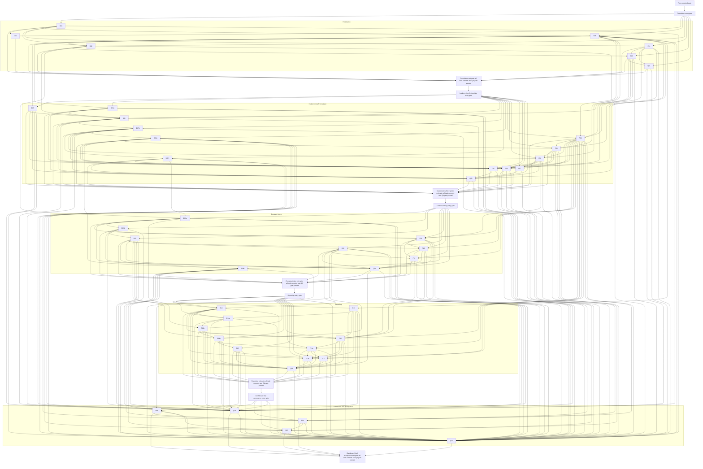

# CRA vulnerability-register PoC — implementation plan

Plan CRA PoC implementation and specialist-agent orchestration (`sacs-80fg`) owns the planning deliverable. On 22 October 2026 the human explicitly authorised full execution through the active thread goal. Implement local CRA vulnerability-register PoC (`sacs-0nmk`) owns implementation and its B/F/Q task records. This remains a static implementation specification: live leases, status, commits and verification evidence belong in the implementation tracker, and this document does not itself establish runtime success. The human requested a fully working local CRA PoC; no separate personal-goal file is required.

## Goal, evidence and authority

At the planning baseline, the local application did not exist (`app/` was absent in the inspected checkout). The accepted source documents are the product requirements, three ADRs, and the imported Sygnity visual reference. The authoritative PRD is [`docs/PRD.md`](../PRD.md); the long filename `docs/PRD-Product-Requirements-Document.md` is not present and must not be introduced as a duplicate. The plan creates no new architecture or product scope. Source baseline commits are requirements `4ffa908`, architecture `0688582`, selected assets `9c1cd76`, and design reference `72830d9`; dispatch must resolve the repository root and verify the actual committed predecessor instead of relying on an absolute machine path.

| Authority | Use in this plan |
|---|---|
| [PRD §4–6](../PRD.md#4-main-flows), [§7–9](../PRD.md#7-out-of-scope) | Product flows, AC-01–AC-60, exclusions, constraints and UI-level expectations. |
| [ADR-000 §3–7, §10](../ADR/000-main-architecture.md#3-system-architecture) | Angular/Ionic SPA + Express API, module boundaries, pinned baseline, local command and test contracts, TAC-000-01–07. |
| [ADR-001 §3–6, §8](../ADR/001-api-and-persistence.md#3-component-design) | API/domain/persistence rules, storage model/contract source, TAC-001-01–10. |
| [ADR-002 §3–5, §8](../ADR/002-frontend-and-starter.md#3-component-design) | Pinned donor boundary, UI flows, transient state, TAC-002-01–09. |
| [CRA research §4–8](../CRA-RESEARCH.md#4-actively-exploited-vulnerability-reporting-stages) | Reporting stages, source-backed field mapping and limits; preparation is not legal advice or submission. |
| [Design guide](../design-guidelines.md#assets), [tokens](../../assets/design-tokens.json), [observations](../../assets/design-observations.json), [provenance](../design-reference-provenance.md#file-manifest) | Selected logo/favicon and extracted visual evidence with documented limits. The font files are icons; Montserrat/Lora text fonts were not included. |

The design capture is an extracted marketing-site reference, not an official product brand manual. Use selected tokens/assets; preserve logo proportions and check rights. Null color/state observations do not establish values. Feedback colors and focus/success/error treatments are not supplied tokens: the implementation brief must choose accessible values and record the deliberate deviation. Use text fallbacks; do not download fonts.

## Roles and model routing

Use the native role definitions whose TOML schema was validated (runtime discovery is not yet verified) [`fe-developer`](../../.codex/agents/fe-developer.toml) / [Copilot role](../../.github/agents/fe-developer.agent.md), [`be-developer`](../../.codex/agents/be-developer.toml) / [Copilot role](../../.github/agents/be-developer.agent.md), and [`qa-engineer`](../../.codex/agents/qa-engineer.toml) / [Copilot role](../../.github/agents/qa-engineer.agent.md). The orchestrator owns scope/decisions, task briefs and tracking, evidence review, source review, and all commits. It writes no application code. Developers own application behavior plus their unit/component or API/repository integration tests; QA owns real-browser E2E and concise verification reports.

Default route is subscription/native `gpt-6-luna` at high for all tasks except B06 atomic intake and B14c draft signature/revision lifecycle, which use `gpt-6.1-sol` at high. Record the selected role, model and reason before each launch. No silent model/provider substitution. The manager may explicitly upgrade a narrowly failed task to subscription Sol after recording the failure and reason and regenerating its brief; paid Azure programming remains excluded. Verify named-role discovery in the next session; the role definition files are syntax-validated, but runtime discovery is not yet verified, and the current session's static catalog is not assumed to hot-reload. If a named role is unavailable, either use a verified CLI named role or the native default agent with the complete specialist role text in its brief; label that compatibility route accurately and do not claim the registered role ran. Same-family factual QA is not an independent model-family critique. Do not introduce new enterprise or process infrastructure.

## Source-to-brief policy

The static plan points to durable requirements and architecture. Before dispatch, compile a just-in-time brief at `.agent-briefs/cra/<task>/<attempt>/brief.md` (already ignored). Each brief embeds only the relevant source excerpts plus exact current committed symbols, DTOs, sample payloads/error states, concrete file allow/deny list, test vectors, commands and expected outcomes. It does not instruct the delegate to reread all source documents. Check source and contract hashes, exact paths, and each predecessor commit before launch; any source or contract change invalidates queued briefs. Do not launch if a payload shape, option, command, path or predecessor is unknown or uncommitted. Manager settles minor implementation shape in the brief. Changed requirements require user/PRD/ADR agreement; workers must not invent them.

Keep a brief normally within 4–8k tokens and split it if it needs a large part of the app. Include role/model, base SHA and dependency proof; goal/non-goal; observable behavior; allowed/forbidden paths; preconditions; required source excerpts and current symbols; finite TDD steps; success/error/boundary vectors with fixture values; exact verified commands and expected exits/test counts; manual/API/browser evidence; report path and stop conditions; and an invitation to disagree. A report gives Red assertion/failure, Green/regression counts and skips, build/startup separately, screenshot/API/log references, changed files and surprises. Never claim evidence that was not produced. Planning fragments are not execution briefs.

The first paragraph of every future delegate brief is copied verbatim from the delegation instruction:

> You are a delegate. The orchestrator owns tracking, process and commits: do not load the `agents-workflow-sacs`, `beads` or `cli-agent-delegation` skills, do not run `bd`, do not commit or push. Everything you need is in this brief. Write your result to <path>.

## Ownership, scheduling and shared state

Use the existing checkout; no new worktree. The manager records path leases in Beads (`sacs-0nmk`), never in a committed live-status file. Default policy is **one task writing live source at a time**, and it reaches Red/Green, checks, real manual QA and manager review/commit before the next source task is promoted. Independent graph edges permit preparation only; they do not authorize concurrent implementation. Up to two read-only preparation/verification specialists may work alongside one active writer, subject to available slots; narrow to two delegates if capacity requires it. Preparation may inspect source, draft briefs or design test vectors in temporary files. In the single-writer task, the implementer writes the behavior test before production code, runs it and records a meaningful semantic Red, then implements the minimum change. No overlapping installs/dependency changes or shared-file writes.

| Hotspot | Exclusive owner / lease | Other-agent rule |
|---|---|---|
| `app/package.json`, `app/pnpm-lock.yaml`, dependency install | B01 owns initial dependency pins, install and lock. Later B02/F01/B03/Q01 may get separate sequential `package.json` script-only leases; B02 adds its real `db:migrate` command before its required CLI verification. | No simultaneous script edits, dependency edits, lock changes or installs. Any new dependency becomes a separate B01-owned verified substep. |
| Numbered SQL migrations | Exact one file named in the dispatched B-task brief. | Never edit committed migrations; no wildcard `migrations/**` lease. |
| `app/web/src/app/app.routes.ts` | F01 shell/not-found; then sequential F03, F06, F05 and F09 route leases as each screen is complete. | No parallel route edits. Do not expose finding-creation links until F05 wires a real form and F06 provides a real destination. |
| Register page/query/view seams | F03 baseline; F08 board; F04 later filter/dashboard integration, through named seams. | Sequential integration lease. F08 uses F03 baseline query/view state; F04 extends it later. |
| Vulnerability detail / context workspace page | F06 creates detail seam; F05 and F07 integrate sequentially. F09 creates context seam; F10/F11/F12/F13a/F13b/F14 integrate sequentially. | Coordinator grants one exact-file lease at a time; feature components otherwise stay in their named files. |
| Source DB, running servers and test data | One active runtime task exclusively leases the ADR default API/web loopback pair (`3001`/`4200`) and a private `DATABASE_PATH`. If either port is held by an unowned process, stop and report the conflict; do not kill/reuse it or silently select a different API port while proxy configuration still targets `3001`. | No simultaneous DB/server mutation unless paths, ports and source stability are proven isolated. Cleanup removes only files/processes created by that run. |

Every writer is told others share the repository and must not revert another task. Any planned wildcard is narrowed to exact paths in the dispatch brief. Delegates do not commit, push or change tracking. QA prepares concise evidence summaries and points to ignored raw reports/screenshots; the orchestrator reviews and commits the summary.

**Preparation opportunities:** after B01, FE can inspect the pinned donor and prepare F01 test vectors read-only while BE implements B04; after B04, FE can prepare F01 layout vectors read-only while BE implements B02. During any active feature, QA may prepare a later Q brief from committed requirements and inspect already committed evidence read-only. Each promotion waits for exact direct prerequisites and the single-writer lane; preparation never counts as a completed task.

## Verification and commit gates

For each implementation task: write a meaningful behavior test before production code; observe a valid semantic Red; implement minimum Green; refactor while green; run focused and affected regression suites/typecheck/build; start the actual runtime; manually exercise the real affected API/browser flow with synthetic local data; inspect logs; have manager review the frozen-source diff and QA evidence; stage explicit paths; commit one logical task. No failing-red commit, no combined cleanup commit, and no weakening/skipping required checks. A missing import, fixture, dependency or build is not Red. Harness tasks use positive and controlled assertion-failure/discovery controls, not a fake feature Red. Pure modules get reachable harness/API evidence, not invented GUI proof. F02 has a bounded exception for runtime-unused frontend primitives: its commit gate is semantic Red/Green, meaningful component/guard tests and typecheck/build, with no application wiring or placeholder UI. The mandatory real-form browser evidence transfers to the first mutating consumer F06 and blocks that task's commit; the exception does not apply to later visible UI changes or waive any final acceptance criterion. B02 validates the real `db:migrate` CLI and file reopen before commit. API-only tasks use the real listener. UI tasks use Playwright CLI/manual browser after automation; business E2E requests are never mocked or intercepted. QA verifies delivered behavior and does not invent post-hoc Red; defects return to owner for test-first regression.

Keep `pnpm typecheck`, `pnpm build`, `pnpm test:unit`, `pnpm test:integration`, `pnpm test:e2e`, `pnpm db:migrate`, `pnpm dev`, and `pnpm install --frozen-lockfile` as distinct future command contracts. B01 verifies actual focused-selector syntax and records runbook commands; no task invents flags or claims these are presently executable. Report counts and skips separately; zero discovered or skipped required flow is not a pass. Fix newly introduced warnings and distinguish proven baseline warnings. Q01/Q07 capture dependency installation only after B01 verifies the lock. QA prepares `app/docs/verification/Qxx.md`; the orchestrator reviews and commits it. Raw output stays ignored in `app/artifacts/`. Preserve UI screenshots locally under `app/artifacts/screenshots/<task>/<run-id>/` with stable descriptive filenames; this directory is outside test-runner output folders that are cleared on rerun. Never remove or overwrite earlier screenshot runs during fixture/job cleanup. F01 adds a discoverable pointer in the application runbook; later Q tasks retain their screenshots at the same location. The orchestrator publishes verified granular commits under the human-authorised branch policy below; delegates never push.

After a defect, only affected source owners and dependents are reblocked; rerun changed owner tests, impacted regression suites and relevant manual flow before recommitting. Re-evaluate any phase gate whose covered behavior changed. A failing prerequisite or missing service is blocked/unverified, never success.

## Phases and entry gates

The dependency matrix below is authoritative for direct edges. The phase entry gate adds an additional barrier; within each phase follow the graph, not the printed sequence.

| Phase | Tasks | Entry gate for tasks in phase | Exit gate |
|---|---|---|---|
| Foundation | B01, C01, B04, B02, F01, B03, Q01 | Plan draft accepted for execution; applies to every Foundation task. B01 pins base before dependent tasks; B04 precedes B02. | All seven task commits are complete, C01 has a successful online run for the committed revision, and Q01 passes shell/not-found, health, isolation and lifecycle harness checks. |
| Intake, review and first register | B05, B07a, B06, B07b, B07c, B08a, F02, F03, F06, F07, F05, F08, Q02 | Foundation exit gate passed; applies to every Intake task. Follow task-level dependencies and route/page leases. | All phase task commits are complete, including F08, and Q02 passes intake/review/manual form acceptance. |
| Contexts and timing | B09a, B09b, B10, B08b, B11, F09, F10, F11, Q04 | Intake exit gate passed; applies to every Context task. | All phase task commits are complete, including B08b, and Q04 passes context/scope/anchor acceptance. |
| Reporting | B12, B13, B14a, B14b, B14c, F12, F13a, F13b, B15, F14, Q05 | Context exit gate passed; applies to every Reporting task. Contexts are usable. | All phase task commits are complete and Q05 passes draft, editor, copy and snapshot acceptance. |
| Dashboard and final acceptance | B16, F04, Q03, Q06, Q07 | Reporting exit gate passed; applies to every final-phase task. B16 and F04 complete before Q03 acceptance. | All phase task commits are complete; Q03 and Q06 pass; Q07 signs off all criteria and evidence. |

Graph-independent pairs above are preparation opportunities only. Phase exit gates cannot be inferred from task completion. If a defect is found, reblock the owner and only direct/transitive dependents; invalidate their queued briefs and rerun the relevant gate.

## Authoritative dependency matrix

The matrix contains the original 44 product tasks (22 backend, 15 frontend including F13a/F13b, and 7 QA) plus the human-requested C01 online-CI task. Role/model routes are explicit. “Preparation” is read-only; global one-writer policy governs all live source changes. Phase gates above are additional prerequisites. Commit titles are proposals.

| Task | Role | Model | Direct prerequisites | Owned scope | Preparation opportunity / promotion | Proposed commit |
|---|---|---|---|---|---|---|
| B01 — Pinned manifest, lock, server/shared harness | be-developer | gpt-6-luna (high) | Plan accepted | B01 scope; exact writable paths are in the [B01 card](#task-b01). | Read-only briefs/test-vector prep only; promotion waits on direct deps and the single-writer lane. | `App: establish pinned server test harness` |
| C01 — Online foundation checks | qa-engineer | gpt-6-luna (high) | B01 | `.github/workflows/cra-poc.yml` and assigned CI evidence only; [C01 card](#task-c01). | Separate sequential config lease after B01; no app source/lock writes. | `CI: verify CRA PoC on branch pushes` |
| B04 — Shared common/finding DTOs | be-developer | gpt-6-luna (high) | B01 | B04 scope; exact writable paths are in the [B04 card](#task-b04). | FE may prepare donor/test vectors read-only after B01; B04 owns live write. | `Contracts: define common and finding DTOs` |
| B02 — SQLite adapter + initial migration | be-developer | gpt-6-luna (high) | B01, B04 | B02 scope; exact writable paths are in the [B02 card](#task-b02). | FE donor inspection only after B01; no simultaneous source writes. | `Persistence: add SQLite unit of work and findings schema` |
| F01 — Ionic donor shell/assets | fe-developer | gpt-6-luna (high) | B01 | F01 scope; exact writable paths are in the [F01 card](#task-f01). | BE may prepare B04/B02 test vectors read-only; F01 owns live FE write. | `Frontend: adapt pinned Ionic donor shell` |
| B03 — Express health/transport/lifecycle | be-developer | gpt-6-luna (high) | B02, F01 | B03 scope; exact writable paths are in the [B03 card](#task-b03). | Read-only briefs/test-vector prep only; promotion waits on direct deps and the single-writer lane. | `API: add readiness and local transport lifecycle` |
| Q01 — E2E harness + verification report | qa-engineer | gpt-6-luna (high) | B03, F01 | Q01 scope; exact writable paths are in the [Q01 card](#task-q01). | No live-source preparation conflicts; Q01 starts only after B03/F01. | `Tests: establish isolated browser QA harness` |
| B05 — Identity/fingerprint pure rules | be-developer | gpt-6-luna (high) | B04 | B05 scope; exact writable paths are in the [B05 card](#task-b05). | Read-only briefs/test-vector prep only; promotion waits on direct deps and the single-writer lane. | `Domain: add exact identity and request fingerprints` |
| B07a — Pure gaps/status rules | be-developer | gpt-6-luna (high) | B04 | B07a scope; exact writable paths are in the [B07a card](#task-b07a). | Read-only briefs/test-vector prep only; promotion waits on direct deps and the single-writer lane. | `Domain: define finding gaps and status transitions` |
| B06 — Atomic intake command/route | be-developer | gpt-6.1-sol (high) | B02, B03, B05, B07a | B06 scope; exact writable paths are in the [B06 card](#task-b06). | QA may prepare Q02 vectors read-only; B06 owns intake source until commit. | `Intake: persist findings atomically with stable retries` |
| B07b — Shared PATCH/detail | be-developer | gpt-6-luna (high) | B06 | B07b scope; exact writable paths are in the [B07b card](#task-b07b). | Read-only briefs/test-vector prep only; promotion waits on direct deps and the single-writer lane. | `Review: add revision-checked vulnerability updates` |
| B07c — Event PATCH/candidates | be-developer | gpt-6-luna (high) | B07b | B07c scope; exact writable paths are in the [B07c card](#task-b07c). | Read-only briefs/test-vector prep only; promotion waits on direct deps and the single-writer lane. | `Review: preserve event evidence during revision-checked edits` |
| B08a — Base register query | be-developer | gpt-6-luna (high) | B07b | B08a scope; exact writable paths are in the [B08a card](#task-b08a). | Read-only briefs/test-vector prep only; promotion waits on direct deps and the single-writer lane. | `Register: add same-event search and core filters` |
| F02 — API errors/navigation primitives | fe-developer | gpt-6-luna (high) | F01, B03, B04 | F02 scope; exact writable paths are in the [F02 card](#task-f02). | Read-only briefs/test-vector prep only; promotion waits on direct deps and the single-writer lane. | `Frontend: add typed API and unsaved navigation primitives` |
| F03 — Register baseline | fe-developer | gpt-6-luna (high) | F01, F02, B04, B08a | F03 scope; exact writable paths are in the [F03 card](#task-f03). | Read-only briefs/test-vector prep only; promotion waits on direct deps and the single-writer lane. | `Frontend: add searchable vulnerability register` |
| F06 — Vulnerability detail/shared editor | fe-developer | gpt-6-luna (high) | F02, F03, B04, B07b | F06 scope; exact writable paths are in the [F06 card](#task-f06). | Read-only briefs/test-vector prep only; promotion waits on direct deps and the single-writer lane. | `Frontend: add vulnerability detail and shared editing` |
| F07 — Event review/candidate UI | fe-developer | gpt-6-luna (high) | F06, F02, B07c | F07 scope; exact writable paths are in the [F07 card](#task-f07). | Read-only briefs/test-vector prep only; promotion waits on direct deps and the single-writer lane. | `Frontend: add event review and candidate adoption` |
| F05 — Manual finding form + route links | fe-developer | gpt-6-luna (high) | F02, F03, F06, B03, B04, B05, B06, B07a, B08a | F05 scope; exact writable paths are in the [F05 card](#task-f05). | Read-only briefs/test-vector prep only; promotion waits on direct deps and the single-writer lane. | `Frontend: add retry-safe manual finding form` |
| F08 — Kanban board | fe-developer | gpt-6-luna (high) | F03, F06, F02, B07b, B08a | F08 scope; exact writable paths are in the [F08 card](#task-f08). | Read-only briefs/test-vector prep only; promotion waits on direct deps and the single-writer lane. | `Frontend: add validated register Kanban transitions` |
| Q02 — Intake/review acceptance E2E | qa-engineer | gpt-6-luna (high) | B04, B05, B07a, B06, B07b, B07c, F05, F06, F07 | Q02 scope; exact writable paths are in the [Q02 card](#task-q02). | Read-only briefs/test-vector prep only; promotion waits on direct deps and the single-writer lane. | `Tests: verify intake and review acceptance` |
| B09a — Context schema/repository | be-developer | gpt-6-luna (high) | B02, B07c | B09a scope; exact writable paths are in the [B09a card](#task-b09a). | Read-only briefs/test-vector prep only; promotion waits on direct deps and the single-writer lane. | `Persistence: add reporting context schema` |
| B09b — Context APIs/scope | be-developer | gpt-6-luna (high) | B09a | B09b scope; exact writable paths are in the [B09b card](#task-b09b). | Read-only briefs/test-vector prep only; promotion waits on direct deps and the single-writer lane. | `Contexts: add scope creation and event membership` |
| B10 — Context assessment/follow-up/anchors | be-developer | gpt-6-luna (high) | B09b | B10 scope; exact writable paths are in the [B10 card](#task-b10). | Read-only briefs/test-vector prep only; promotion waits on direct deps and the single-writer lane. | `Contexts: preserve assessments and initial awareness evidence` |
| B08b — Notification filter | be-developer | gpt-6-luna (high) | B08a, B10 | B08b scope; exact writable paths are in the [B08b card](#task-b08b). | Read-only briefs/test-vector prep only; promotion waits on direct deps and the single-writer lane. | `Register: filter findings by notification assessment` |
| B11 — Deadlines/corrections | be-developer | gpt-6-luna (high) | B10 | B11 scope; exact writable paths are in the [B11 card](#task-b11). | Read-only briefs/test-vector prep only; promotion waits on direct deps and the single-writer lane. | `Timing: calculate planning limits and preserve corrections` |
| F09 — Context creation/workspace | fe-developer | gpt-6-luna (high) | F06, F02, B09a, B09b | F09 scope; exact writable paths are in the [F09 card](#task-f09). | Read-only briefs/test-vector prep only; promotion waits on direct deps and the single-writer lane. | `Frontend: create and reuse reporting contexts` |
| F10 — Assessments/follow-up UI | fe-developer | gpt-6-luna (high) | F09, F02, B10 | F10 scope; exact writable paths are in the [F10 card](#task-f10). | Read-only briefs/test-vector prep only; promotion waits on direct deps and the single-writer lane. | `Frontend: add context assessments and follow-up details` |
| F11 — Deadline timeline/correction UI | fe-developer | gpt-6-luna (high) | F09, F10, F02, B11 | F11 scope; exact writable paths are in the [F11 card](#task-f11). | Read-only briefs/test-vector prep only; promotion waits on direct deps and the single-writer lane. | `Frontend: display and correct reporting anchors` |
| Q04 — Context/deadline acceptance E2E | qa-engineer | gpt-6-luna (high) | B09a, B09b, B10, B11, F09, F10, F11 | Q04 scope; exact writable paths are in the [Q04 card](#task-q04). | Read-only briefs/test-vector prep only; promotion waits on direct deps and the single-writer lane. | `Tests: verify context and deadline acceptance` |
| B12 — Stage checklists/SRP limits | be-developer | gpt-6-luna (high) | B10, B11 | B12 scope; exact writable paths are in the [B12 card](#task-b12). | Read-only briefs/test-vector prep only; promotion waits on direct deps and the single-writer lane. | `Reports: calculate stage completeness and SRP warnings` |
| B13 — Delta/plain text | be-developer | gpt-6-luna (high) | B04 | B13 shared helper + server wrapper; exact writable paths are in the [B13 card](#task-b13). | Read-only briefs/test-vector prep only; promotion waits on direct deps and the single-writer lane. | `Reports: validate Delta and derive plain text` |
| B14a — Pure templates | be-developer | gpt-6-luna (high) | B12, B13 | B14a scope; exact writable paths are in the [B14a card](#task-b14a). | Read-only briefs/test-vector prep only; promotion waits on direct deps and the single-writer lane. | `Reports: add deterministic stage templates` |
| B14b — Draft persistence/generate/save | be-developer | gpt-6-luna (high) | B09a, B14a | B14b scope; exact writable paths are in the [B14b card](#task-b14b). | FE may prepare editor tests read-only; B14b owns API source until commit. | `Reports: persist and revision-check stage drafts` |
| B14c — Draft signatures/staleness/readiness | be-developer | gpt-6.1-sol (high) | B14b, B10, B11 | B14c scope; exact writable paths are in the [B14c card](#task-b14c). | Read-only briefs/test-vector prep only; promotion waits on direct deps and the single-writer lane. | `Reports: enforce draft source review and replacement rules` |
| F12 — Rich editor | fe-developer | gpt-6-luna (high) | F09, F10, F11, F02, B12, B13, B14b | F12 scope; exact writable paths are in the [F12 card](#task-f12). | Read-only briefs/test-vector prep only; promotion waits on direct deps and the single-writer lane. | `Frontend: add scoped rich report editor` |
| F13a — Draft protection/readiness UI | fe-developer | gpt-6-luna (high) | F12, F02, B14c | F13a scope; exact writable paths are in the [F13a card](#task-f13a). | Read-only briefs/test-vector prep only; promotion waits on direct deps and the single-writer lane. | `Frontend: protect draft replacement and show readiness` |
| F13b — Copy/fallback UI | fe-developer | gpt-6-luna (high) | F13a, F12, F02, B12, B13 | F13b scope; exact writable paths are in the [F13b card](#task-f13b). | Read-only briefs/test-vector prep only; promotion waits on direct deps and the single-writer lane. | `Frontend: add copy fallback and editor recovery` |
| B15 — External snapshots | be-developer | gpt-6-luna (high) | B14c | B15 scope; exact writable paths are in the [B15 card](#task-b15). | Read-only briefs/test-vector prep only; promotion waits on direct deps and the single-writer lane. | `Reports: record immutable manual submission snapshots` |
| F14 — Manual external-record UI | fe-developer | gpt-6-luna (high) | F13a, F12, F02, B15 | F14 scope; exact writable paths are in the [F14 card](#task-f14). | Read-only briefs/test-vector prep only; promotion waits on direct deps and the single-writer lane. | `Frontend: record manual external submission snapshots` |
| Q05 — Draft/snapshot acceptance E2E | qa-engineer | gpt-6-luna (high) | B12, B13, B14a, B14b, B14c, B15, F12, F13a, F13b, F14, Q04 | Q05 scope; exact writable paths are in the [Q05 card](#task-q05). | Read-only briefs/test-vector prep only; promotion waits on direct deps and the single-writer lane. | `Tests: verify draft and external-record acceptance` |
| B16 — Dashboard counts | be-developer | gpt-6-luna (high) | B08b, B11, B15 | B16 scope; exact writable paths are in the [B16 card](#task-b16). | Read-only briefs/test-vector prep only; promotion waits on direct deps and the single-writer lane. | `Dashboard: include reporting deadlines in register counts` |
| F04 — Filters/URL/dashboard integration | fe-developer | gpt-6-luna (high) | F03, F02, F08, B08a, B08b, B16 | F04 scope; exact writable paths are in the [F04 card](#task-f04). | Read-only briefs/test-vector prep only; promotion waits on direct deps and the single-writer lane. | `Frontend: preserve register filters and dashboard scope` |
| Q03 — Register/Kanban acceptance E2E | qa-engineer | gpt-6-luna (high) | B08a, B08b, B16, F03, F04, F08 | Q03 scope; exact writable paths are in the [Q03 card](#task-q03). | Read-only briefs/test-vector prep only; promotion waits on direct deps and the single-writer lane. | `Tests: verify register and Kanban acceptance` |
| Q06 — Cross-cutting regression E2E | qa-engineer | gpt-6-luna (high) | B04, B05, B06, B07a, B07b, B07c, B08a, B08b, B09a, B09b, B10, B11, B12, B13, B14a, B14b, B14c, B15, Q01 | Q06 scope; exact writable paths are in the [Q06 card](#task-q06). | Read-only briefs/test-vector prep only; promotion waits on direct deps and the single-writer lane. | `Tests: verify transport and persistence regressions` |
| Q07 — Final acceptance/report | qa-engineer | gpt-6-luna (high) | B01, B02, B03, B04, B05, B06, B07a, B07b, B07c, B08a, B08b, B09a, B09b, B10, B11, B12, B13, B14a, B14b, B14c, B15, B16, F01, F02, F03, F04, F05, F06, F07, F08, F09, F10, F11, F12, F13a, F13b, F14, Q01, Q02, Q03, Q04, Q05, Q06 | Q07 scope; exact writable paths are in the [Q07 card](#task-q07). | Read-only briefs/test-vector prep only; promotion waits on direct deps and the single-writer lane. | `Tests: record full acceptance evidence` |

## Dependency graph

The following diagram shows direct dependencies and additional named phase gates. Gate nodes are phase barriers, not task IDs.

## Agent write/read and hotspot matrix

| Lane | May write | Reads | Hotspots / limits |
|---|---|---|---|
| `be-developer` | Exact assigned `app/server/**` and `app/shared/**` files; assigned BE tests. | PRD/ADR contracts, FE contract consumers, current committed symbols. | B01 owns dependency/lock initially; migrations are exact-file leases; no UI/E2E/Beads/commits. |
| `fe-developer` | Exact assigned `app/web/**` component/service paths. | Shared DTOs, server responses, design guide/tokens and current committed server symbols. | Script-only package leases sequentially; route, register, detail and context-page integration leases sequentially; no backend/E2E/Beads/commits. |
| `qa-engineer` | `app/e2e/<slice>/**`, `app/docs/verification/Qxx.md`; raw files only in ignored `app/artifacts/`. | All accepted requirements and committed UI/API behavior. | No app production source, no business request mocks/intercepts, no DB fixture writes during exercised flow, no tracker or commits; prepare evidence summaries for orchestrator review. |
| Orchestrator | This plan and task briefs/tracking records. | All source, task reports, diffs and evidence. | No application code; owns scope decisions, verification/review, explicit-path staging and commits. |

Read-only source review and brief/test-vector preparation can overlap the single active source writer. A source writer cannot promote until its direct dependencies, committed symbols and phase barrier are satisfied.

## Branch publication and online checks

On 22 October 2026 the human requested a new implementation branch, granular commits after each verified task, regular pushes, and online test results. The orchestrator uses `codex/cra-poc-implementation` and pushes each reviewed task commit after its applicable checks; this authorisation supersedes the earlier no-push instruction for the orchestrator only. Delegates still never commit or push. No deployment, merge or automatic external AI review is authorised by this CI request.

C01 adds GitHub Actions after B01, running only commands already delivered. F01 receives an additional sequential workflow lease to add its real build/component checks; Q01 receives the same exclusive lease later to add its real isolated E2E command and diagnostic artifact handling. Each later task must keep online checks green for its exact published revision. Do not add placeholder/zero-test jobs or conceal a failing job with continue-on-error. A queued run or a green older SHA is not proof for a newer commit.

## Task cards by phase

### Foundation

**Entry barrier:** Plan draft is accepted for execution; B01 pins the base before dependent work. **Exit barrier:** Q01 passes before Phase 2 entry.

### B01 — Dependency pins and server/shared test harness

- **Goal / sources:** Own the single initial dependency/lock setup and executable server/shared harness. [ADR-000 §3, §4, §7, §10](../ADR/000-main-architecture.md#4-module-structure--dependencies); TAC-000-04/05/06. Use exact package baseline already recorded in ADR-000; no new stack decisions.
- **Acceptance:** One `app/package.json` and lock; scripts/config needed for server/shared tests and type checks are real and discoverable. Unit and integration harness each execute at least one named test and provide positive/negative discovery controls. Do not add placeholder frontend commands or run Angular build/dev/E2E before FE infrastructure exists.
- **Owns:** `app/package.json`, `app/pnpm-lock.yaml`, shared/server test and TS config, server/shared test support only, `app/.gitignore`, implementation runbook entry for verified test selectors.
- **Forbidden/shared:** Course repo manifests; feature source outside minimal test harness; all later package/lock/installation changes absent an exclusive sequential lease; `.data` live DB and `artifacts` outputs.
- **Prerequisites:** Approved plan and current ADR package baseline. Context7-first for implementation-time APIs.
- **Work:** Inspect installed runtime; create pinned direct dependencies and compatible server/shared harness; wire only currently runnable scripts, no Angular placeholders; create isolated temp SQLite test helper; prove test discovery with a valid positive test and controlled inverted-assertion negative test, then revert mutation; inspect dependency graph/licences and verify frozen install; record actual focused selectors in runbook.
- **Red:** Harness task has no business-behavior Red. Demonstrate a discovered valid test fails for an intentionally inverted assertion, then restore it. Missing import/dependency is never Red.
- **Green / boundaries:** Unit and integration harness return nonzero discovered test counts; negative discovery control demonstrates that an absent/misnamed test cannot appear as a pass. No claim about Angular app/build/dev/E2E.
- **Future verification:** Only actual existing commands in package; `pnpm install --frozen-lockfile`, server/shared test commands, `pnpm typecheck` if genuinely wired. Do not run future ADR commands until implemented. Record focused selectors after verifying them.
- **Manual QA:** Verify harness command output and temp-file cleanup; no production API exists yet, so no user-flow claim.
- **Commit:** `App: establish pinned server test harness`.

### C01 — Online foundation checks

- **Goal / authority:** Implement the human-requested GitHub Actions verification on the implementation branch. Source command contracts remain [ADR-000 §7](../ADR/000-main-architecture.md#7-environment-variables-and-command-contract) and the committed B01 runbook; do not duplicate product requirements.
- **Prerequisite:** B01 committed and verified. One sequential config writer; no overlapping dependency/app writes.
- **Role / model:** qa-engineer, gpt-6-luna high. Manager owns action/version choices, review, commits, pushes and online-run acceptance.
- **Owns:** Exactly `.github/workflows/cra-poc.yml`; ignored brief/log evidence. Concise durable CI instructions may be added to `app/docs/verification/C01.md` under an explicit lease. No app source, package/lock, other workflows, secrets, external review configuration or deployments.
- **Behavior:** On relevant branch pushes and pull requests, install exact Node/pnpm baseline, reproduce frozen dependencies, and run delivered unit, integration and typecheck commands separately. Use read-only repository permissions and local synthetic fixtures. Add build and E2E only when F01/Q01 deliver executable commands; their later workflow edits are separate sequential leases.
- **Verification:** Validate YAML/configuration and action inputs against current primary documentation, inspect the diff, and require a real successful GitHub Actions run matching the published commit SHA. Infrastructure validation uses successful execution plus actual failure propagation; do not fabricate a business-feature Red. Preserve exact run URL/conclusion and surfaced upstream warnings. A runner/service prerequisite failure remains unverified until resolved.
- **Commit:** `CI: verify CRA PoC on branch pushes`.

### B04 — Common and finding contracts

- **Goal / sources:** Define strict browser-safe shared types/schemas before persistence or FE use. [ADR-000 §4, §6](../ADR/000-main-architecture.md#4-module-structure--dependencies); [ADR-001 §5.1–5.2](../ADR/001-api-and-persistence.md#51-transport-rules); PRD AC-05/06/10 and AC-55–60.
- **Acceptance:** Strict objects, valid UUID/instant/enums, field-path errors; missing optional facts accepted, invalid supplied values rejected. No Node, filesystem, Express, TypeORM or SQLite dependencies. **Traceability:** PRD AC-05/06/10; ADR-000 TAC-000-05/06.
- **Owns:** `app/shared/common.ts`, `app/shared/finding-contracts.ts`, corresponding unit tests.
- **Forbidden/shared:** package/lock, persistence entities, routes, other shared schemas. FE imports only after exported names are frozen.
- **Prerequisites:** B01.
- **Work:** Define common API error, ID/instant/enum representations and finding request/response schemas; infer types from schemas; exercise incomplete-valid and invalid cases; publish exact exported names for FE.
- **Red:** A valid incomplete finding is rejected or an invalid supplied timestamp/unknown key is accepted; expected field-path-specific validation behavior.
- **Green / boundaries:** Missing detection time remains valid/unknown; malformed provided timestamp and required source/event identity fail; schemas remain browser portable.
- **Future verification:** B01-recorded focused server/shared selector for finding schema tests; full `pnpm test:unit`, `pnpm typecheck`, `pnpm build` only when scripts exist.
- **Manual QA:** Exercise schema over real API once B06 exists; no fake endpoint during B04.
- **Commit:** `Contracts: define common and finding DTOs`.

### B02 — SQLite unit of work and initial migration

- **Goal / sources:** Build portable explicit persistence for vulnerability, identity and event. [ADR-000 §4–5, §7](../ADR/000-main-architecture.md#4-module-structure--dependencies); [ADR-001 §4.3, §6](../ADR/001-api-and-persistence.md#43-persisted-records); TAC-001-02/03/04.
- **Acceptance:** SQLite explicit migration, no schema synchronization; UUID/text/scalar mappings; unique identity and event keys; transaction rollback; restart persistence; migration failure blocks readiness when B03 composes it.
- **Owns:** `app/server/persistence/data-source.ts`, `unit-of-work.ts`, relevant EntitySchemas/repositories, exactly `app/server/persistence/migrations/<ordered-id>-InitialFindings.ts` (implementation brief must resolve and freeze the unique ordered ID before dispatch), persistence integration tests. The dispatch also names `app/server/application/ports/findings-store.ts`, `app/server/persistence/migrate.ts`, a script-only `app/package.json` lease for `db:migrate`, and its runbook/evidence paths; B03 consumes this delivered migration lifecycle rather than introducing a second migration CLI.
- **Forbidden/shared:** Existing migration contents; package dependency or lock changes (only the named `db:migrate` script lease is allowed); transport, frontend or business-rule implementation; normal `.data` file; blanket migration-directory write lease.
- **Prerequisites:** B01 and B04 contracts.
- **Work:** Define persistence ports without TypeORM types escaping; configure `DATABASE_PATH`; add only initial vulnerability/identity/event schema and FKs/unique constraints; implement transaction boundary; test commit, rollback, uniqueness and reopen using disposable temp DB; inspect schema.
- **Red:** Insert vulnerability then force a valid constraint failure on event insert; expected error with no attempted records committed.
- **Green / boundaries:** Valid linked records persist, duplicate keys reject, full rollback, reopening same file restores data. Keep dates/JSON portable; no PostgreSQL implementation.
- **Future verification:** `pnpm test:integration`, `pnpm test:unit`, `pnpm typecheck`, `pnpm build`, `pnpm db:migrate` once active. Use B01-recorded focused selectors only.
- **Manual QA:** Required before commit: run the real `pnpm db:migrate` CLI against a fresh temporary file, inspect schema/constraints, reopen the same file and verify persistence; capture command results and logs. API QA waits for B03.
- **Commit:** `Persistence: add SQLite unit of work and findings schema`.

### F01 — Adapt official Ionic donor and establish the brand/component baseline

**Goal and dependencies:** Adapt the pinned base+sidemenu donor into the minimal browser shell, branded design tokens, not-found route and executable component-test baseline. Depends on B01. Read-only donor inspection and test-vector preparation may overlap B02; live source writing is serialized by the global one-writer rule. F01 receives only the exclusive temporary `app/package.json` script lease after donor files exist; no dependency/lockfile edits or installation. B03 depends on B02+F01; full proxy lifecycle is deferred to B03 and Q01. All later F cards depend transitively on F01.

**Source anchors:** [ADR-002 §3.1–3.3 and §6](../ADR/002-frontend-and-starter.md#31-source-donor-and-adaptation-boundary) (anchors [§3.1](../ADR/002-frontend-and-starter.md#31-source-donor-and-adaptation-boundary), [§3.2](../ADR/002-frontend-and-starter.md#32-feature-boundaries-and-routes), [§3.3](../ADR/002-frontend-and-starter.md#33-selected-visual-reference), [§6](../ADR/002-frontend-and-starter.md#6-technical-decisions)); [ADR-000 §repository structure, §technology baseline, §environment commands](../ADR/000-main-architecture.md#3-system-architecture) (anchors [Repository structure](../ADR/000-main-architecture.md#repository-structure), [Technology stack and baseline](../ADR/000-main-architecture.md#technology-stack-and-baseline), [Environment variables and command contract](../ADR/000-main-architecture.md#7-environment-variables-and-command-contract)); [design reference assets/type limits](../design-guidelines.md#assets) (anchors [Assets](../design-guidelines.md#assets), [Typography](../design-guidelines.md#typography), [Visual style](../design-guidelines.md#visual-style-summary)); [TAC-002-01, TAC-002-09](../ADR/002-frontend-and-starter.md#8-testing-strategy).

**Acceptance and tests:** TAC-002-01 and TAC-002-09. Red: a donor-shell component/browser assertion fails when the baseline shell route does not render or the branded logo asset is unresolved; do not call install/build failure Red. Green: Angular/Ionic route renders with local logo/favicon and CSS tokens, Polish shell labels, visible keyboard focus, no sample inbox/folder/login routes, no native/PWA assets. Add a deliberately failing-then-passing component test proving the baseline shell/logo route and a negative route/discovery control proving demo route is absent and the incomplete register route is not exposed. Keep the four domain routes unregistered until their screens are wired; do not add a placeholder `/register` route or root redirect before F03. Render the adapted shell at `/` and local not-found behavior here; F03 later wires `/` to the completed register. Q01 baseline browser QA targets the shell at `/` before F03 changes that route. F01 must not depend on F03.

**Writable paths:** `app/angular.json` (workspace root, project `web`, source root `web/src`), `app/web/tsconfig.json`, `app/web/tsconfig.app.json`, `app/web/tsconfig.spec.json`, `app/web/THIRD-PARTY-NOTICES.md`, listed `app/web/src/` shell/routes/assets files; `app/package.json` only for needed script additions while holding the exclusive temporary lease. F01 also owns the runbook update `app/README.md`, evidence report `app/docs/verification/F01.md`, and a sequential `.github/workflows/cra-poc.yml` lease to add its delivered build check; server/shared TypeScript and test configurations remain unchanged. Copy only selected logo/favicon, not fonts. **Do not touch:** repository root files, docs/PRD/ADR/design, `app/server/**`, `app/shared/**`, API feature routes, native/PWA/auth files, or package/lockfile dependency declarations.

**Handoff:** Input is B01's committed pinned manifest/script contract, resolved dependencies/test harness and donor revision. Output is committed `app/web/` shell, startup/render evidence, and actual component/bootstrap symbols and focused test selector for generated briefs. F01 may add scripts only during its exclusive lease, then returns it. Its own frontend can render before the full two-process lifecycle; verify proxy traffic only after B03 and Q01.

**Sequence and verification:** obtain the pinned donor scaffolding and executable component-test harness as setup; establish baseline and test discovery; write requested behavior tests for Polish shell/routes, branding and demo-route removal, then observe semantic Red before changing feature behavior; adapt Angular 22.1.7 declarations to 22.2.3 using B01 dependencies without force peer resolution; remove demo/native/service-worker behavior, apply selected tokens/logo, and document accessible focus/feedback choices and fallback font; reach Green/refactor, then run focused shell test and `pnpm typecheck`, `pnpm build`, `pnpm test:unit`; add only needed script entries under the lease, start the frontend directly using the verified Angular command and render the baseline shell route and local not-found route in Chromium; after B03/Q01, add proxy smoke evidence. Verify no console errors, missing logo/favicon, demo/login routes or HTTP asset errors. Screenshots: branded shell at 1440x1000 and 1024x768, focus-visible navigation and not-found page; narrow reflow guard. **Commit:** `Frontend: adapt pinned Ionic donor shell`.

### B03 — Health, transport boundary and local lifecycle

- **Goal / sources:** Compose Express API, readiness, bounded transport errors and one-command local lifecycle. [ADR-000 §3, §6–7](../ADR/000-main-architecture.md#3-system-architecture); [ADR-001 §5.1](../ADR/001-api-and-persistence.md#51-transport-rules); TAC-000-01/02/03.
- **Acceptance:** Loopback default; migrations complete before listen; health reflects storage; JSON-only, 1 MiB limit; stable 400/413/415/503/500 mappings without internals; one command stops sibling process on failure/interruption; direct and proxy health match.
- **Owns:** `app/server/http/app.ts`, `health.ts`, `error-middleware.ts`, composition/entrypoint and lifecycle glue subject to exclusive sequential script lease; HTTP tests. No findings route.
- **Forbidden/shared:** package/lock except exclusive lease; B02 migration; production fake routes; FE proxy files unless F01 owner grants exact path; domain logic.
- **Prerequisites:** B02 and F01; F01 depends on B01 and may overlap B02.
- **Work:** Compose services/adapters; ensure migration-before-listen; add health/error/body/content-type guard; coordinate processes; integration test guard independently using a test-only fixture route, never a fake production endpoint; manually validate real health and process lifecycle.
- **Red:** Test-only valid route receives unsupported content type, malformed JSON or oversized payload; expected 415/400/413 and no persistence. Simulated migration failure prevents API listen. Finding-specific error semantics wait for B06/Q02.
- **Green / boundaries:** Health 200 after migration, 503 if storage unavailable; generic errors hide stack/path/SQL; dev process tree terminates correctly. No finding behavior in this card.
- **Future verification:** `pnpm test:integration`, `pnpm typecheck`, `pnpm build` only where active; real `pnpm dev`; direct `/api/v1/health` and proxy health. No invented flags.
- **Manual QA:** Before commit start actual API and Angular via `pnpm dev`, verify direct/proxy health, migration-failure startup and process shutdown; capture HTTP/exit/log evidence. Full finding/error flow is B06/Q02.
- **Commit:** `API: add readiness and local transport lifecycle`.

### Q01 — Establish real-browser E2E and isolated-storage harness

- **Prerequisites:** B01 has established the dependency lock/install baseline; B02 storage follows B04 contracts; B03 transport/dev lifecycle is committed after B02+F01. Begin after B03+F01. Smoke only the F01 delivered branded-shell/not-found baseline; `/register` acceptance waits for F03. Q01 may take an exclusive `app/package.json` SCRIPT-only lease after those predecessors; do not overlap script edits. Q01 establishes the harness before feature acceptance suites.
- **Sources / AC / TAC:** [ADR-000 §§7, 10](../ADR/000-main-architecture.md#7-environment-variables-and-command-contract); [ADR-001 §8](../ADR/001-api-and-persistence.md#8-testing-strategy); [ADR-002 §8](../ADR/002-frontend-and-starter.md#8-testing-strategy); [PRD AC-52](../PRD.md#6-acceptance-criteria).  ADR-000 environment and command contract; ADR-000 testing strategy; ADR-000 TAC-000-01, -02, -04, -06, -07; ADR-001 TAC-001-03; ADR-002 TAC-002-01; PRD AC-52. Saved-record restart acceptance belongs to Q02/Q06 after intake exists.
- **Writable paths:** `app/e2e/**`; `app/package.json` scripts section only under the exclusive lease; `app/docs/verification/Q01.md`; ignored `app/artifacts/` only for raw evidence. No app production code, dependency declarations/lockfile, or developer-owned unit/integration suite.
- **Forbidden:** No real credentials, external services, app data, default DB deletion, test-only reset endpoint, E2E request interception, installation override, dependency/runtime implementation, or committed raw evidence.
- **Vectors:** Verify real Chromium reaches the F01 branded shell baseline route and the delivered not-found route; do not require `/register` until F03. Lease only the ADR default loopback pair for this runtime, then verify health via `http://127.0.0.1:4200/api/v1/health` and direct API `http://127.0.0.1:3001/api/v1/health` resolve to the same running API. If either port is occupied by an unowned process, report a conflict for the manager; do not kill/reuse it or silently select another API port while proxy configuration targets 3001. Also verify that the private SQLite file is migrated and reopened without writing a finding. Verify `pnpm dev` sibling-failure/interruption shutdown and startup failure on migration failure when the interfaces are available. Verify the established dependency lock/install contract without peer override flags.
- **Red / Green:** This is a harness/bootstrap acceptance task. Prove test discovery with one positive E2E and a negative discovery control (e.g. a deliberately unmatched test filter yields zero discovered tests and is explicitly rejected by the harness). A missing package/import or failed startup is not behavioral Red. For already-delivered server behavior, record factual pass/fail only; do not falsify Red.
- **Green evidence / commands:** From `app/`, capture exact output for the established `pnpm install --frozen-lockfile` contract only if B01 has verified the lockfile; do not invent a browser or package installation command. Run `pnpm typecheck`, `pnpm build`, `pnpm db:migrate`, `pnpm test:e2e`, and a separately started `pnpm dev`; report test counts/skips, startup readiness, both health results, migration/reopen state, and process shutdown. If required browser binaries are absent, report the prerequisite blocked and follow the verified repository setup rather than improvising installation.
- **Manual QA:** Launch real browser and API on the exclusively leased ADR default loopback pair (`4200`/`3001`) and isolated private database; if an unowned process occupies either port, stop and report the conflict; exercise the F01 shell/not-found route, health proxy and migration/reopen only, without creating a finding. Inspect Chromium and server logs and capture the shell state. Cleanup only Q01-owned DB/processes.
- **Report title:** `Tests: establish isolated browser QA harness`. QA prepares a concise engineering evidence report for orchestrator review and commit; no runtime artifacts.

### Intake and review

**Entry barrier:** Q01 has passed its shell/health/isolated-storage harness gate. **Exit barrier:** Q02 passes before Phase 3 entry.

### B05 — Exact identity and canonical fingerprint

- **Goal / sources:** Pure identity matching and canonical event fingerprint rules. [PRD §8, AC-03/04/07/08](../PRD.md#8-constraints); [ADR-001 §5.2, atomic retry decision](../ADR/001-api-and-persistence.md#52-intake); TAC-001-01/05.
- **Acceptance:** Exact identities/declared aliases only; contradictory identity resolution conflicts; canonical object keys and set-like arrays; timestamp offsets normalize; receipt time excluded.
- **Owns:** `app/server/domain/identity.ts`, `fingerprint.ts`, unit tests.
- **Forbidden/shared:** Shared DTO edits (B04 owns), route/persistence, fuzzy matching, package files.
- **Prerequisites:** B04.
- **Work:** Implement pure normalization; canonical serialized representation and SHA-256; preserve absent/null distinctions defined by DTO; test equivalence and material-change behavior; freeze exports for B06.
- **Red:** Equivalent reordered/set-reordered/offset-equivalent requests produce different fingerprints; expected identical canonical digest.
- **Green / boundaries:** Equivalent material requests match, changed material fields differ, identity/title similarities never fuzzy-merge, receipt clock absent.
- **Future verification:** B01-verified focused unit selector; `pnpm test:unit`, `pnpm typecheck`; integration through B06 later.
- **Manual QA:** Later API replay flow belongs to B06; no fake route now.
- **Commit:** `Domain: add exact identity and request fingerprints`.

### B07a — Pure gaps and handling status rules

- **Goal / sources:** Implement pure gap derivation and vulnerability/event handling transitions. [PRD AC-11–17](../PRD.md#6-acceptance-criteria); [ADR-001 §5.6](../ADR/001-api-and-persistence.md#56-gaps-statuses-and-readiness).
- **Acceptance:** Gaps are calculated, never stored as stale copies; shared/event statuses independent; gaps force missing-data; clearing all returns to review; close requires note; new distinct event reopens shared record while retry does not. **Traceability:** PRD AC-11–17; ADR-001 review/status test cases and TAC-001-06 for revision-guarded mutations that consume these rules.
- **Owns:** `app/server/domain/gaps.ts`, `handling-status.ts`, pure unit tests.
- **Forbidden/shared:** Routes, persistence, shared contracts, UI, intake command (B06 integrates).
- **Prerequisites:** B04.
- **Work:** Define shared/event required facts and allowed explained-unknown exceptions; return field/code/Polish-safe message items; transition logic including close/reopen semantics; export immutable rules for B06/B07b/c.
- **Red:** Record with a gap transitions out of missing-data or resolving all gaps auto-closes it; expected blocked transition / review status.
- **Green / boundaries:** Explained permitted unknown may close review gap but remains unknown for stage readiness; shared and event rules do not affect each other.
- **Future verification:** B01-recorded focused unit selector; `pnpm test:unit`, `pnpm typecheck`.
- **Manual QA:** Real API visibility follows B06/B07b/c; no false UI proof.
- **Commit:** `Domain: define finding gaps and status transitions`.

### B06 — Atomic intake and retry/conflict behavior

- **Goal / sources:** Single scanner/manual intake command with stable replay, atomic writes and curation safeguards. [PRD §4.1–4.2, §4.6–4.7, AC-01–10, AC-55–60](../PRD.md#41-receive-a-new-finding); [ADR-001 §5.2](../ADR/001-api-and-persistence.md#52-intake); TAC-001-01/02/05/09.
- **Acceptance:** First create/reuse, exact retry, changed content 409/no mutation, invalid required ID/date zero writes, receipt time independent, preserve curated nonempty shared facts and incoming candidates, concurrent duplicate one event, manual/API same command.
- **Owns:** `app/server/application/intake/**`, `app/server/http/findings-routes.ts`, exact event/intake persistence repository files (not migrations), unit/integration tests. Candidate DTO additions only via contract-owner coordination.
- **Forbidden/shared:** migrations, manifest, B07a rules, context/draft modules, UI.
- **Prerequisites:** B02, B03, B05, B07a.
- **Work:** Normalize request, resolve identities/fingerprint, run one transaction for identity/weakness/event and initial enrichment; resolve unique races by reread; map stable API results/errors; route scanner/manual origins through same command; test rollback, race and replay.
- **Red:** Reuse event key with materially changed valid content mutates or succeeds; expected `SOURCE_EVENT_CONFLICT` with original stored bytes unchanged. Also inject failure after first write to prove rollback.
- **Green / boundaries:** AC-01–10 and AC-57/58; exact retry has no side effects; new distinct event may reopen via B07a; curation conflict is review candidate, not overwrite.
- **Future verification:** `pnpm test:unit`, `pnpm test:integration`, `pnpm test:e2e` once FE exists, `pnpm typecheck`, `pnpm build`; test selector from B01 runbook.
- **Manual QA:** Exercise real POST create/reuse/replay/conflict/invalid date/incomplete record/manual retry and offline responses; test a genuine SQLite lock response only if reproducible without fault injection. Re-run/cite B06-owned integration evidence for the mid-transaction rollback and inspect returned IDs, persisted state and logs. Do not add a fault endpoint or inject failure in E2E.
- **Commit:** `Intake: persist findings atomically with stable retries`.

### B07b — Shared vulnerability PATCH and detail read

- **Goal / sources:** Revision-checked shared edits and vulnerability detail response. [PRD AC-13–16, AC-18](../PRD.md#6-acceptance-criteria); [ADR-001 §5.3 PATCH/detail](../ADR/001-api-and-persistence.md#53-register-and-review); TAC-001-06.
- **Acceptance:** `GET /vulnerabilities/:id`, `PATCH /vulnerabilities/:id`; stale expectedRevision 409; only allowed shared fields/identity additions; cannot remove/reassign/merge; persisted fields/gaps restore; statuses use B07a rules. **Traceability:** PRD AC-13–16/18; ADR-001 TAC-001-06.
- **Owns:** `app/server/application/review/shared-update.ts`, `app/server/http/vulnerability-detail-routes.ts`, exact repo methods/tests. No event PATCH.
- **Forbidden/shared:** B07a pure rules, migration, contracts without owner, event route, manifest.
- **Prerequisites:** B06.
- **Work:** Implement detail read with identities/events/context summaries available at this stage; allowed shared patch; expected revision transaction; test conflicting identity and closure/gap transitions.
- **Red:** Two patches from same revision both overwrite; expected second 409 with first retained.
- **Green / boundaries:** Revision increments once; fields reload; adding identity owned elsewhere conflicts; no event mutation or bulk closure.
- **Future verification:** `pnpm test:unit`, `pnpm test:integration`, typecheck/build; focused selector from runbook.
- **Manual QA:** Create via API; GET detail; patch facts/status; submit stale revision and conflicting identity; reread state.
- **Commit:** `Review: add revision-checked vulnerability updates`.

### B07c — Event PATCH and incoming candidate review

- **Goal / sources:** Revision-checked observation edits while preserving immutable intake evidence and surfacing conflicting incoming candidates. [PRD AC-09, AC-13/18](../PRD.md#6-acceptance-criteria); [ADR-001 §4.3, §5.3](../ADR/001-api-and-persistence.md#43-persisted-records); TAC-001-06/07.
- **Acceptance:** `PATCH /events/:id` only mutable observation/impact/review fields; event key, receipt time, original snapshot/fingerprint immutable; event status independent; context product conflict blocked once contexts exist. **Traceability:** PRD AC-09/13/18; ADR-001 TAC-001-06/07.
- **Owns:** `app/server/application/review/event-update.ts`, `app/server/http/event-routes.ts`, exact event repo methods/tests.
- **Forbidden/shared:** Vulnerability PATCH/detail owned by B07b, migrations, shared contract file absent owner, manifest.
- **Prerequisites:** B07b.
- **Work:** Add allowed field list; return incoming shared candidates with detail/event response; compare expected revision; enforce immutable fields; provide candidate resolution through explicit shared update path rather than replacing curated values silently.
- **Red:** Event PATCH changes source key/receipt/original snapshot or loses candidate; expected immutable evidence remains byte-stable.
- **Green / boundaries:** Stale write 409; valid event edit increments revision and recomputes gaps; candidates remain inspectable; linked context conflict checked after B09.
- **Future verification:** `pnpm test:unit`, `pnpm test:integration`, typecheck/build.
- **Manual QA:** Edit event over API, retry stale revision, inspect incoming candidate and immutable snapshot after reread.
- **Commit:** `Review: preserve event evidence during revision-checked edits`.

### B08a — Register query and non-notification filters

- **Goal / sources:** Base register search and shared/event filters. [PRD AC-44–48](../PRD.md#6-acceptance-criteria); [ADR-001 §5.3 query semantics](../ADR/001-api-and-persistence.md#53-register-and-review); portable storage decision.
- **Acceptance:** Trimmed Unicode/case-insensitive text search over identifiers/title/component/tags and linked product/client; shared status, event status, severity, category, tag, product/client and inclusive date bounds; all event predicates match one event; matching event IDs, deterministic order and base counts; filtering in application code. **Traceability:** PRD AC-44–49; ADR-001 §8 filter integration cases and TAC-001-04.
- **Owns:** `app/server/application/register-query.ts` excluding notification predicate and final dashboard composition; `app/server/http/register-route.ts`; tests.
- **Forbidden/shared:** notification filter (B08b), deadline/dashboard counts (B16), SQL-specific FTS/JSON/array logic, FE state.
- **Prerequisites:** B07b.
- **Work:** Load via repository ports; implement one event predicate; apply shared predicates; return matching IDs and base counts; test Unicode, null dates and split-event trap.
- **Red:** Product matches event A while client/date match event B and combined query returns the vulnerability; expected no match.
- **Green / boundaries:** Conditions on one event match; IDs/counts derive from exact matched set; date bounds inclusive; no event predicate means event match not required.
- **Future verification:** `pnpm test:unit`, `pnpm test:integration`, typecheck/build with B01 selectors.
- **Manual QA:** Create synthetic events then query product/client/date combinations; inspect HTTP rows, matching IDs and order.
- **Commit:** `Register: add same-event search and core filters`.

### F02 — Typed API client, error display and unsaved-navigation primitives

**Goal and dependencies:** Provide small typed HTTP/error/navigation building blocks without adding state management. Depends on F01, B03 and B04.

**Source anchors:** [ADR-002 §3.2, §3.4, §4](../ADR/002-frontend-and-starter.md#32-feature-boundaries-and-routes) (anchors [Feature boundaries and routes](../ADR/002-frontend-and-starter.md#32-feature-boundaries-and-routes), [Shared interaction rules](../ADR/002-frontend-and-starter.md#34-shared-interaction-rules), [Data structures and state](../ADR/002-frontend-and-starter.md#4-data-structures-and-state)); [ADR-000 §6–7](../ADR/000-main-architecture.md#3-system-architecture) (anchors [API/interface contracts](../ADR/000-main-architecture.md#6-api--interface-contracts), [Environment variables and command contract](../ADR/000-main-architecture.md#7-environment-variables-and-command-contract)); PRD AC-10, AC-19 and PRD §9.2 unsaved navigation (anchors [PRD §6 acceptance criteria](../PRD.md#6-acceptance-criteria), [PRD §9.2](../PRD.md#92-vulnerability-details-and-events)).

**Acceptance and tests:** API failures never render success; typed field errors attach to the right form controls, service errors keep a form-level explanation, and 409 exposes explicit reload without silently resubmitting. A dirty navigation guard gives save/discard/cancel or continue/abandon according to the operation. Red: HttpClient component test sends a response with known field errors/409 and asserts the visible field mapping, preserved value and no success state; a guard test proves cancel blocks navigation. Green: typed relative `/api/v1` requests, one error mapper for API envelope/network/unexpected errors, retry affordance where appropriate, no business-specific rules.

**Writable paths:** `app/web/src/app/core/http/api-client.{ts,spec.ts}`; `app/web/src/app/core/errors/api-error.{ts,spec.ts}`; `app/web/src/app/core/forms/server-field-errors.{ts,spec.ts}`; `app/web/src/app/core/navigation/unsaved-changes.guard.{ts,spec.ts}`. **Do not touch:** package files, shared schemas, server/domain, feature screens owned by F03+, persistent browser storage or business contracts.

**Handoff:** Consume B04 contracts and B03 transport/error/revision envelopes. Export thin injectable API transport/error mapping and reusable dirty-form navigation primitive; feature modules own their request methods and user-facing recovery policy.

**Sequence and verification:** test typed envelope and 409 handling, then network error and guard cancellation; implement; test retries do not clear form/reference; `pnpm typecheck`, focused component tests, then `pnpm test:unit`, `pnpm build`. F02 introduces runtime-unused primitives only: do not add a feature route, fake form or production test endpoint. Verify the primitives through semantic Red/Green, meaningful Angular component/HttpClient/guard tests and the existing typecheck/unit/build commands before committing. Real application browser evidence is mandatory at the first mutating consumer F06, before its commit: cause a local validation failure and stale-revision 409 for a synthetic record; verify field mapping, retained input, explicit reload without automatic resubmission and all dirty-navigation choices. Capture form-error and navigation-confirmation states at primary/secondary desktop sizes and inspect console/API logs. F02 and F06 reports must cross-reference this evidence; until F06 supplies it, F02 has component verification only and must not claim real-form manual QA. **Commit:** `Frontend: add typed API and unsaved navigation primitives`.

### F03 — Default register table and text search

**Goal and dependencies:** Implement the default one-row-per-vulnerability register, loading/empty/error states, text search and navigation into details. Depends on F01, F02, B04 and B08a. F03 establishes the initial query/view URL state; F04 later extends it with full filters and dashboard behavior. Keep register files partitioned for sequential F08 and F04 integration.

**Source anchors:** [PRD §9.1](../PRD.md#91-register-and-dashboard) , AC-44 and AC-49; [ADR-002 §3.2, §5.1](../ADR/002-frontend-and-starter.md#32-feature-boundaries-and-routes) (anchors [Feature boundaries and routes](../ADR/002-frontend-and-starter.md#32-feature-boundaries-and-routes), [Register and Kanban](../ADR/002-frontend-and-starter.md#51-register-and-kanban)).

**Acceptance and tests:** Default table initially shows identity/title, component, severity, shared status and event count from available B08a results; notification filters and full dashboard counts are deliberately deferred to F04 after B08b/B16. Search delegates all matching to B08a and sends the active query. Red: HttpClient testing-double test supplies a result with two vulnerabilities and matching-event markers, then asserts one row per vulnerability and query parameter; separate tests assert load error+retry and empty state. Green: displayed server result is replaced atomically only after fetch succeeds, retry preserves query, clear empty state is explicit, and a row-selection seam is available. F06 wires row selection to `/vulnerabilities/:id` after that route is committed. Do not locally merge events or fabricate business rows.

**Writable paths:** `app/web/src/app/features/register/register-page.{ts,html,scss,spec.ts}`, `register-table.{ts,html,scss,spec.ts}`, `register-data.service.{ts,spec.ts}`. **Do not touch:** F04 filter controls/URL serializer files (use register integration seam), Kanban, backend, contracts, package files.

**Handoff:** Input B08a query/result symbols including matched event IDs; full count units arrive with F04/B16. Output a register component taking URL-derived query state and rendering returned result. F03 owns the initial URL codec for `q` and `view`; F08 owns Kanban; F04 extends the codec and dashboard after F08; F06 owns the later row→detail integration through the agreed register seam. Agree seams in generated briefs before concurrent work.

**Sequence and verification:** failing table/search/loading/retry/filtered-empty and initial query/view URL round-trip tests; implement CDK table with Ionic controls, server deterministic order and Polish text; assert the currently available identity/title/component/severity/shared-status/event-count fields; F04 adds any later query summary fields only after B16 is ready. Focused component tests, `pnpm typecheck`, `pnpm test:unit`, `pnpm build`; then `pnpm test:e2e` with real API/SQLite search; row→detail navigation is added and verified by F06 after its route exists. Manual browser: seed synthetic data, search identifier/title/component/product/client/tag, retry a failed read and clear search; capture populated/loading/error/no-results states at both desktop viewports and inspect browser/server logs. F06 validates opening the selected row. **Commit:** `Frontend: add searchable vulnerability register`.

### F06 — Vulnerability detail and shared information editing

**Goal and dependencies:** Implement shared vulnerability header/data, editable curated shared fields and event list/detail shell; event-specific review remains F07. Depends on F02, F03, B04, B07b.

**Source anchors:** PRD AC-13–19 and AC-55; [PRD §9.2](../PRD.md#92-vulnerability-details-and-events) ; [ADR-002 §3.2, §3.4, §5.2](../ADR/002-frontend-and-starter.md#32-feature-boundaries-and-routes) (anchors [Feature boundaries and routes](../ADR/002-frontend-and-starter.md#32-feature-boundaries-and-routes), [Shared interaction rules](../ADR/002-frontend-and-starter.md#34-shared-interaction-rules), [Manual creation and review](../ADR/002-frontend-and-starter.md#52-manual-creation-and-review)).

**Acceptance and tests:** header identity/title/severity/shared status/tags; shared description/component/category/evidence/remediation and shared gaps; event list with distinct event state and origins; API errors retain edits; dirty navigation prompts. Red: supplied detail response test asserts vulnerability and event statuses render independently; edit test sends stale revision and verifies local values remain plus reload option. Green: latest committed version restores edits; all status/gaps/data from API; no client-side lifecycle inference.

**Writable paths:** `app/web/src/app/features/vulnerabilities/detail-page.{ts,html,scss,spec.ts}`, `shared-info-editor.{ts,html,scss,spec.ts}`, `event-list.{ts,html,scss,spec.ts}`, `vulnerability-detail.service.{ts,spec.ts}`. **Do not touch:** event candidate adoption UI (F07), manual form fields (F05), status/Kanban implementation (F08), backend/contracts/package files.

**Handoff:** Expose a detail-route seam with loaded vulnerability, event summary and callbacks for add-event/review; F07 wires event review; F05 wires add-finding actions after its detail navigation contract is ready. Do not expose the add-event creation link until F05 has integrated the form. Consume B07b detail DTO/revision/update contract; gap values originate from backend rules in B07a and arrive through those DTOs.

**Sequence/verification:** fail independent status rendering, edit persistence and 409-retention tests; implement read/edit tabs or sections; test status independence, empty events, loading/failure, retry, unsaved choices and keyboard form flow. Focused tests + typecheck/unit/build; E2E real API edit/reopen and verify SQLite state. Manual open saved finding, edit shared description/tag, stale-write conflict with another request and reload explicitly; capture detail/list/edit/error states at desktop viewports, check tab/focus and console/API logs. Before the F06 commit, satisfy the transferred F02 real-form gate as well: local validation-field mapping, preserved input, 409 with explicit reload and no automatic resubmission, and all dirty-navigation choices, with primary/secondary desktop screenshots and cross-linked F02/F06 evidence. The add-event entry action is verified by F05 once the real creation form and link are delivered, as required by the F06 handoff boundary. **Commit:** `Frontend: add vulnerability detail and shared editing`.

### F07 — Event review and incoming shared-candidate adoption

**Goal and dependencies:** Add event-detail notes/gaps/status editing and explicit review/adoption of incoming scanner candidates. Depends on F06, F02, B07c.

**Source anchors:** PRD AC-09, AC-12–19; [PRD §9.2](../PRD.md#92-vulnerability-details-and-events) ; [ADR-002 §5.2](../ADR/002-frontend-and-starter.md#32-feature-boundaries-and-routes) (anchor [Manual creation and review](../ADR/002-frontend-and-starter.md#52-manual-creation-and-review)); ADR-002 testing scenario shared/event independence (anchor [Testing strategy](../ADR/002-frontend-and-starter.md#8-testing-strategy)).

**Acceptance and tests:** event notes and status remain distinct from shared status; scanner candidate displayed adjacent to curated value and changed only through explicit revision-checked operator adoption. Red: two incoming event/detail responses prove event status edit does not mutate shared status; 409 test proves candidate not silently adopted; no-candidate view shows no adoption action. Green: preserve previous curated value until action success; handle stale revision by retained candidate + explicit reload; show returned gaps and independent event notes.

**Writable paths:** `app/web/src/app/features/vulnerabilities/event-review.{ts,html,scss,spec.ts}`, `candidate-comparison.{ts,html,scss,spec.ts}`; integration within F06 seam only. **Do not touch:** backend candidate logic, shared rules, vulnerability-wide status logic, F08 Kanban, package files.

**Handoff:** B07c provides event update/candidate adoption contracts and revision outcomes. Output explicit action completion and refreshed B07b detail query; F08 uses the B07b shared-status action and may not copy review logic.

**Sequence/verification:** behavior Red on independent states/candidate unchanged until accepted/409; implement note edit and candidate compare with Polish labels; test empty candidate, differing candidate, API rejection, retry/reload. Focused tests + typecheck/unit/build; E2E real API: scanner candidate conflict leaves curated value, explicit adopt changes only intended field, event status remains independent. Manual operate event selection, notes, candidate accept/reject path and stale revision; capture before/candidate/adopted/conflict states, keyboard use, error logs at standard viewports. **Commit:** `Frontend: add event review and candidate adoption`.

### F05 — Manual new/existing vulnerability finding form

**Goal and dependencies:** Add manual finding from register and existing vulnerability detail entry points, using the same intake command and stable identity/event tokens. Depends on F02, F03, F06, B03, B04, B05, B06, B07a and B08a. F06 does not depend on F05; F05 integrates the form into its already committed detail seam so success can navigate to real persisted details.

**Source anchors:** PRD AC-01–08, AC-10–12, AC-19, AC-55–60; [PRD §9.4](../PRD.md#94-manual-finding-form) ; [ADR-002 §4, §5.2](../ADR/002-frontend-and-starter.md#32-feature-boundaries-and-routes) (anchors [Data structures and state](../ADR/002-frontend-and-starter.md#4-data-structures-and-state), [Manual creation and review](../ADR/002-frontend-and-starter.md#52-manual-creation-and-review)); TAC-002-02/03.

**Acceptance and tests:** existing/new selector; no CVE requirement; unknowns remain explicitly unknown; preview gaps do not block identifiable incomplete finding. Generate internal identity UUID once per new draft and source-event token once, preserve across error/retry. Disable pending submit; success navigates to persisted vulnerability and highlights event; cancel/confirmed abandonment sends no intake request. Red vectors: fail request then retry and assert exact same idempotency tokens/payload; double-click sends once; cancel sends zero; API field error retains values. Green: scanner/manual identity and status behavior is owned by B06/B07a, UI displays returned gaps/status and manual origin without inventing values.

**Writable paths:** `app/web/src/app/features/findings/manual-finding-form.{ts,html,scss,spec.ts}`; `app/web/src/app/app.routes.ts` only under a coordinator-assigned exclusive route-table lease after F03; register entry point in F03 and detail entry point in F06 only through their agreed sequential integration seams. Keep both creation links hidden until this card wires a real form and destination. **Do not touch:** package files, shared contracts, backend intake, global state, localStorage/sessionStorage.

**Handoff:** Consume B06 atomic intake command, B04/B07a finding rules/contracts, B08a existing register search, and B03 transport. Output stored IDs to router and selected-event marker; do not assume client UUID is persisted record UUID.

**Sequence/verification:** component Red for stable token, retry, validation, cancel/no-request, result navigation; implement reactive form; test no CVE, no detection time/product/client, invalid supplied date, field error, offline error and repeated click. Focused tests, `pnpm typecheck`, `pnpm test:unit`, `pnpm build`, then `pnpm test:e2e` real API/SQLite. Manual browser create no-CVE finding, existing-vulnerability event, force rejection/retry with same token, cancel another draft and verify DB unchanged; reload saved record. Capture new/existing selector, gaps, pending, retained-error and success/detail states at both desktop sizes; inspect API/browser logs. **Commit:** `Frontend: add retry-safe manual finding form`.

### F08 — Kanban with drag and non-drag status transitions

**Goal and dependencies:** Add four-column shared-status board from the same baseline register query/view state and server result as the table, using one revision-checked command and accessible non-drag alternative. This is phase 2, before contexts and the full dashboard. Depends exactly on F03, F06, F02, B07b and B08a. F03 supplies baseline query/view state; F04 later extends the same contract with full filters and dashboard fields.

**Source anchors:** PRD AC-13–17, AC-47–49; [PRD §9.1](../PRD.md#91-register-and-dashboard) ; [ADR-002 §5.1](../ADR/002-frontend-and-starter.md#32-feature-boundaries-and-routes) (anchor [Register and Kanban](../ADR/002-frontend-and-starter.md#51-register-and-kanban)); testing scenario status update and TAC-002-04/05.

**Acceptance and tests:** four shared-handling columns; cards expose severity, gaps and event count. Deadline indicators and full filtered-summary parity are integrated later by F04 after deadline/dashboard contracts are ready. Drag and select/button action issue identical revision-checked transition. Old placement retained until success; failed/missing-data/stale revision displays reason and retains old state. Shared move never changes event status. Red: CDK component test submits transition rejection and asserts card remains in origin; non-drag test asserts same service method/revision. Green: success moves only after response, refreshes server data; baseline query/view unaffected and table/board set parity maintained; full filtered parity is verified when F04 integrates.

**Writable paths:** `app/web/src/app/features/register/kanban-board.{ts,html,scss,spec.ts}`, `kanban-card.{ts,html,scss,spec.ts}`, `kanban-column.{ts,html,scss,spec.ts}`; register view-switch integration in the explicit F03 seam; F04 extends it later. **Do not touch:** table/filter implementation, API status logic, F06 detail editor, package files.

**Handoff:** Consume F03 baseline `RegisterQuery`/view state and B08a server result; F04 later extends the same state contract. Use the same B07b revision-checked shared status action as detail. Exports board mode only; status mutation must be shared service primitive consumed by detail action.

**Sequence/verification:** Red for rejected drag and same-action non-drag; implement CDK drag-drop, announce movement via accessible status feedback and retain previous placement pending response. Unit cases: gaps, stale revision, network failure, success, event remains unchanged. Do not depend on contexts or deadline fields in this phase. Focused tests + typecheck/unit/build; E2E actual API/SQLite drag and select alternative, compare resulting table set. Manual drag permitted and non-drag keyboard operation, reject invalid move, retry/reload; screenshots board columns/cards, pending/rejected/accessibility alternative at both desktop sizes; verify no errors. **Commit:** `Frontend: add validated register Kanban transitions`.

### Q02 — Intake, review and manual-entry API-to-browser acceptance

- **Prerequisites:** B04 contracts, B05 identity, B07a pure gaps/status, B06 atomic intake, and B07b shared PATCH/detail plus B07c event PATCH/candidates are committed. F05/F06/F07 review, status and manual-entry screens are committed. Run only against those exact contracts; incomplete prerequisites block this card.
- **Sources / AC / TAC:** [PRD AC-01–19, AC-55–60](../PRD.md#6-acceptance-criteria); [ADR-001 §8](../ADR/001-api-and-persistence.md#8-testing-strategy); [ADR-002 §§5.2, 8](../ADR/002-frontend-and-starter.md#52-manual-creation-and-review).  PRD AC-01–AC-19 and AC-55–AC-60; ADR-000 AC responsibility ranges; ADR-001 intake/review/rollback cases and TAC-001-01, -02, -05, -09, -10; ADR-002 manual form and TAC-002-02, -03.
- **Writable paths:** `app/e2e/intake/**`, `app/e2e/review/**`; `app/docs/verification/Q02.md`; ignored `app/artifacts/` for evidence.
- **Forbidden:** No scanner install/connection, external FTP/service, private/participant data, API mocks/intercepts in the browser path, direct DB fixture writes during the flow, or weakening existing assertions.
- **Vectors:** First valid identity creates one vulnerability/event; same stable identity plus new event reuses vulnerability; exact retry replays IDs; changed same-key content conflicts without mutation; missing stable refs/invalid supplied timestamp rejects without records; identifiable incomplete data persists with receipt time/gaps; title similarity does not merge; no-CVE manual identity works; conflicting curated facts surface as candidates. Exercise independent shared/event statuses, gap gating/resolution, close/reopen on new distinct event, reopen persistence, and cancel without records. For a real service-offline failure, stop the local API after entering the manual form, confirm no false success and retained values, restart it, then retry and confirm at most one event.
- **Red / Green:** The implementation tasks must already have their own developer-owned behavior-test Red evidence. QA's delivered E2E acceptance coverage is verification and must report observed actual outcome, not manufacture Red after implementation. If this run exposes a defect, provide a reproducible request/UI sequence; the developer adds and observes the regression test fail before changing code.
- **Green evidence / commands:** From `app/`, run `pnpm typecheck`, `pnpm build`, `pnpm test:e2e`; capture exact discovered/executed/skipped counts. Confirm developer report for `pnpm test:integration` exists and inspect relevant results; do not claim QA owns that suite. Separately run `pnpm dev` and record startup and stop.
- **Manual QA:** In real Chromium, create a manual no-CVE finding, add an event from existing details, retry a failed save and cancel another form. Verify rendered statuses/gaps, retained field values, one-event persistence and event lists; inspect browser/server errors and capture changed screens.
- **Commit title:** `Tests: verify intake and review acceptance`. QA prepares the evidence report for orchestrator review and commit; it is the only documentation output beyond its E2E tests.

### Contexts and timing

**Entry barrier:** Q02 has passed intake/review/manual-entry acceptance. **Exit barrier:** Q04 passes before Phase 4 entry.

### B09a — Context persistence schema and adapter

- **Goal / sources:** Persist context and membership records with portable relational constraints. [PRD AC-20/21](../PRD.md#6-acceptance-criteria); [ADR-001 §4.3](../ADR/001-api-and-persistence.md#43-persisted-records); portable storage decision.
- **Acceptance:** Context row independent of shared weakness; unique known scope; composite membership uniqueness; memberships reference same vulnerability enforced at application boundary; provisional null scope possible. **Traceability:** PRD AC-20/21/51; ADR-001 TAC-001-02/03/04.
- **Owns:** One exact migration `app/server/persistence/migrations/<ordered-id>-ReportingContexts.ts`, context EntitySchema/repository and persistence tests. Resolve and freeze a concrete unique ID before dispatch; no wildcard lease.
- **Forbidden/shared:** Earlier migrations, routes/application behavior, drafts/records migrations, manifest.
- **Prerequisites:** B02 and B07c.
- **Work:** Define scalar/text mappings and nullable unique scope; add context/member FKs and composite key; migration/reopen/unique tests using temp DB; ensure no database-specific domain queries.
- **Red:** Duplicate known-scope or duplicate membership commits; expected constraint-level prevention and no partial membership.
- **Green / boundaries:** Provisional contexts have no scope key; one context can link many valid events; no context duplication for a known normalized scope.
- **Future verification:** `pnpm test:integration`, `pnpm db:migrate`, typecheck/build; focused selectors from runbook.
- **Manual QA:** Run actual migration CLI on temp DB, inspect context/membership schema/constraints, reopen and confirm schema/state.
- **Commit:** `Persistence: add reporting context schema`.

### B09b — Context create/reuse and membership endpoints

- **Goal / sources:** Context creation, read and scope/membership edit behavior. [PRD §4.4, AC-20/21](../PRD.md#44-establish-a-reporting-context); [ADR-001 §5.4](../ADR/001-api-and-persistence.md#54-reporting-contexts-and-timing).
- **Acceptance:** `POST/GET/PATCH /contexts`; same vulnerability events only; known event product compatible; known scope collision returns 409 `existingContextId`; unknown scope may persist provisionally and cannot be ready; no fuzzy product/manufacturer merge. **Traceability:** PRD AC-20/21; ADR-001 portable-storage TAC-001-04.
- **Owns:** `app/server/application/contexts/scope.ts`, context routes/service and tests.
- **Forbidden/shared:** B09a migration/entities; assessments/follow-up/anchors (B10); drafts.
- **Prerequisites:** B09a.
- **Work:** Normalize scope according to agreed stable rule only; validate event membership; create/read/patch with revision; map known collision to existing ID; test provisional and incompatible cases.
- **Red:** Duplicate known scope or cross-vulnerability/product membership is accepted; expected 409 and rollback.
- **Green / boundaries:** Cross-client/version events for same product can be included; no new context/clock on reuse; assessment initially undecided (B10 completes output).
- **Future verification:** `pnpm test:unit`, `pnpm test:integration`, typecheck/build.
- **Manual QA:** Create provisional and known context; retry same scope; attempt invalid event membership; inspect GET and no partial writes.
- **Commit:** `Contexts: add scope creation and event membership`.

### B10 — Context assessments, follow-up and initial anchors

- **Goal / sources:** Persist separate assessments/follow-up and preserve supplied initial awareness evidence. [PRD AC-22–28/31](../PRD.md#6-acceptance-criteria); [ADR-001 §4.2 and §5.4 initial anchor rules](../ADR/001-api-and-persistence.md#54-reporting-contexts-and-timing).
- **Acceptance:** Affected product/exploitation/notification assessments separate; required/not-required needs rationale; severity/CVE never infers duty; explicit event awareness candidates retained with source; earliest selected on initial context creation where differing; later evidence never silently moves established anchor; no fallback to detection/receipt/current time; follow-up and intermediate request fields persisted. **Traceability:** PRD AC-22–28/31; ADR-001 TAC-001-08.
- **Owns:** `app/server/domain/context-assessment.ts`, `app/server/application/contexts/assessment.ts`, owned context fields/tests (schema fields added in a new precisely named migration if needed).
- **Forbidden/shared:** B09a migration, B11 correction/deadline behavior, B12 completeness, draft modules.
- **Prerequisites:** B09b.
- **Work:** Define enum/rationale checks; preserve awareness candidates and provenance; select earliest only on initial establishment; retain later candidates separately for human correction; implement follow-up/request fields; test anchor stability under membership/review changes.
- **Red:** Missing awareness is replaced by detection/receipt/current time, or linking a later observation moves an existing anchor; expected null/original value.
- **Green / boundaries:** Null remains null; initial evidence selection is visible; assessments do not depend on severity; explicit correction is reserved for B11.
- **Future verification:** `pnpm test:unit`, `pnpm test:integration`, typecheck/build.
- **Manual QA:** Real API contexts with none/one/multiple awareness candidates; inspect value/source and verify adding later event does not change anchor; test rationales.
- **Commit:** `Contexts: preserve assessments and initial awareness evidence`.

### B08b — Notification assessment register filter

- **Goal / sources:** Add register notification-assessment filtering once context values exist. [PRD AC-45/46](../PRD.md#6-acceptance-criteria); [ADR-001 §5.3](../ADR/001-api-and-persistence.md#53-register-and-review).
- **Acceptance:** Exact controlled filter; vulnerabilities included only where relevant context matches; event predicates remain same-event conjunctive; context count derives from matched vulnerability set. **Traceability:** PRD AC-45/46/49; ADR-001 TAC-001-04.
- **Owns:** Exact `register-query.ts` notification predicate integration and query tests; coordinate single file lease.
- **Forbidden/shared:** B08a base query rewrite, B16 dashboard/deadline counts, SQL-specific logic.
- **Prerequisites:** B08a and B10.
- **Work:** Extend filter DTO/schema through owner; query related contexts; define matching semantics per ADR; keep ordering and existing predicates unchanged; add integration cases.
- **Red:** Context assessment filter returns vulnerability with no matching context or changes base event matching; expected exclusion / unchanged matching IDs.
- **Green / boundaries:** Required/not-required/undecided exact matches; context counts accurate; no assessment inference.
- **Future verification:** `pnpm test:unit`, `pnpm test:integration`, typecheck/build.
- **Manual QA:** Query real register for each assessment and inspect IDs/counts.
- **Commit:** `Register: filter findings by notification assessment`.

### B11 — Pure deadlines and timing correction transaction

- **Goal / sources:** Calculate outer planning limits and atomically record intentional correction. [PRD AC-25–30](../PRD.md#6-acceptance-criteria); [CRA-RESEARCH §4, §8](../CRA-RESEARCH.md#4-actively-exploited-vulnerability-reporting-stages); [ADR-001 §5.4, TAC-001-07/08](../ADR/001-api-and-persistence.md#54-reporting-contexts-and-timing).
- **Acceptance:** Awareness +24/+72 elapsed hours; measure availability +14×24h UTC; unknown yields no date; estimated labelled; overdue uses injected clock; correction preserves old/new/accuracy/reason atomically with context revision; clearing anchor is valid correction. **Traceability:** PRD AC-25–30; ADR-001 TAC-001-02/06/07/08.
- **Owns:** `app/server/domain/deadlines.ts`, timing correction service/route, exact next ordered timing-correction migration only if needed, tests.
- **Forbidden/shared:** prior migrations, general audit trail, B10 assessments, B14 drafts except interface hook.
- **Prerequisites:** B10.
- **Work:** Pure time functions, injected clock boundary; append-only correction row; expectedRevision transaction; invalidate affected draft via agreed interface; test rollback/staleness and UTC/local DST display.
- **Red:** Unknown anchor fabricates date or correction history commits without anchor update; expected null and atomic rollback.
- **Green / boundaries:** Exact fixed-instant limits and equality boundary; correction history/version move together; no holiday/extension/legal compliance logic.
- **Future verification:** `pnpm test:unit`, `pnpm test:integration`, typecheck/build.
- **Manual QA:** Real API known/unknown/estimated anchor, exact deadline and correction/clear reason; inspect history/reload and logs.
- **Commit:** `Timing: calculate planning limits and preserve corrections`.

### F09 — Reporting-context creation, known-scope reuse and event membership

**Goal and dependencies:** Create a context from selected relevant events, show unresolved manufacturer/product, and offer opening a known matching scope to add membership without resetting anchors. Depends on F06, F02, B09a, B09b.

**Source anchors:** PRD AC-20–21, AC-28; [PRD §9.2–9.3](../PRD.md#92-vulnerability-details-and-events) ; [ADR-002 §5.3](../ADR/002-frontend-and-starter.md#32-feature-boundaries-and-routes) (anchor [Contexts and reporting editor](../ADR/002-frontend-and-starter.md#53-contexts-and-reporting-editor)).

**Acceptance and tests:** selection includes only requested event IDs from the vulnerability; manufacturer/product remain unresolved when absent; known-scope response offers reuse and membership update without resetting saved awareness/measure times. Red: component test selects events from two products and asserts exact IDs sent; reuse response test asserts opening existing scope preserves prior anchors and event membership is explicit. Green: no duplicate vulnerability/context; context route registered only once backend contract and screen exist; unresolved scope prevents any ready claim.

**Writable paths:** `app/web/src/app/features/contexts/context-create.{ts,html,scss,spec.ts}`, `event-scope-picker.{ts,html,scss,spec.ts}`, `context-page.{ts,html,scss,spec.ts}`; `app/web/src/app/app.routes.ts` only under an exclusive route-table lease after the complete context screen exists; detail integration through F06 callback seam. **Do not touch:** deadline calculations, assessment decisions, editor, server, contract types, package files.

**Handoff:** B09b context creation/reuse/membership response drives route `/contexts/:id`; F10/F11/F12 then build on that workspace. Event IDs and context ID are API-returned.

**Sequence/verification:** fail event selection/reuse-preserve-anchors tests; implement selector and visible unresolved values; test no selected events, absent product/manufacturer, existing context with older anchors, adding event. Focused tests + typecheck/unit/build; real API/SQLite E2E create context, reuse context, verify IDs/membership and unchanged anchors after reload. Manual create from detail, inspect unresolved case and reuse suggestion; capture picker/reuse/context route at desktop widths; verify error and browser/server logs. **Commit:** `Frontend: create and reuse reporting contexts`.

### F10 — Context assessments and user-information follow-up form

**Goal and dependencies:** Present context assessments independently from severity/status, edit rationale-backed notification assessment, and retain follow-up audience/instructions/external communication reference without sending. Depends on F09, F02, B10.

**Source anchors:** PRD AC-21–24 and [PRD §9.3](../PRD.md#93-reporting-preparation) ; [ADR-002 §5.3](../ADR/002-frontend-and-starter.md#32-feature-boundaries-and-routes) (anchor [Contexts and reporting editor](../ADR/002-frontend-and-starter.md#53-contexts-and-reporting-editor)).

**Acceptance and tests:** show product-affect, exploitation, notification assessment separately from severity/status. New assessment remains `Nieustalone`; required/not required requires rationale; CVE/high severity does not auto-set it. Follow-up info stores audience/instructions and external communication state/date/reference only; no delivery control. Red: test high-severity context still remains `Nieustalone`; missing rationale blocks request and preserves entry; follow-up save never triggers communication endpoint. Green: B10 validation/error state rendered and reload restores values.

**Writable paths:** `app/web/src/app/features/contexts/context-assessments.{ts,html,scss,spec.ts}`, `follow-up-info.{ts,html,scss,spec.ts}`, context-page integration through a coordinator-assigned exclusive `context-page` lease after F09 commits the seam. **Do not touch:** deadline anchors/timeline (F11), editor (F12/F13a/F13b), external-submission record (F14), backend/contract/package files.

**Handoff:** consume B10 response and return saved context revision to F11 and stage editor. No client-derived notification decision.

**Sequence/verification:** Red independent assessments, rationale requirement, persisted follow-up tests; implement; cover empty rationale, high severity/CVE, save failure, restored follow-up, no-send action inventory. Focused tests + typecheck/unit/build; E2E real API save/reopen assessment and follow-up. Manual operate each assessment separately and follow-up form, inspect no-send boundary, retry; capture all assessment fields and saved/error states at desktop dimensions; check keyboard/browser/API errors. **Commit:** `Frontend: add context assessments and follow-up details`.

### F11 — Deadline display and timing-anchor correction history

**Goal and dependencies:** Display API-calculated limits/state, intermediate requested date, and correct anchors through dedicated reasoned correction with visible history. Depends on F09, F10, F02, B11.

**Source anchors:** PRD AC-25–31 and [PRD §9.3](../PRD.md#93-reporting-preparation) ; [ADR-002 §5.3](../ADR/002-frontend-and-starter.md#32-feature-boundaries-and-routes) (anchor [Contexts and reporting editor](../ADR/002-frontend-and-starter.md#53-contexts-and-reporting-editor)).

**Acceptance and tests:** display supplied 24/72-hour/final 14-day limits with known/estimated/unknown/overdue states; no client substitute clock or recompute rules. Unknown reads `Nieustalony termin` and gap; overdue remains visible when incomplete/undecided. Intermediate deadline is only supplied request date. Correction requires reason and shows prior/new/reason history; extra event/stage/status does not reset anchor. Red: API contract component fixtures with unknown anchor must render unknown, never detection/receipt/current fallback; correction cancel/invalid reason does not mutate and successful response adds old/new history. Green: new returned limits rendered immediately after save.

**Writable paths:** `app/web/src/app/features/contexts/deadline-timeline.{ts,html,scss,spec.ts}`, `timing-correction.{ts,html,scss,spec.ts}`; context-page integration through a coordinator-assigned exclusive `context-page` lease after F09 commits the seam. **Do not touch:** shared deadline/domain rules, B11, assessment fields, draft editor or package files.

**Handoff:** B11 is sole authority for instant/state/history. F12/F13a/F13b receive this timeline and stage status through context workspace outputs.

**Sequence/verification:** add display-state and correction tests; implement API-backed timeline; test timezone rendering, unknown, overdue, estimated, correction conflict, intermediate request date, unchanged anchors through event/membership. Focused tests + typecheck/unit/build; E2E actual API/SQLite correct anchor and reload full history. Manual context with known/unknown and elapsed synthetic times, correct/reopen, verify original and recalculated limits; capture timeline and history at both sizes, inspect logs. **Commit:** `Frontend: display and correct reporting anchors`.

### Q04 — Reporting contexts, scope, awareness and deadline acceptance

- **Prerequisites:** B09a context persistence, B09b context create/member, B10 assessments/follow-up/initial anchors, B11 deadlines/corrections, and F09/F10/F11 are committed. Existing known-scope reuse and event membership behavior must be available before start.
- **Sources / AC / TAC:** [PRD AC-20–31, AC-53](../PRD.md#6-acceptance-criteria); [ADR-001 §§5.4, 8](../ADR/001-api-and-persistence.md#54-reporting-contexts-and-timing); [CRA research §§4, 8](../CRA-RESEARCH.md#4-actively-exploited-vulnerability-reporting-stages).  PRD AC-20–AC-31 and AC-53; ADR-001 context/timing/dashboard rules and TAC-001-08; ADR-000 test layers and manual QA.
- **Writable paths:** `app/e2e/contexts/**`; `app/docs/verification/Q04.md`; ignored `app/artifacts/` for evidence.
- **Forbidden:** No inferred legal conclusions, current-time substitution for unknown anchors, external research/services, test-only resets, mocked E2E requests, or changes to product requirements.
- **Vectors:** Create a context with an exact event scope; reject incompatible or duplicate known scope and offer reuse; retain provisional unknown scope; verify manufacturer/product readiness blockers and separately displayed assessment dimensions. Test no severity/CVE-to-notification inference. For multiple selected events with distinct supplied awareness instants, preserve source and choose earliest; verify known 24/72-hour anchors and 14×24-hour UTC measure deadline, unknown anchor remains unknown, DST display, overdue undecided/incomplete context, and no automatic clock reset on added event/review/stage/status. Correct anchors with required reason/history and recalculated deadlines. Persist and reload intermediate-report follow-up fields, including a CSIRT request and optional requested response date, without inventing a statutory duration.
- **Red / Green:** Implementation tests must carry their own observed Red evidence. QA reports actual E2E results without retroactively claiming Red; a discovered issue returns to the owner with an exact context/event/timing reproduction and a test-first fix requirement.
- **Green evidence / commands:** From `app/`, run `pnpm typecheck`, `pnpm build`, `pnpm test:e2e` and record counts/skips. Inspect developer-owned `pnpm test:unit` and `pnpm test:integration` evidence for fixed-clock/deadline and persistence checks. Record `pnpm dev` startup separately.
- **Manual QA:** In Chromium, create/reuse a context, add scope, view unknown and known deadlines, correct an anchor, and inspect history and overdue presentation. Capture context and correction states; inspect browser/server logs. Dashboard views belong to Q03 after B16/F04 are ready.
- **Commit title:** `Tests: verify context and deadline acceptance`.

### Reporting

**Entry barrier:** Q04 has passed context/timing acceptance. **Exit barrier:** Q05 passes before Phase 5 entry.

### B12 — Stage completeness and SRP limits

- **Goal / sources:** Structured readiness checks and mapped external field warnings. [PRD AC-32–35/43, §8](../PRD.md#8-constraints); [ADR-001 §5.6](../ADR/001-api-and-persistence.md#56-gaps-statuses-and-readiness); [CRA-RESEARCH §7.4](../CRA-RESEARCH.md#74-srp-field-alignment).
- **Acceptance:** Stage-specific structured checks; early readiness independent of final-only information; unknown distinct from false/no measure; 72h combines vulnerability/exploit account for 4,000 limit; mapped limits 255/4000/2000/100; warnings do not truncate; overlong fields block ready but not draft. **Traceability:** PRD AC-32–35/43; ADR-001 TAC-001-09.
- **Owns:** `app/server/domain/stage-completeness.ts`, mapped projection/limit constants, tests.
- **Forbidden/shared:** Templates, draft persistence, external platform connection, editor.
- **Prerequisites:** B10 and B11.
- **Work:** Implement pure checklist per PRD/research; field/code/message and length warning shape; exact boundary tests; unknown/no-measure distinction; freeze FE symbol names.
- **Red:** Final-only missing field blocks early warning or narrative text fills structured gap; expected early remains preparable and structured gap remains.
- **Green / boundaries:** At-limit passes, over-limit warns; no truncation; actor required only if known; stage-specific independence.
- **Future verification:** `pnpm test:unit`; `pnpm typecheck`; persistence integration after B14b.
- **Manual QA:** Use context API after B14; vary structured fields and inspect checklist/limit payload. No SRP calls.
- **Commit:** `Reports: calculate stage completeness and SRP warnings`.

### B13 — Restricted Delta and plain-text conversion

- **Goal / sources:** Validate constrained Quill Delta and deterministic readable plain text. [PRD AC-36–38](../PRD.md#45-generate-edit-save-and-copy-text); [ADR-001 §5.5](../ADR/001-api-and-persistence.md#55-drafts-and-manual-external-records); TAC-001-09.
- **Acceptance:** String inserts only; paragraph/newline, bold, italic, ordered/bullet lists and HTTP(S)/mailto links; reject embeds, objects, HTML/scripts, unsupported attributes/protocols; list markers/readable links in plain text. **Traceability:** PRD AC-36–38; ADR-001 TAC-001-09.
- **Owns:** Canonical browser-safe `app/shared/report-content.ts` and shared unit tests for restricted Delta validation/plain-text conversion; thin `app/server/domain/report-content.ts` consumer/wrapper and server integration tests. Keep the shared helper free of Node, filesystem and ORM dependencies; no duplicated validation/conversion algorithm.
- **Forbidden/shared:** package/editor config, raw HTML preview/sanitizer, drafts.
- **Prerequisites:** B04.
- **Work:** Define the browser-safe pure helper contract; validate restricted Delta operations and URL protocols and derive readable plain text; have the server domain wrapper consume it; test empty/hostile/boundary content and request-limit integration later.
- **Red:** Unsafe protocol/embed/unsupported object accepted; expected path-specific rejection.
- **Green / boundaries:** Allowed formatting survives and plain text readable; no HTML rendering.
- **Future verification:** `pnpm test:unit`; API zero-write rejection integration after B14b; typecheck/build.
- **Handoff:** Publish the exact shared import/API for F13b to derive plain text from current unsaved Delta. The server domain module remains a thin consumer/wrapper of the same helper.
- **Manual QA:** Through B14b draft endpoint, save allowed formatting and reject unsafe payload; browser toolbar is FE QA.
- **Commit:** `Reports: validate Delta and derive plain text`.

### B14a — Pure deterministic stage templates

- **Goal / sources:** Generate deterministic Polish stage templates from structured facts, without persistence. [PRD AC-32–34](../PRD.md#45-generate-edit-save-and-copy-text); [ADR-001 §5.5](../ADR/001-api-and-persistence.md#55-drafts-and-manual-external-records).
- **Acceptance:** Four stage templates; explicit unknown placeholders; selected scope/stage/facts; internal client/private review notes excluded by default; early warning available despite final gaps; pure deterministic output. **Traceability:** PRD AC-32–34; ADR-001 draft lifecycle test cases.
- **Owns:** `app/server/domain/report-template.ts`, unit tests.
- **Forbidden/shared:** draft persistence/routes, Delta policy owned B13, external connections.
- **Prerequisites:** B12, B13.
- **Work:** Define pure input type from frozen context/checklist/content contracts; generate subject and restricted Delta; test deterministic results, stage-specific fields/placeholders and exclusions.
- **Red:** Final-only missing facts suppress early-warning template or internal note appears in outward body; expected early template and omission.
- **Green / boundaries:** Same input yields same output; unknowns explicit; no inferred facts or legal assertions.
- **Future verification:** `pnpm test:unit`, typecheck/build.
- **Manual QA:** API generation after B14b; no fake route now.
- **Commit:** `Reports: add deterministic stage templates`.

### B14b — Draft persistence, generate and save

- **Goal / sources:** Persist one current draft per context/stage and revision-check generation/edit/save. [PRD AC-32–38](../PRD.md#45-generate-edit-save-and-copy-text); [ADR-001 §4.3, §5.5](../ADR/001-api-and-persistence.md#55-drafts-and-manual-external-records).
- **Acceptance:** Exact numbered draft migration; unique context/stage; generate and PUT endpoints are revision-checked; edited regeneration requires confirmation before routes are exposed; generation stamps the relevant committed source signature; save derives validated plain text. Only `draft` state is available here. B14c adds signature comparison/effective staleness, source-review acknowledgement and readiness transition; do not expose a placeholder `ready` action. **Traceability:** PRD AC-32–38/51; ADR-001 TAC-001-03/06.
- **Owns:** One exact draft migration `app/server/persistence/migrations/<ordered-id>-ReportDrafts.ts` (freeze unique ID before dispatch), draft entity/repo, `app/server/application/drafts/store.ts`, generate/save route and tests.
- **Forbidden/shared:** earlier migrations; B14a template logic; B14c signature/readiness policy; B15 record migration/routes.
- **Prerequisites:** B09a, B14a.
- **Work:** Add migration; persist subject/Delta/text/state/revision; connect pure generator; implement create/update revision, mandatory edited-content replacement guard, and source-signature stamping at generation; reject any readiness request until B14c owns that behavior; map API errors.
- **Red:** Stale draft revision overwrites latest saved content; expected 409 and preserved text.
- **Green / boundaries:** New draft and valid edit persist/reopen; invalid Delta writes nothing; source signature is persisted at generation, but no signature-comparison/readiness behavior is exposed until B14c.
- **Future verification:** `pnpm test:integration`, `pnpm test:unit`, `pnpm db:migrate`, typecheck/build.
- **Manual QA:** Run migration on temp file; generate early draft, edit/save/reopen via actual API and inspect persistence/logs.
- **Commit:** `Reports: persist and revision-check stage drafts`.

### B14c — Source signatures, readiness and replacement conflicts

- **Goal / sources:** Prevent stale/overwritten draft readiness while retaining saved body. [PRD AC-35/38–40](../PRD.md#45-generate-edit-save-and-copy-text); [ADR-001 §5.5](../ADR/001-api-and-persistence.md#55-drafts-and-manual-external-records); TAC-001-06/07.
- **Acceptance:** Signature covers relevant shared/event/context revisions; relevant source changes leave body unchanged and mark needsReview; effective ready demotes to draft; edited replacement requires confirmation; ready requires matching explicitly reviewed signature and B12 completeness; stale draft remains editable/copyable; unrelated changes do not stale. **Traceability:** PRD AC-35/38–40; ADR-001 TAC-001-06/07.
- **Owns:** `app/server/domain/draft-signature.ts`, `application/drafts/staleness.ts`, owned draft routes/read behavior and tests. No new migration unless exact field migration is assigned.
- **Forbidden/shared:** B14b storage implementation outside exact agreed extension, B15 snapshots, template output.
- **Prerequisites:** B14b, B10, B11. B12 completeness is available transitively through B14a and B14b.
- **Work:** Select relevant source revision set; hash deterministically; calculate staleness/effective state on read; enforce `reviewedSourceSignature`; 409 `SOURCE_CHANGED` mismatch; confirmation on replacement; ensure source edits never touch body.
- **Red:** Source change overwrites body or stale saved-ready remains effectively ready; expected body byte-stable and effective draft. Edited regenerate without confirmation must 409.
- **Green / boundaries:** Relevant changes stale, unrelated do not; only matching reviewed signature plus complete stage can be ready; narrative never changes structured facts.
- **Future verification:** `pnpm test:unit`, `pnpm test:integration`, typecheck/build using B01 selectors.
- **Manual QA:** Real API save ready draft, change source, reread, acknowledge matching source, attempt mismatch, regenerate edited with cancel/confirm; compare body and state.
- **Commit:** `Reports: enforce draft source review and replacement rules`.

### F12 — Rich report editor, deterministic stage generation and save/formatting

**Goal and dependencies:** Provide scoped stage editor backed by deterministic generation and revisioned persisted Delta; support allowed formatting and save/reopen. Depends on F09, F10, F11, F02, B12, B13, B14b. F13a owns regeneration confirmation, staleness and readiness; F13b owns copy/error recovery, preventing overlap.

**Source anchors:** PRD AC-32–36, AC-40; [PRD §9.3](../PRD.md#93-reporting-preparation) ; [ADR-002 §5.3](../ADR/002-frontend-and-starter.md#32-feature-boundaries-and-routes) (anchor [Contexts and reporting editor](../ADR/002-frontend-and-starter.md#53-contexts-and-reporting-editor)); editor test scenario and TAC-002-06/07.

**Acceptance and tests:** scope/stage remains visible; initial deterministic generation for all four stages is available only when no saved draft exists; body canonical model is restricted Delta: paragraph, bold, italic, bullet/ordered, links, clear formatting. Disable image/video/attachment/embed. Save restores format on reopen; subject editable; failed/409 save retains local text and explicit reload/reapply. Preserve complete mapped source values in editor state; F13a renders any B12 mapped SRP warning/readiness state. An early draft remains available with later-stage gaps; save/copy never submits. Until F13a is wired, do not expose regeneration for an existing draft or any ready/acknowledgement control; expose only initial generation for a missing draft and ordinary save. Red: component test rejects unsupported Delta operation and asserts serialization/save request remains unchanged; format round-trip test fails when one formatting type is lost. Green: allowed format save/reopen and clean scope.

**Writable paths:** `app/web/src/app/features/reporting/report-editor.{ts,html,scss,spec.ts}`, `stage-toolbar.{ts,html,scss,spec.ts}`, `delta-ui-adapter.{ts,spec.ts}`. **Do not touch:** package files (ngx-quill dependency pinned by B01), backend templates/validation, F13a readiness/replacement and F13b copy logic except consume declared editor state seam.

**Handoff:** B14b generation and draft revision contract; B12 stage checklist and B13 Delta contract; F11 timeline, F10 assessment and F09 scope. Expose editor state `(stage, subject, Delta, revision, dirty, saved)` to F13a/F13b. Ensure stage choice does not imply sent/ready.

**Sequence/verification:** failing restricted Delta and round-trip tests; implement ngx-quill minimal toolbar, deterministic generation and revisioned save; cover each stage, Polish placeholders, links validation, 409/failed save, early-stage with final gap, reload. Focused tests, typecheck/unit/build, integration tests; real API/SQLite browser E2E format/save/reopen. Manual edit every allowed format and save/reload, test service failure and keyboard toolbar; capture editor/saved/error states at 1440x1000 and 1024x768; inspect logs. **Commit:** `Frontend: add scoped rich report editor`.

### F13a — Regeneration confirmation, source staleness and readiness

**Goal and dependencies:** Protect saved/unsaved content during generation, reflect changed source signature without altering text, and display stage readiness and B12 mapped SRP warnings exactly from server-provided limits/readiness. Depends on F12, F02, B14c.

**Source anchors:** PRD AC-33–35, AC-38–39, AC-43; [PRD §9.3](../PRD.md#93-reporting-preparation) ; [ADR-002 §5.3](../ADR/002-frontend-and-starter.md#32-feature-boundaries-and-routes) (anchor [Contexts and reporting editor](../ADR/002-frontend-and-starter.md#53-contexts-and-reporting-editor)).

**Acceptance and tests:** replacement confirmation for edited saved draft; local dirty edit confirmation before generation request; cancellation preserves editor and makes no generation call. Structured source change shows `Wymaga przeglądu` and keeps saved body. Readiness reflects stage-specific checklist and source signature acknowledgement; this readiness panel also renders B12 mapped SRP warnings/limits using the complete source values exposed by F12. Later-stage omissions do not block an early draft. Red: tests assert cancel preserves bytes/Delta and no API call; changed source changes badge but saved body remains unchanged; stale-ready conflict not silently accepted. Green: explicit acknowledgement only for current signature.

**Writable paths:** `app/web/src/app/features/reporting/draft-protection.{ts,html,scss,spec.ts}`, `readiness-panel.{ts,html,scss,spec.ts}`, integration through F12 editor-state seam. **Do not touch:** deterministic template authoring, base editor formatting, backend readiness rules, package files.

**Handoff:** B14c readiness/source signature and replacement-conflict outcomes. F13b will build copy recovery against unchanged editor state and use B13 shared `report-content.ts` for the current unsaved Delta. **Sequence/verification:** Red confirmation/staleness/readiness tests; implement and verify new source conflicts, cancel/retry, incomplete-stage boundaries; focused tests + typecheck/unit/build, integration tests, real E2E source-change and ready acknowledgement. Manual modify draft, cause structured source edit, regenerate then cancel/confirm, review readiness per stage; capture dirty/confirm/stale/ready states on standard viewports and inspect logs. **Commit:** `Frontend: protect draft replacement and show readiness`.

### F13b — Subject/body copying and error recovery

**Goal and dependencies:** Add copy subject/body with readable plain-text fallback and retain local state for browser clipboard rejection and request failures. Depends on F13a, F12, F02, B12, B13.

**Source anchors:** PRD AC-37, AC-40; [PRD §9.3](../PRD.md#93-reporting-preparation) ; [ADR-002 §5.3](../ADR/002-frontend-and-starter.md#32-feature-boundaries-and-routes) (anchor [Contexts and reporting editor](../ADR/002-frontend-and-starter.md#53-contexts-and-reporting-editor)).

**Acceptance and tests:** subject and current editor-derived plain body copy using B13 shared `app/shared/report-content.ts` for unsaved Delta; never import the server-domain wrapper or duplicate conversion logic. Clipboard rejection exposes/selects manually copyable text; indicate when copying unsaved content. No send/submission state mutation. Red: reject clipboard promise and assert selectable plain-text content, retry action, and no submission API calls. Green: copy success visible, failure fallback, retry restores after API errors.

**Writable paths:** `app/web/src/app/features/reporting/copy-actions.{ts,html,scss,spec.ts}`, `copy-fallback.{ts,html,scss,spec.ts}`; limited F12 toolbar integration via agreed seam. **Do not touch:** editor model/template/readiness source behavior, B12 mapped-field rule or F13a readiness-panel warning, F14 submission records, package files.

**Handoff:** consumes F12 current/saved editor-derived text and imports B13 shared `app/shared/report-content.ts` to convert current unsaved Delta. F13a owns B12 mapped-field warning/readiness rendering. Exposes copy-state only; no transport for delivery.

**Sequence/verification:** failing clipboard-rejection and unsaved-Delta conversion tests; implement Clipboard API with selected fallback text and Polish feedback; test unsaved indicator, subject/body pair, repeated action, no POST submission. Focused tests + typecheck/unit/build; E2E real browser editor+clipboard path where available, keep API real and do not intercept business calls. Manual copy success and browser clipboard rejection fallback, manually select/copy fallback, verify saved status unchanged; capture fallback states at both sizes and inspect logs. **Commit:** `Frontend: add copy fallback and editor recovery`.

### B15 — Immutable retry-safe external records

- **Goal / sources:** Append-only manual record of externally asserted submission and text snapshot. [PRD AC-40–42/54](../PRD.md#6-acceptance-criteria); [ADR-001 §4.3, §5.5](../ADR/001-api-and-persistence.md#55-drafts-and-manual-external-records); [CRA-RESEARCH §5](../CRA-RESEARCH.md#5-recipient-and-channel).
- **Acceptance:** Stage/time/reference and current saved draft revision required; unique request id/fingerprint; exact retry returns original; changed reuse conflicts; snapshot immutable across source/draft changes; label says manual/unverified; no sending or compliance assertion. **Traceability:** PRD AC-40–42/54; ADR-001 TAC-001-01/07.
- **Owns:** One exact migration `app/server/persistence/migrations/<ordered-id>-ExternalSubmissionRecords.ts` (freeze unique ID before dispatch), append-only repo, `application/external-submissions/**`, route/tests.
- **Forbidden/shared:** actual mail/SRP integrations, previous migrations, draft write semantics, general audit log.
- **Prerequisites:** B14c.
- **Work:** Add exact migration; snapshot current saved draft transactionally; idempotent request handling; expose read-only response; test replay/conflict and immutability.
- **Red:** Conflicting request-id reuse accepted or later draft edit mutates stored snapshot; expected 409 / identical snapshot.
- **Green / boundaries:** Equivalent retry stable; record explicitly unverified; subsequent stages independent.
- **Future verification:** `pnpm test:integration`, `pnpm test:unit`, typecheck/build.
- **Manual QA:** Use synthetic external reference only; record, retry exact/conflicting, edit draft and reread snapshot; inspect logs.
- **Commit:** `Reports: record immutable manual submission snapshots`.

### F14 — Manual external-record form and submitted snapshot presentation

**Goal and dependencies:** Record an operator-entered external action as unverified history bound to a known saved draft revision, display immutable snapshot and precise label. Depends on F13a, F12, F02, B15. F13b is not required for record creation but can be parallel if editor-state seams are stable; exact F dependency is F12+F13a.

**Source anchors:** PRD AC-40–43 and [PRD §9.3](../PRD.md#93-reporting-preparation) ; [ADR-002 §5.3](../ADR/002-frontend-and-starter.md#32-feature-boundaries-and-routes) (anchor [Contexts and reporting editor](../ADR/002-frontend-and-starter.md#53-contexts-and-reporting-editor)); external record scenario and TAC-002-07/08.

**Acceptance and tests:** stage/time/reference required and stable recording token retained on retry. If draft dirty, require save before opening/confirming submission record; snapshot exact submitted subject/body for a known draft revision. Render exact label `Przekazano poza aplikacją — wpis ręczny`; no approval/delivery-success status and no actual sending. Later draft/text edits do not rewrite snapshot. Red: dirty editor blocks record and does not call B15; retry uses same token; later edit leaves saved snapshot unchanged. Green: record appears in history after reload, marked unverified/manual.

**Writable paths:** `app/web/src/app/features/reporting/external-record-form.{ts,html,scss,spec.ts}`, `submission-history.{ts,html,scss,spec.ts}`, context-page integration through a coordinator-assigned exclusive `context-page` lease after F09 commits the seam. **Do not touch:** email/send feature, editor model, draft generation, backend contract/package files.

**Handoff:** B15 returns immutable snapshot reference and stage/time/reference; record is read-only in UI. Consume F12 known saved revision and F13a current source state.

**Sequence/verification:** Red dirty-block/snapshot-immutability/stable retry tests; implement required form, local validation, save then read-only history; cover invalid date, missing reference, failed retry and later draft edits. Focused tests + typecheck/unit/build, integration, real API/SQLite E2E save record and reload snapshot. Manual save stage, verify exact snapshot and label; attempt from dirty editor, save first, record, edit draft, reopen history and compare; capture form/history/dirty gate at both desktop sizes and inspect browser/API logs. **Commit:** `Frontend: record manual external submission snapshots`.

### Q05 — Draft, rich-text, copy, source-review and snapshot acceptance

- **Prerequisites:** B12 checklists/SRP, B13 Delta, B14a pure templates, B14b draft persistence/generate/save, B14c signature/replacement/readiness, B15 external snapshot/retries, and F12/F13a/F13b/F14 are committed. Q04 context scopes must be usable for realistic draft generation.
- **Sources / AC / TAC:** [PRD AC-32–43](../PRD.md#6-acceptance-criteria); [ADR-001 §§5.5–5.6, 8](../ADR/001-api-and-persistence.md#55-drafts-and-manual-external-records); [CRA research §7.4](../CRA-RESEARCH.md#74-srp-field-alignment); [ADR-002 §5.3](../ADR/002-frontend-and-starter.md#53-contexts-and-reporting-editor).  PRD AC-32–AC-43; ADR-001 draft/SRP/external-record rules and TAC-001-07; ADR-002 editor/copy/error recovery and TAC-002-06, -07; PRD catalogue mapping as cited by ADR-001.
- **Writable paths:** `app/e2e/drafts/**`; `app/docs/verification/Q05.md`; ignored `app/artifacts/` for evidence.
- **Forbidden:** No actual submission, recipient, email export or external recipient; no AI/template network lookup; no raw-HTML assumption, mocked business requests, truncating source fields, or committing screenshots/logs.
- **Vectors:** Generate all four deterministic Polish stages with explicit unknown placeholders; verify incomplete final data does not block early draft; edit/reopen all supported Delta formatting; reject unsafe embedded media/attributes at API boundary in developer tests. Copy subject and readable plain text with list markers/links; force clipboard denial through the real browser permission/OS condition and verify selectable fallback. Modified regeneration requires confirmation; cancel retains saved text. Structured source change marks draft stale but leaves body unchanged; stale readiness requires matching reviewed signature and complete stage checklist. Verify 72-hour combined vulnerability+exploit SRP field limit, other mapped field boundaries including 255/4,000/2,000/100 and over-limit warning without truncation; unknown actor isn't a blocker, no-measure-yet differs from unexplained, and text editing does not populate structured fields. Record manual external stage/time/reference, retry equivalent request id once, conflict on changed reuse, preserve immutable text snapshot through source/draft edits, and show no submit effect from save/copy.
- **Red / Green:** Use the implementation tasks' developer-owned Red evidence. This card verifies integrated acceptance after delivery. Any defect gets a real-browser/API reproducer and is returned for test-first regression repair; do not claim a false post-hoc Red.
- **Green evidence / commands:** From `app/`, run `pnpm typecheck`, `pnpm build`, `pnpm test:e2e`; record exact counts/skips. Inspect developer-owned `pnpm test:unit` and `pnpm test:integration` results for Delta validation, SRP length and snapshots. Record startup via separate `pnpm dev`.
- **Manual QA:** In Chromium, generate/edit/save/reopen/copy drafts, reject regeneration once, trigger source review, record a manual external action, then alter current source/text and inspect retained snapshot. Capture each changed editor/recovery state and inspect browser/server logs.
- **Commit title:** `Tests: verify draft and external-record acceptance`.

### Dashboard and final acceptance

**Entry barrier:** Q05 has passed draft/report acceptance. **Exit barrier:** Q07 is final release gate; Q03 and Q06 are prerequisites.

### B16 — Dashboard counts in register

- **Goal / sources:** Add due/overdue/outstanding/unresolved timing counts to the exact register matched set. [PRD AC-49, AC-53/54](../PRD.md#6-acceptance-criteria); [ADR-001 §5.3–5.4](../ADR/001-api-and-persistence.md#54-reporting-contexts-and-timing); [CRA-RESEARCH §4](../CRA-RESEARCH.md#4-actively-exploited-vulnerability-reporting-stages).
- **Acceptance:** Outstanding if stage lacks manual record and assessment required/undecided; overdue only when known deadline < server clock; unknown anchors separately counted; known dates remain visible if undecided/incomplete; not-required excluded; counts distinguish vulnerabilities/events/contexts and follow matched set. **Traceability:** PRD AC-49/53/54; ADR-001 TAC-001-04/08.
- **Owns:** Exact dashboard summary module and register response integration; shared DTO updates via frozen contract owner; tests.
- **Forbidden/shared:** deadline math B11, base search rewrite B08a, notification predicate B08b, stage completeness B12.
- **Prerequisites:** B08b, B11, B15.
- **Work:** Inject clock; compute outstanding per stage, use existing deadline function and records; join contexts only for matched vulnerabilities; add stable response count fields; test boundary, multi-context and status cases.
- **Red:** Unknown anchor counted overdue or due unrecorded stage omitted for undecided context; expected unresolved count / outstanding increment.
- **Green / boundaries:** Exact boundary, not-required exclusion, recorded stage exclusion, multiple stages and context matched-set semantics pass.
- **Future verification:** `pnpm test:unit`, `pnpm test:integration`, typecheck/build; browser verification after FE.
- **Manual QA:** Real register API with fixed synthetic contexts for each assessment/anchor/record combination; compare summary to fixture and inspect logs. FE rendering QA remains FE owner.
- **Commit:** `Dashboard: include reporting deadlines in register counts`.

### F04 — Filter URL state, date conversion, dashboard and matching events

**Goal and dependencies:** Add all filters, URL round-trip, date-only boundary conversion and scope-aware dashboard metrics while preserving server event matching semantics. Depends on F03, F08, F02, B08a, B08b and B16 (full dashboard counts include context/deadline/unknown-anchor units); F03 and F08 must be committed before full filter/dashboard integration.

**Source anchors:** PRD AC-44–49, AC-53; [PRD §9.1](../PRD.md#91-register-and-dashboard) ; [ADR-002 §4, §5.1](../ADR/002-frontend-and-starter.md#32-feature-boundaries-and-routes) (anchors [Data structures and state](../ADR/002-frontend-and-starter.md#4-data-structures-and-state), [Register and Kanban](../ADR/002-frontend-and-starter.md#51-register-and-kanban)).

**Acceptance and tests:** all active filters are sent via GET register query; route navigation/view changes restore query and filter state. Event-based product/client/date predicates must be satisfied by the same matching event, and UI marks returned matched events. Date input converts local calendar bounds to API instant bounds deterministically; avoid UTC off-by-one and avoid deriving deadline rules locally. Summary labels distinguish vulnerability/event/context units and respects scope. Red vectors: product from event A + client from event B must not appear as a combined match; local-date boundary around midnight must serialize to the intended interval; browser back restores filters. Green: AC-45/46/47/49/53, no-results clear context, dashboard due/overdue and unknown anchors are separate.

**Writable paths:** `app/web/src/app/features/register/register-filters.{ts,html,scss,spec.ts}`, `register-query-state.{ts,spec.ts}`, `register-dashboard.{ts,html,scss,spec.ts}`; limited integration edits to F03 register page via its seam, after F08 commits. **Do not touch:** F03 table columns, F08 Kanban implementation, server filter logic, shared contract definitions, package files.

**Handoff:** Consumes B08a/B08b canonical query and matched-event response; B16 full summary fields (backed by B11 deadline units). Extends F03 URL state codec and verifies both the table and existing F08 board preserve the full query. **Sequence/verification:** fail URL parse/serialize, same-event correlation, date-boundary, dashboard-unit tests; implement; test filter clear, empty, reload/back and view-state handoff. Focused tests + `pnpm typecheck`, `pnpm test:unit`, `pnpm build`; E2E uses real SQLite fixtures with two distinct events and known/unknown deadlines, checks query/result parity. Manual browser apply combined predicates, switch to Kanban, open detail/back, clear all; capture filters/dashboard and matched-event markers at 1440x1000 / 1024x768, check narrow reflow, browser/server logs. **Commit:** `Frontend: preserve register filters and dashboard scope`.

### Q03 — Register query, same-event filters and Kanban acceptance

- **Prerequisites:** B08a basic query, B08b notification filter, B16 final dashboard, and F03 register route plus F04/F08 query/view controls are committed. Q03 is blocked until B16 is available; do not report partial table/Kanban checks as Q03 completion.
- **Sources / AC / TAC:** [PRD AC-44–49, AC-53](../PRD.md#6-acceptance-criteria); [ADR-001 §§5.3, 8](../ADR/001-api-and-persistence.md#53-register-and-review); [ADR-002 §5.1](../ADR/002-frontend-and-starter.md#51-register-and-kanban).  PRD AC-44–AC-49 and AC-53; ADR-000 TAC-000-02 and -06; ADR-001 register filters/same-event rules; ADR-002 query/view-state and status interactions, TAC-002-04 and -05.
- **Writable paths:** `app/e2e/register/**`; `app/docs/verification/Q03.md`; ignored `app/artifacts/` for evidence.
- **Forbidden:** No request interception, direct database mutation during exercised flows, generated real data, unrelated UI redesign, or marking dashboard acceptance complete before B16.
- **Vectors:** Search identifiers/title/component/product/client/tags with trim, Unicode and case variation. Combine product/client/inclusive date/event-status predicates across deliberately different events to prove all event predicates must match the same event. Include unknown dates, empty results, event IDs, deterministic ordering and summary counts distinguishing unique vulnerabilities, matching events and contexts. Switch table/Kanban while retaining URL query and result set; use drag and non-drag transitions; reject missing-data/stale-revision/service-error moves while preserving prior status. Verify dashboard due/overdue unrecorded stages and unknown anchors after B16.
- **Red / Green:** The developer-owned query/component tests must evidence meaningful Red before the relevant implementation. This QA card validates delivered behavior; do not synthesize a post-implementation Red. Defects return with a minimal reproducible search/filter or transition sequence for a regression test before repair.
- **Green evidence / commands:** From `app/`, run `pnpm typecheck`, `pnpm build`, `pnpm test:e2e`; record counts/skips and exact output. Confirm relevant `pnpm test:integration` evidence from backend owners. Run `pnpm dev` separately for manual operation.
- **Manual QA:** In real Chromium, search, combine filters, switch table/Kanban, return from details, and perform both transition controls. After B16, inspect dashboard values for a known overdue stage and unknown anchor. Capture table, Kanban, error/recovery and dashboard states; inspect browser/server logs.
- **Commit title:** `Tests: verify register and Kanban acceptance`.

### Q06 — Cross-cutting transport, rollback, concurrency and boundary regression

- **Prerequisites:** B04–B15 API/persistence behaviors, relevant F acceptance flows, and Q01 isolated harness are committed. Run after affected endpoints/schema are stable; Q06 does not replace developer-owned API/repository integration evidence.
- **Sources / AC / TAC:** [ADR-000 §10](../ADR/000-main-architecture.md#10-testing-strategy); [ADR-001 §§5, 8](../ADR/001-api-and-persistence.md#8-testing-strategy); [ADR-002 §§5, 8](../ADR/002-frontend-and-starter.md#8-testing-strategy).  ADR-000 TAC-000-01, -03, -04, -05, -06; ADR-001 TAC-001-01 through -10; ADR-002 TAC-002-01, -02, -03, -05, -07, -08; PRD AC-03, -04, -10, -13, -16, -17, -19, -28, -29, -38, -39, -41, -42, -46, -47, -51, -58.
- **Writable paths:** `app/e2e/regression/**`; `app/docs/verification/Q06.md`; ignored `app/artifacts/` for raw diagnostic material.
- **Forbidden:** Do not replace integration tests, inspect private production data, inject database writes from E2E, weaken assertions, hide errors, or add a test-only reset operation. No production hosting or external integrations.
- **Vectors:** Exercise simultaneous exact delivery retaining one event/original IDs; stale vulnerability/event/context/draft update returning 409 without overwriting; invalid JSON/unsupported media/over-1MiB body with no persistence; migration-before-ready and sync-disabled evidence; unknown anchors staying null; immutable external snapshots after source/timing/draft edits; manual stable references across failed save/retry; sibling process shutdown; same-event filter behavior; and dependency-boundary/source graph checks. For mid-transaction failure, inspect and re-run the developer-owned integration result; do not inject an E2E database fault. Use real invalid/stale/server constraints in E2E; a SQLite lock may be held by a separate local process outside the exercised browser flow, never via a production fault endpoint.
- **Red / Green:** This is a regression acceptance pass for existing implementation; report observed outcomes. For each new bug, the owning developer must add a regression reproducer and observe behavioral failure before repair. Test harness setup failures are not behavior Red.
- **Green evidence / commands:** From `app/`, record `pnpm typecheck`, `pnpm build`, `pnpm test:e2e`, and developer-owner `pnpm test:integration` separately with counts/skips. Recheck `pnpm dev` shutdown/restart and install lock behavior only where applicable; capture exact results.
- **Manual QA:** Exercise selected failure/recovery flows in a real browser against private DB/loopback services; verify persisted state after restart. For partial-write rollback, cite the developer-owned integration evidence rather than claiming QA injected an E2E fault. Inspect browser/API logs and document real server constraints used to elicit browser-visible failures.
- **Commit title:** `Tests: verify transport and persistence regressions`.

### Q07 — Full acceptance, manual browser run and clean-start evidence

- **Prerequisites:** All B/F feature tasks, including F13a regeneration/source staleness/readiness, F13b clipboard/error recovery and B16 final dashboard; Q01–Q06; reviewed PRD/ADR coverage map; all dependent developer checks green. Any missing criterion or runtime prerequisite blocks completion.
- **Sources / AC / TAC:** [PRD §§6–9](../PRD.md#6-acceptance-criteria); [ADR-000 §10](../ADR/000-main-architecture.md#10-testing-strategy); [ADR-001 §8](../ADR/001-api-and-persistence.md#8-testing-strategy); [ADR-002 §§5, 8](../ADR/002-frontend-and-starter.md#8-testing-strategy); [design guide](../design-guidelines.md#capture-limits-and-verification).  All PRD AC-01–AC-60; all technical criteria TAC-000-01–TAC-000-07, TAC-001-01–TAC-001-10, TAC-002-01–TAC-002-09; ADR-000 manual QA requirements and ADR-002 visual-reference/manual-browser requirements.
- **Writable paths:** `app/e2e/acceptance/**` for final end-to-end acceptance additions only; `app/docs/verification/Q07.md`; ignored `app/artifacts/` for raw evidence. Do not copy PRD/ADR data models into the report; link criterion IDs and evidence.
- **Forbidden:** No feature implementation, test relaxation, skip-based completion, production credential/data, external service/authority, push/deploy, committed raw screenshots/logs or deletion of a shared/default database.
- **Vectors:** Walk one synthetic end-to-end lifecycle covering intake/reuse/review, register filters/Kanban/status, scoped context and timing, stage drafts and source review, copy fallback, manual external snapshot, restart persistence and excluded-feature boundary. Check Polish UI/drafts, selected local tokens/logo/favicon and screenshots against supplied reference; do not claim absent font assets exist. Confirm no login, roles, approval, send, automatic research, incident intake, inspection report or production hosting controls are present. Reconcile each AC/TAC to named evidence from Q01-Q06 or final manual steps; no unmapped criterion.
- **Red / Green:** This final acceptance is verification of already implemented behavior, so no artificial Red is expected. Newly found defects return to owners for test-first regression work; rerun affected checks and this card after the fix. A build, zero tests, skipped test, missing service, or incomplete manual flow is not pass.
- **Green evidence / commands:** From a clean checkout of the committed lockfile, record `pnpm install --frozen-lockfile`, `pnpm typecheck`, `pnpm build`, `pnpm test:unit`, `pnpm test:integration`, `pnpm test:e2e`, `pnpm db:migrate`, and separately start `pnpm dev`. Report counts/skips per suite, startup/readiness, clean-stop, and observed restart persistence; do not conflate command outcomes.
- **Manual QA:** Follow complete flows as a user in Chromium using only synthetic local data and loopback services. Capture each changed screen/state, keyboard/focus/navigation and clipboard fallback, successful save plus visible error recovery, reload persistence and dashboard. Inspect browser and server logs. Store raw captures in ignored artifacts and link them from the concise evidence report.
- **Report title:** `Tests: record full acceptance evidence`. QA prepares the short engineering evidence summary for orchestrator review and commit; all feature commits remain with their owners. No push.

## Acceptance-criteria-to-test traceability

The table includes every PRD acceptance criterion and all technical criteria (60 AC + 7 TAC-000 + 10 TAC-001 + 9 TAC-002 = 86 rows). Test names are behavior-focused future contracts; QA steps describe real local manual scenarios. Nothing below is reported as executed.

| Criterion | Concise behavior | Implementation owner and developer test behavior | QA card and manual scenario | Source section |
|---|---|---|---|---|
| AC-01 | Identity intake creates linked vulnerability and event | B05/B06 — identity unit + atomic-intake integration | Q02 — submit valid source finding; verify both IDs in register | [PRD §6 — Intake, identity and observations](../PRD.md#6-acceptance-criteria) |
| AC-02 | Stable vulnerability reuse appends a distinct event | B05/B06 — identity-resolution unit + reuse integration | Q02 — submit same identity/new event; inspect one vulnerability, two events | [PRD §6 — Intake, identity and observations](../PRD.md#6-acceptance-criteria) |
| AC-03 | Equivalent source-event replay is idempotent | B06 — fingerprint/replay integration | Q02/Q06 — repeat real request; compare returned IDs and event count | [PRD §6 — Intake, identity and observations](../PRD.md#6-acceptance-criteria) |
| AC-04 | Changed retry conflicts without mutation | B06 — request-conflict integration | Q02/Q06 — reuse key with changed body; verify conflict and stored facts | [PRD §6 — Intake, identity and observations](../PRD.md#6-acceptance-criteria) |
| AC-05 | Missing identity/reference and invalid time reject atomically | B04/B05/B06 — validation unit + no-write integration | Q02 — send invalid real API requests; confirm affected fields and no records | [PRD §6 — Intake, identity and observations](../PRD.md#6-acceptance-criteria) |
| AC-06 | Incomplete identifiable findings persist with gaps and receipt time | B06/B07a — intake/gap integration | Q02 — submit incomplete synthetic finding; inspect gaps and receipt time | [PRD §6 — Intake, identity and observations](../PRD.md#6-acceptance-criteria) |
| AC-07 | Titles neither merge different identities nor split equal identities | B05 — exact-identity unit + resolution integration | Q02 — submit similar-title/different-ID and different-title/same-ID cases | [PRD §6 — Intake, identity and observations](../PRD.md#6-acceptance-criteria) |
| AC-08 | No-CVE findings reuse a stable source identity | B05/B06 — identity unit + intake integration; F05 component validation | Q02 — create and reuse manual no-CVE finding | [PRD §6 — Intake, identity and observations](../PRD.md#6-acceptance-criteria) |
| AC-09 | Curated facts stay unchanged while incoming candidates remain reviewable | B06/B07c — intake snapshot integration + candidate update integration; F07 review component | Q02 — create conflicting scanner update; inspect candidate and curated value | [PRD §6 — Intake, identity and observations](../PRD.md#6-acceptance-criteria) |
| AC-10 | Failed API intake never reports success | B06 — failure atomicity integration; F05 save-error component | Q02 — take API offline during form save; inspect error and retained fields | [PRD §6 — Intake, identity and observations](../PRD.md#6-acceptance-criteria) |
| AC-11 | Gap-free records begin in review | B07a — initial-status unit; F06 shared-status detail component; F07 event-status detail component | Q02 — save complete record; inspect shared and event initial statuses | [PRD §6 — Review, status and persistence](../PRD.md#6-acceptance-criteria) |
| AC-12 | Records with gaps begin in missing-data status and list level gaps | B07a — gap/status unit; F06 shared-gap/status detail component; F07 event-gap/status component | Q02 — save incomplete record; inspect shared/event gap separation | [PRD §6 — Review, status and persistence](../PRD.md#6-acceptance-criteria) |
| AC-13 | Shared and event statuses change independently | B07a/B07b/B07c — transition unit + PATCH integration; F06 shared-status detail component; F07 event-status component | Q02 — edit shared and event statuses independently; reload both | [PRD §6 — Review, status and persistence](../PRD.md#6-acceptance-criteria) |
| AC-14 | Resolved gaps return missing-data status to review | B07a/B07b/B07c — gap-resolution unit + PATCH integration; F06 shared-gap component; F07 event-gap component | Q02 — resolve shared and event gaps; verify corresponding review states | [PRD §6 — Review, status and persistence](../PRD.md#6-acceptance-criteria) |
| AC-15 | Unresolved gaps block disallowed status transitions | B07a/B07b/B07c — transition-guard unit + PATCH integration; F06 shared transition component; F07 event transition component | Q02 — attempt prohibited shared and event transitions; verify rejection and unchanged states | [PRD §6 — Review, status and persistence](../PRD.md#6-acceptance-criteria) |
| AC-16 | Shared status does not close events or submit stages | B07b/B07c/B15 — status/submission integration; F06 status component | Q02 — change shared status; inspect event states and submission records | [PRD §6 — Review, status and persistence](../PRD.md#6-acceptance-criteria) |
| AC-17 | New event reopens closed shared record and preserves event history | B06/B07a — new-event/reopen integration | Q02 — close then add distinct event; verify shared and historic event statuses | [PRD §6 — Review, status and persistence](../PRD.md#6-acceptance-criteria) |
| AC-18 | Reviewed shared and event data persist on reopen | B07b/B07c — shared/event revision persistence integration; F06 shared-editor detail component; F07 event-review component | Q02 — edit shared and event fields; reload detail and compare both | [PRD §6 — Review, status and persistence](../PRD.md#6-acceptance-criteria) |
| AC-19 | Failed web save retains entries and offers retry | B06 — retry idempotency integration; F05 form-error component | Q02 — stop API then restore; retry retained form and verify one event | [PRD §6 — Review, status and persistence](../PRD.md#6-acceptance-criteria) |
| AC-20 | Context records manufacturer, product and selected events independently | B09a/B09b — context persistence/scope integration; F09 scope component | Q04 — create context for selected events; reload without duplicate weakness | [PRD §6 — Reporting scope, assessments and timing](../PRD.md#6-acceptance-criteria) |
| AC-21 | Unresolved manufacturer/product blocks transfer readiness | B12/B14c — checklist/readiness unit; F13a readiness component | Q05 — request ready state with unresolved scope; verify blocked state | [PRD §6 — Reporting scope, assessments and timing](../PRD.md#6-acceptance-criteria) |
| AC-22 | Notification assessment starts undecided; decisions retain rationale | B10 — assessment unit/integration; F10 assessment component | Q04 — set required/not-required with rationale; reload context | [PRD §6 — Reporting scope, assessments and timing](../PRD.md#6-acceptance-criteria) |
| AC-23 | Product impact, exploitation and notification assessments stay separate | B10 — assessment-model unit; F10 assessment component | Q04 — vary each assessment; verify independent rendered values | [PRD §6 — Reporting scope, assessments and timing](../PRD.md#6-acceptance-criteria) |
| AC-24 | Severity or CVE alone does not imply notification required | B10 — no-inference unit; F10 assessment component | Q04 — use high/CVE fixture with undecided assessment | [PRD §6 — Reporting scope, assessments and timing](../PRD.md#6-acceptance-criteria) |
| AC-25 | Known awareness shows 24-hour and 72-hour limits from one anchor | B10/B11 — anchor/deadline unit; F11 timeline component | Q04 — inspect fixed known anchor and both displayed limits | [PRD §6 — Reporting scope, assessments and timing](../PRD.md#6-acceptance-criteria) |
| AC-26 | Known measure availability shows 14-day planning limit | B10/B11 — UTC deadline unit; F11 timeline component | Q04 — enter known measure time; verify 14×24-hour limit | [PRD §6 — Reporting scope, assessments and timing](../PRD.md#6-acceptance-criteria) |
| AC-27 | Unknown anchors stay unknown and create a gap | B10/B11 — null-anchor/deadline unit; F11 timeline component | Q04 — leave anchor unknown; verify no receipt/current-time substitution | [PRD §6 — Reporting scope, assessments and timing](../PRD.md#6-acceptance-criteria) |
| AC-28 | Later events and edits do not reset established anchors | B10/B11 — anchor-preservation integration; F11 timeline component | Q04 — add event/review and compare anchor/history | [PRD §6 — Reporting scope, assessments and timing](../PRD.md#6-acceptance-criteria) |
| AC-29 | Anchor correction preserves old/new values, reason and recalculated limits | B11 — correction-history integration; F11 correction component | Q04 — correct anchor with reason; inspect history and recalculation | [PRD §6 — Reporting scope, assessments and timing](../PRD.md#6-acceptance-criteria) |
| AC-30 | Known elapsed deadlines remain overdue in incomplete contexts | B11 — overdue calculation unit; F11 timeline component | Q04 — inspect overdue incomplete context; dashboard is Q03 after B16 | [PRD §6 — Reporting scope, assessments and timing](../PRD.md#6-acceptance-criteria) |
| AC-31 | Intermediate context stores CSIRT request and optional response date | B10 — follow-up persistence integration; F10 follow-up component | Q04 — enter request/date, reload, confirm no invented deadline | [PRD §6 — Reporting scope, assessments and timing](../PRD.md#6-acceptance-criteria) |
| AC-32 | Four separate deterministic Polish stage templates exist | B14a — template unit; F12 editor component | Q05 — generate each named stage and inspect localized output | [PRD §6 — Drafts and external records](../PRD.md#6-acceptance-criteria) |
| AC-33 | Drafts carry scope, stage facts and explicit unknown placeholders | B14a/B14b — template unit + generation integration; F12 editor component | Q05 — generate drafts with known and unknown synthetic fields | [PRD §6 — Drafts and external records](../PRD.md#6-acceptance-criteria) |
| AC-34 | Missing final data does not block early-warning draft work | B12/B14a/B14b — stage-checklist unit + generation integration; F12 editor component | Q05 — generate, edit, save and copy early draft with final gaps | [PRD §6 — Drafts and external records](../PRD.md#6-acceptance-criteria) |
| AC-35 | Ready state requires stage checklist and mapped SRP completeness | B12/B14c — checklist/readiness unit and integration; F13a readiness component | Q05 — request readiness with each required-field gap present | [PRD §6 — Drafts and external records](../PRD.md#6-acceptance-criteria) |
| AC-36 | Allowed rich-text formatting survives save and reopen | B13/B14b — Delta unit + draft round-trip integration; F12 editor component | Q05 — format, save and reopen paragraphs, emphasis, lists and links | [PRD §6 — Drafts and external records](../PRD.md#6-acceptance-criteria) |
| AC-37 | Copy includes subject/readable text and preserves fallback selection | B13/B14b — plain-text unit + copy contract integration; F13b clipboard component | Q05 — copy in browser; deny clipboard and select fallback text | [PRD §6 — Drafts and external records](../PRD.md#6-acceptance-criteria) |
| AC-38 | Edited draft replacement requires confirmation; cancel retains text | B14b/B14c — regeneration/revision integration; F13a editor component | Q05 — edit, regenerate, cancel; compare saved body | [PRD §6 — Drafts and external records](../PRD.md#6-acceptance-criteria) |
| AC-39 | Structured source change flags review without rewriting draft body | B14c — source-signature integration; F13a stale-source component | Q05 — alter source then inspect stale flag and unchanged text | [PRD §6 — Drafts and external records](../PRD.md#6-acceptance-criteria) |
| AC-40 | Draft save/copy never records submission or sends externally | B14b/B15 — draft/submission-boundary integration; F13b editor component | Q05 — save/copy and inspect absence of submission record | [PRD §6 — Drafts and external records](../PRD.md#6-acceptance-criteria) |
| AC-41 | Manual external record stores stage, time, reference and manual label | B15 — submission-record integration; F14 external-record component | Q05 — record synthetic external action and inspect label/details | [PRD §6 — Drafts and external records](../PRD.md#6-acceptance-criteria) |
| AC-42 | External submission snapshot is immutable and later stages remain separate | B15 — snapshot/retry integration; F14 record component | Q05 — edit source/current draft after record; compare saved snapshot | [PRD §6 — Drafts and external records](../PRD.md#6-acceptance-criteria) |
| AC-43 | Overlong SRP value warns without truncating draft data | B12/B14b — mapped-limit unit + draft persistence integration; F12 exposes complete source value; F13a readiness-panel warning component | Q05 — exceed mapped boundary; inspect warning and complete retained value | [PRD §6 — Drafts and external records](../PRD.md#6-acceptance-criteria) |
| AC-44 | Text search covers specified identities and linked fields | B08a — normalized-search integration; F03 baseline text-search component, F04 full-filter integration | Q03 — search synthetic identifier/title/component/product/client/tag variants | [PRD §6 — Search, views and PoC boundary](../PRD.md#6-acceptance-criteria) |
| AC-45 | All specified filters return correct result set | B08a/B08b — filter integration; F04 filter component | Q03 — combine status, severity, category, tag, date and notification filters | [PRD §6 — Search, views and PoC boundary](../PRD.md#6-acceptance-criteria) |
| AC-46 | Event predicates match one same event and identify its ID | B08a — same-event query integration; F04 filter component | Q03 — distribute predicates across events and verify no false match | [PRD §6 — Search, views and PoC boundary](../PRD.md#6-acceptance-criteria) |
| AC-47 | Table/Kanban switch preserves URL query and result set | B08a — query integration; F03 initial q/view codec/table, F04 filter URL extension, F08 Kanban view components | Q03 — filter, switch views, return from detail and compare IDs/query | [PRD §6 — Search, views and PoC boundary](../PRD.md#6-acceptance-criteria) |
| AC-48 | Drag and non-drag use validated transitions | B07a/B07b — transition/PATCH integration; F08 interaction component | Q03 — try both controls with gap, stale revision and server rejection | [PRD §6 — Search, views and PoC boundary](../PRD.md#6-acceptance-criteria) |
| AC-49 | Counts distinguish vulnerabilities, events and contexts | B16 — summary-query integration; F04 dashboard component | Q03 — compare counts to synthetic records after B16 is committed | [PRD §6 — Search, views and PoC boundary](../PRD.md#6-acceptance-criteria) |
| AC-50 | Interface and generated drafts use Polish | B14a — localized template unit; F03/F05/F09/F12 — screen component checks | Q07 — inspect representative register, form, context and draft screens | [PRD §6 — Search, views and PoC boundary](../PRD.md#6-acceptance-criteria) |
| AC-51 | Saved records, contexts, drafts and submissions survive restart | B02/B03/B06/B09a/B14b/B15 — isolated SQLite integration; F03 route component | Q02/Q06/Q07 — restart private DB and verify lifecycle records in browser | [PRD §6 — Search, views and PoC boundary](../PRD.md#6-acceptance-criteria) |
| AC-52 | PoC excludes login, roles, approval, sending and automatic research | B03 — loopback boundary integration; F01/F03 — route/component boundary checks | Q07 — inspect routes and controls; confirm excluded actions are absent | [PRD §6 — Search, views and PoC boundary](../PRD.md#6-acceptance-criteria) |
| AC-53 | Dashboard separates due, overdue and unknown-anchor contexts | B16 — dashboard query integration; F04 dashboard component | Q03 — inspect overdue/unrecorded and unknown-anchor synthetic contexts | [PRD §6 — Search, views and PoC boundary](../PRD.md#6-acceptance-criteria) |
| AC-54 | Preparation and manual records are not represented as legal certification | B14c/B15 — readiness/record integration; F13a/F14 status components | Q05/Q07 — inspect preparation and unverified-manual labels | [PRD §6 — Search, views and PoC boundary](../PRD.md#6-acceptance-criteria) |
| AC-55 | Register offers manual finding and details offer another event | B06 — intake integration; F05 manual form and F07 event-detail components | Q02 — create finding from register, then add event from detail | [PRD §6 — Manual creation](../PRD.md#6-acceptance-criteria) |
| AC-56 | Manual entry reuses selected identity or creates internal identity | B05/B06 — identity/intake integration; F05 selection component | Q02 — select existing vulnerability and create internal-identity case | [PRD §6 — Manual creation](../PRD.md#6-acceptance-criteria) |
| AC-57 | Manual and scanner intake share rules and manual entries are identified | B06 — shared-command integration; F05 manual component | Q02 — compare equivalent API/manual payload outcomes and visible origin | [PRD §6 — Manual creation](../PRD.md#6-acceptance-criteria) |
| AC-58 | Repeated manual click/retry retains at most one event | B06/B07c — idempotency integration; F05 retry component | Q02 — double-click/retry against real local API; inspect event count | [PRD §6 — Manual creation](../PRD.md#6-acceptance-criteria) |
| AC-59 | Success opens stored finding; failure retains values and shows error | B06 — intake integration; F05 save/navigation component | Q02 — complete and offline-failure browser paths | [PRD §6 — Manual creation](../PRD.md#6-acceptance-criteria) |
| AC-60 | Canceling unsaved form creates no records | B06 — no-write integration; F05 cancel component | Q02 — cancel populated form and verify register/API state unchanged | [PRD §6 — Manual creation](../PRD.md#6-acceptance-criteria) |
| TAC-000-01 | Dev process starts/stops both services | B03 — process lifecycle integration | Q01 — start and induce sibling failure/interruption; inspect shutdown | [ADR-000 §10](../ADR/000-main-architecture.md#10-testing-strategy) |
| TAC-000-02 | Web health proxy reaches same API | B03 — proxy/health integration; F01 — shell component | Q01 — compare loopback health through 4200 and direct API | [ADR-000 §10](../ADR/000-main-architecture.md#10-testing-strategy) |
| TAC-000-03 | SQLite records survive restart | B02/B03 — isolated-file restart integration | Q02/Q06 — restart private DB and re-read browser finding | [ADR-000 §10](../ADR/000-main-architecture.md#10-testing-strategy) |
| TAC-000-04 | Frozen install respects peers and lockfile | B01 — clean frozen-install check | Q01/Q07 — capture clean install without override flags | [ADR-000 §10](../ADR/000-main-architecture.md#10-testing-strategy) |
| TAC-000-05 | Shared/domain dependency direction is portable | B01/B04 — dependency-boundary check | Q06 — inspect static graph/source check and evidence | [ADR-000 §10](../ADR/000-main-architecture.md#10-testing-strategy) |
| TAC-000-06 | Each required suite discovers and executes tests | B01 — suite wiring/discovery checks | Q01/Q07 — positive and zero-match controls; record counts/skips | [ADR-000 §10](../ADR/000-main-architecture.md#10-testing-strategy) |
| TAC-000-07 | Runtime change includes manual QA evidence | Each changed B/F task — per-task manual evidence | Q01-Q07 — capture real steps, environment, screenshots/API and logs | [ADR-000 §10](../ADR/000-main-architecture.md#10-testing-strategy) |
| TAC-001-01 | Concurrent equivalent intake yields one event | B06 — concurrent-intake integration | Q02/Q06 — concurrent real API deliveries; compare IDs/count | [ADR-001 §8](../ADR/001-api-and-persistence.md#8-testing-strategy) |
| TAC-001-02 | Partial SQL failure rolls back intake | B06 — rollback integration | Q06 — inspect developer integration result; no E2E fault injection | [ADR-001 §8](../ADR/001-api-and-persistence.md#8-testing-strategy) |
| TAC-001-03 | Migrations precede readiness; auto-sync disabled | B02/B03 — migration/startup integration | Q01/Q06 — migrate private file and verify readiness behavior | [ADR-001 §8](../ADR/001-api-and-persistence.md#8-testing-strategy) |
| TAC-001-04 | Domain avoids database-specific expressions | B04/B05/B07a/B08a/B11/B12/B14a — domain boundary/unit checks | Q06 — static dependency/query audit plus owner test evidence | [ADR-001 §8](../ADR/001-api-and-persistence.md#8-testing-strategy) |
| TAC-001-05 | Manual references persist across failed retry | B06/B07c — manual retry integration | Q02 — offline browser save then retry; verify one event | [ADR-001 §8](../ADR/001-api-and-persistence.md#8-testing-strategy) |
| TAC-001-06 | All stale mutable updates reject without overwriting | B07b/B07c/B10/B11/B14b/B14c — revision integration | Q06 — stale real updates across shared/event/context/timing/draft paths | [ADR-001 §8](../ADR/001-api-and-persistence.md#8-testing-strategy) |
| TAC-001-07 | Prior external snapshots survive source/timing changes | B11/B14c/B15 — snapshot integration | Q05/Q06 — record then alter source/anchor/draft; compare snapshot | [ADR-001 §8](../ADR/001-api-and-persistence.md#8-testing-strategy) |
| TAC-001-08 | Unknown timing anchors remain null | B10/B11 — anchor nullability unit/integration | Q04 — create unknown-anchor context and inspect stored/display state | [ADR-001 §8](../ADR/001-api-and-persistence.md#8-testing-strategy) |
| TAC-001-09 | Transport errors do not persist records | B03/B04/B06 — parser/media/size integration | Q06 — send invalid JSON, media and oversized local requests | [ADR-001 §8](../ADR/001-api-and-persistence.md#8-testing-strategy) |
| TAC-001-10 | Real API finding appears after restart in register | B02/B03/B06/B08a; F01/F03 — restart integration | Q02/Q06 — save via real API, restart, inspect real register | [ADR-001 §8](../ADR/001-api-and-persistence.md#8-testing-strategy) |
| TAC-002-01 | Pinned Ionic donor, no demo auth/native setup | F01 — donor shell build/component check | Q01/Q07 — inspect shell/routes and excluded demo controls | [ADR-002 §8](../ADR/002-frontend-and-starter.md#8-testing-strategy) |
| TAC-002-02 | Manual entry and detail event use same command | B06 — shared-command integration; F05 manual form integrates through F06 detail seam; F06 detail-entry component | Q02 — save through both browser entry paths and compare outcomes | [ADR-002 §8](../ADR/002-frontend-and-starter.md#8-testing-strategy) |
| TAC-002-03 | Manual failed save retains values and retry is idempotent | B06 — retry integration; F05 — form error component | Q02 — stop/restart local API, retry, verify retained values/one event | [ADR-002 §8](../ADR/002-frontend-and-starter.md#8-testing-strategy) |
| TAC-002-04 | Table/Kanban preserve query and result set | B08a — query integration; F04/F08 — view component tests | Q03 — switch filtered views and compare URL/result IDs | [ADR-002 §8](../ADR/002-frontend-and-starter.md#8-testing-strategy) |
| TAC-002-05 | Both transition controls honor server validation | B07a/B07b — transition integration; F06/F08 — control component tests | Q03 — drag/non-drag gap and stale-revision rejection | [ADR-002 §8](../ADR/002-frontend-and-starter.md#8-testing-strategy) |
| TAC-002-06 | Rich text survives round trip; copy stays local | B13 — canonical shared Delta/plain-text helper; B14b — save integration; F12 — editor round trip; F13b — unsaved Delta copy through shared helper | Q05 — format/save/reopen/copy/fallback in real browser | [ADR-002 §8](../ADR/002-frontend-and-starter.md#8-testing-strategy) |
| TAC-002-07 | Stale/failed save preserves edits and old snapshots | B14b/B14c/B15 — draft/revision/snapshot integration; F13a/F13b — editor components | Q05 — stale edit recovery and preserved external record snapshot | [ADR-002 §8](../ADR/002-frontend-and-starter.md#8-testing-strategy) |
| TAC-002-08 | Browser flow uses actual local API and SQLite | B03/B06 — real listener/persistence integration; F01/F03 — browser route components | Q02/Q07 — real Chromium save/restart flow and evidence capture | [ADR-002 §8](../ADR/002-frontend-and-starter.md#8-testing-strategy) |
| TAC-002-09 | Selected visual assets match imported reference | F01 — asset resolution/build check | Q07 — screenshot comparison for logo/tokens/favicon | [ADR-002 §8](../ADR/002-frontend-and-starter.md#8-testing-strategy) |

Coverage count is a required planning validation: 86 unique IDs, with no missing or duplicate AC/TAC. Implementation IDs in each row must exist in the authoritative matrix. Any source/ownership correction updates both the task card/matrix and this row before the plan can be marked accepted.

## Final acceptance and execution handoff

Q07 is the final evidence gate. Starting from the committed lockfile in a clean app checkout, record install, typecheck, build, unit, integration, E2E, migration and startup separately. Each required suite discovers and executes tests with counts/skips recorded. Start the real `pnpm dev`; verify direct and proxied health, sibling shutdown and migration failure behavior. Complete real synthetic scanner and manual finding flows, review/gaps, register search and same-event filters, table/Kanban transitions, contexts and timing corrections, all four draft stages, editor formatting, save/reopen, copy/fallback, source staleness/readiness and immutable manual records. Restart the private DB and verify every stored entity class.

Capture real browser screenshots at 1440×1000 and 1024×768 for each changed screen and important success/error/fallback state. Check keyboard flow/focus, Polish text, feedback, overflow and selected tokens/logo/favicon; compare with the reference while acknowledging absent Montserrat/Lora files. Inspect browser and server logs. Preserve source snapshots, timing correction history and manual external snapshots; label preparation and unverified manual records accurately. No login, roles, approvals, sending, AI, external research, authority integration, production hosting, severe-incident flow or inspection report is included. Record unresolved limitations honestly.

Finish with a clean Git status, owned processes stopped and only task-authorized evidence retained. Publish verified task commits under the branch policy above and verify online results for the published revision. Static plan validation covers task/card/matrix counts, the direct-dependency and phase-gate DAG, source links/anchors, and coverage-row uniqueness; it does not establish runtime success.

## Corrections log

- **2026-10-22 — ENV-01 (human-approved):** Change the local API default and matching Angular proxy/test baseline from port `3000` to `3001`; keep the web listener on `4200`. Actual runtime on the mirrored WSL host failed with `EADDRINUSE` because the shared Windows Tailscale listener reserves port 3000. A temporary owned bind on `127.0.0.1:3001` succeeded and was immediately closed. This corrects a verified local-environment conflict without stopping shared networking services, changing business behavior or adding configuration infrastructure. The developer must update the configuration test first, observe Red for the new default, then align API/proxy and all runtime QA/harness references and rerun verification.

- **2026-10-22 — QA-01 (human-approved):** F02 previously required real-form manual QA before dependent form consumers existed. Permit the runtime-unused primitives commit after semantic Red/Green, meaningful component/guard tests and typecheck/build, with no placeholder application wiring. The complete real validation/409/dirty-navigation browser gate remains mandatory and blocks the first mutating consumer F06 commit; cross-reference F02/F06 evidence. F05 verifies its own add-event creation action once delivered. No final product criterion is waived.
